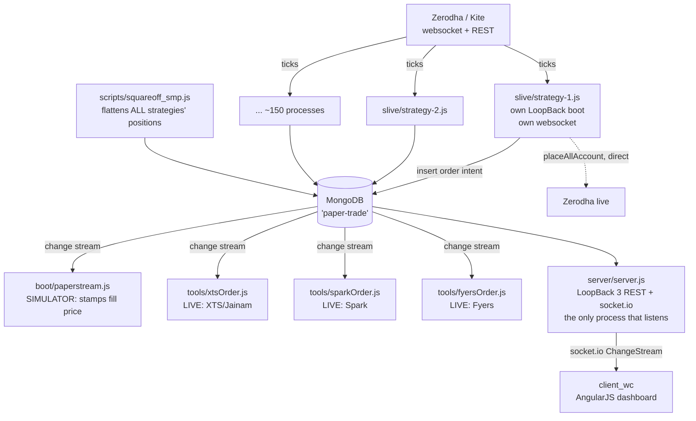

# AlgoMaker — System Overview

*Written 2026-07-25. Every claim here was verified directly against the code; file:line
citations are given so you can re-check. Where something could not be verified it is
labelled **OPEN QUESTION** rather than guessed.*

## 1. What this system is

AlgoMaker is a self-hosted algorithmic trading platform for Indian equity-derivatives
(F&O) markets — index options and futures on NIFTY, BANKNIFTY, FINNIFTY, MIDCPNIFTY and
SENSEX. It does three jobs:

1. **Runs strategies.** ~150 independent Node processes, each implementing one intraday
   options strategy, driven by live Zerodha/Kite tick data.
2. **Routes orders to brokers.** Orders are written to MongoDB and fanned out to real
   broker accounts (Zerodha, XTS/Jainam, Fyers, Spark, Tradelab) by daemon processes.
3. **Presents a dashboard.** An AngularJS SPA for managing broker accounts, monitoring
   live positions and P&L, and manually placing/reversing/squaring-off orders.

It has been in continuous development for **~6 years**: first commit 2020-11-30, latest
2026-07-17, **3,966 commits**, peaking at 2,001 commits in 2021.

## 2. The single most important thing to understand

**`PaperTrade` is not paper trading. It is the order bus.**

This one misnomer causes more confusion than anything else in the codebase, and it is not
documented anywhere else. A strategy does not "place an order" — it *emits an order intent*
by inserting a document into the MongoDB `paper-trade` collection:

```js
PaperTrade.trackOrder_v2(inst, 'BUY', strategyTag, lots)   // common/models/paper-trade.js:43
PaperTrade.trackOrder_slm(inst, 'BUY', tag, 1, stopPrice)  // :25  → order_type 'StopMarket'
PaperTrade.trackOrder_limit(inst, ...)                     // :6   → order_type 'Limit'
```

Note `trackOrder_v2` deliberately inserts **no `average_price`** (`paper-trade.js:53`, the
line is commented out). The order carries no price. Separate **consumer daemons** each open
their own change stream on that same collection and decide what the order means:

| Consumer | File | What it does with the order |
|---|---|---|
| **Simulator** | `server/boot/paperstream.js` | Stamps `average_price` from its own live tick cache. No broker involved. |
| **XTS / Jainam** | `server/tools/xtsOrder.js:306-309` | Forwards to **real** XTS accounts. `StopMarket` → XTS `StopLimit` with a computed ±1% limit (`:150-158`). |
| **Spark** | `server/tools/sparkOrder.js:62-67` | Forwards to **real** Spark accounts. `StopMarket` → `SL`. |
| **Fyers** | `server/tools/fyersOrder.js` | Forwards to **real** Fyers accounts. |

### The consequence

**Whether an order is simulated or real is decided by which daemons are running — not by
the strategy code.** You cannot tell from reading a strategy file whether it trades real
money.

This invalidates the obvious-looking metric. Grepping `placeAllAccount` (63 files) vs
`PaperTrade` (123 files) tells you which *rail* a strategy uses, **not** whether real money
moves. Both rails can reach a live broker:

- `Account.placeAllAccount(...)` → Zerodha, placed **directly and synchronously**.
- `PaperTrade.trackOrder_*(...)` → the bus → live **only if** a forwarding daemon is up.

**OPEN QUESTION — needs a human answer.** Some strategies (e.g. the `lion-s25` family) take
their *entry* via `Account.placeAllAccount` (Zerodha, direct) but place their *stop* via
`trackOrder_slm` (the bus → XTS/Spark). If entry and stop land on different broker rails,
the stop may not protect the position it was written for. Which forwarding daemons run in
production, and against which accounts, cannot be determined from the repo.

## 3. Runtime shape

Not one server — **~150 independent processes**, because `boot(app, __dirname, cb)` runs
unconditionally at module scope (`server/server.js:68`). Every strategy `require`s
`../server.js` to reach `app.models`, so each one independently:

- boots the entire LoopBack app and all 10 `server/boot/*.js` scripts,
- opens its own MongoDB connection pool,
- performs its own Zerodha login,
- opens its own Kite websocket.

Measured: **150 of 156** `slive` files `require('../server.js')`; **147 of 156** construct
their own `KiteTicker`. So ~150 concurrent websocket connections and ~150 LoopBack boots
carry roughly 15–18 distinct trading ideas.

Only the main `server.js` process actually calls `listen()` (guarded by
`require.main === module`), so the HTTP/socket.io API is singular even though the app is
booted ~150 times.



## 4. Stack

| Layer | Technology | Status |
|---|---|---|
| API framework | LoopBack 3.28 + loopback-boot | **EOL** (LB3 end-of-life Dec 2020) |
| Database | MongoDB Atlas via `loopback-connector-mongodb` | current |
| Secondary datasource | LoopBack **in-memory** connector | **data loss on restart** — see §6 |
| Realtime | socket.io **3.1.2** server / **4.8.1** client | **major-version mismatch** |
| Frontend | AngularJS 1.x + ui-router + AdminLTE + Bootstrap + jQuery | **EOL** (AngularJS Jan 2022) |
| Build | gulp 4 + uglify + `gulp-javascript-obfuscator` | works; obfuscation is unusual for an internal tool |
| Process mgr | pm2 4.5 | current-ish |
| Market data | Zerodha Kite (custom `server/lib/KiteTicker.js`, 690 LOC) | current |
| Indicators | `tulind` | current |
| Node | declared `>=6`; prod ran **14.17.0**; local is **24.11.0** | unpinned, no `.nvmrc` |

## 5. Directory map

### Live
| Path | Role |
|---|---|
| `server/slive/` | **Production strategies** (156 files, 37.5k LOC). Last commit 2026-07-14. |
| `server/smp/` | **Staging/authoring** for strategies (134 files). See §7. |
| `server/lib/` | Broker adapters, KiteTicker, option pricing/greeks, notify |
| `server/boot/` | 10 LoopBack boot scripts (auto-loaded, run in *every* process) |
| `server/tools/` | Operational daemons — the order-forwarding consumers, token exchange, reports |
| `common/models/` | 25 LoopBack models (`.json` schema + `.js` remote methods) |
| `client_wc/` → `build_wc/` | **The only live frontend.** `gulpfile.js:14-15` |
| `server/test/` | 4 `node:test` files (the only tests in the repo) |
| `data/`, `historical/` | Local research data (223 MB + 222 JSON), untracked |

### Dead — abandoned strata
| Path | Last real activity |
|---|---|
| `client/`, `build/` | 2022-10 |
| `client_am/`, `build_am/` | 2021-10 |
| `client_ob/`, `build_ob/` | 2024-05 |
| `client_pd/`, `build_pd/` | 2022-10 |
| `server/tob/` | 2023 (66 files) |
| `server/scripts/` | 2021-22 — **except `squareoff_smp.js`, which is ACTIVE** |
| `server/monks/` | 2022-07 (26) |
| `server/insta/` | 2022-11 (7) |
| `server/archive/` + `xts/` | 2021-09 (36) |
| `server/asmp/` | 2021-08 (23) |
| `server/wealth/` | 2021-06 (14) |
| `extra/` | 2025-02 (12) |
| `server/standle/`, `models/`, `memphis/`, `greeks/`, `logs/` | empty |

The strategy directories are clean archaeological strata — each is a generation that was
abandoned rather than deleted:

```
2020 ──────────────────────────────────────────────── 2026
archive   ████ (→2021-09)
wealth      ██ (→2021-06)
asmp        ██ (→2021-08)
monks        ████ (→2022-07)
insta          ██ (→2022-11)
tob         ████████████████████ (→2025-02)
scripts   ██████████████████████ (→2025-05)
smp         ████████████████████████████ (→2026-07)  ← staging
slive        ███████████████████████████ (→2026-07)  ← production
```

## 6. The in-memory datasource trap

`server/datasources.json` defines two datasources: `cloud` (MongoDB) and `db`, which is
`{"connector": "memory"}` — i.e. **not persistent**. Per `server/model-config.json`, these
models are on `db` and therefore **lose all data when a process restarts**:

`strategy`, `strategyPNL`, `payment`, `log`, `manager`, `algopaper`, `algouser`

`strategyPNL` receives 10-second M2M snapshots, so a mid-session restart silently truncates
the day's P&L history to `[]` — with no error raised.

There is a related consistency bug: `algopaper` is on the in-memory datasource, but
`server/boot/paperstream.js:413-420` watches an `algopaper` **MongoDB collection** via a raw
change stream — a collection the memory-backed model never writes to. `tools/paperalgo.js`
creates priceless `Algopaper` documents expecting a fill-stamp that can never arrive.

## 7. `smp` vs `slive` — staging and production

`server/smp/` is not a dead twin of `slive`; it is where strategies are **authored**, then
promoted into `slive` in the same commit. Afterwards only `slive` receives feature work.

`bn-breakout.js` is the clean example: a 2026-07-03 commit touched both copies identically;
the 2026-07-14 commit ("one trade per side per day") touched **only** `slive`. 108 of 134
`smp` files have no `slive` twin, so `smp` is **drift, not garbage** — it needs a
reconciliation decision, not a delete.

## 8. What actually runs in production — UNKNOWN

**`dump.pm2` is stale and must not be trusted as an inventory.** Although committed
2025-05-02, its newest internal timestamp is **2023-03-05** and it records Node 14.17.0. It
contains **none** of the current-era strategies — `bn-breakout`, `atr-band-nifty`, `orb-*`,
`candlestrategy`, `snx-orb-1` are all absent.

The best in-repo signal is `common/models/strategies.json` (101 entries of
`{name, module, autostart, delay_start}`), consumed by `Manager.liveStrategies`
(`common/models/manager.js`) and launched by `server/tools/ob_start.js` at 09:15:30.

But registration ≠ running: per the project's own conventions, `ob_start` only ever
`pm2.restart`s **existing** processes — there is no `pm2.start` anywhere in the repo — so a
strategy must be manually `pm2 start`ed once before the registry has any effect.

**OPEN QUESTION — needs a human answer.** There is no reliable in-repo record of what is
running in production today. A fresh `pm2 jlist > dump.pm2` from the production box is the
single highest-value piece of missing information for planning the overhaul.

## 9. Where to read next

| Document | Contents |
|---|---|
| `02-backend-architecture.md` | Boot scripts, lib modules, data model, broker matrix, order paths |
| `03-frontend-architecture.md` | Route map, controllers, API surface, build pipeline, rewrite feature list |
| `04-strategy-catalog.md` | Per-family trading logic; the canonical modern file anatomy |
| `05-legacy-and-dead-code.md` | Per-directory verdicts with evidence |
| `06-cleanup-audit.md` | Deletion plan, secrets report, tooling gaps |
| `07-verified-risks.md` | **Severity-ranked findings, verified only** |
| `08-overhaul-proposal.md` | **The upgrade plan awaiting approval** |
| `sheets/slive-strategies.csv` | 156 rows — one per production strategy |
| `sheets/legacy-strategies.csv` | 408 rows — one per legacy-directory file |

Documents 02–06 were produced by survey agents and are evidence-dense but were written
before the order-bus finding in §2; treat their "paper" labels as "routed via the order
bus". Documents 01, 07, 08 are the verified synthesis layer.
