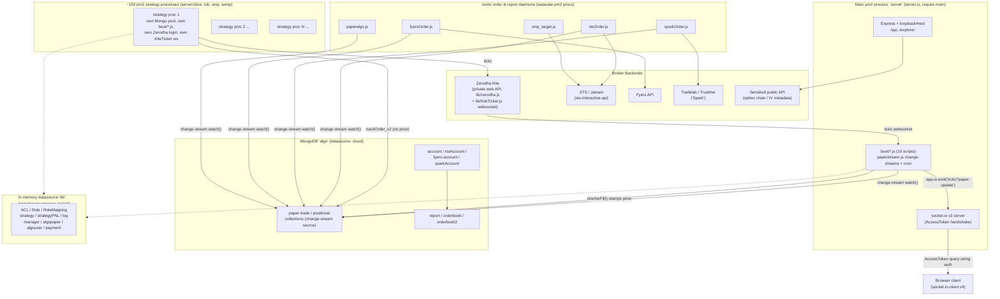
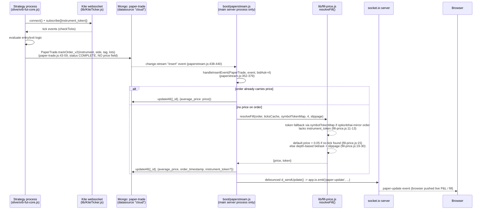

# algomaker Backend Runtime Architecture

Repo root: `/Users/aaditya/Documents/dev/algomaker`. Stack: LoopBack 3.28 (EOL) + loopback-boot 2.28, MongoDB (`loopback-connector-mongodb`), socket.io 3.1 server / 4.8 client (mismatched majors), pm2 4.5, Node engine declared `>=6` (production ran Node 14.17.0 per `dump.pm2`). Entry point `server/server.js`.

## 1. System overview

The platform is not one server — it is **one HTTP/socket.io server process plus roughly 150 independent strategy processes**, all of which boot a full copy of the same LoopBack application. Each strategy process (`server/slive/*.js`, and siblings in `server/tob/`, `server/smp/`, `server/asmp/`) does `require('../server.js')` (e.g. `server/slive/bn-breakout.js:16`, `server/slive/atr-band-nifty.js:15`), and because `server/server.js:68` calls `boot(app, __dirname, cb)` unconditionally at module scope (not gated by `require.main === module`), **every strategy process independently**: opens its own MongoDB connection pool, re-executes all 10 `server/boot/*.js` scripts (including three raw MongoDB change-stream `.watch()` calls in `paperstream.js:418-420`), performs its own read-only Zerodha login, and opens its own dedicated `KiteTicker` websocket to Kite subscribed only to its own instrument(s) (`server/slive/orb-fut-core.js:54-63`, `bn-breakout.js:61-74`). Only the primary `server` pm2 process additionally calls `app.start()` and stands up an HTTP listener + socket.io server, gated by `if (require.main === module)` (`server.js:72`).

Order flow fans out through MongoDB itself rather than through a message broker: strategy processes write "priceless" paper-order intents into the `paper-trade` (and `positional`) Mongo collections via `PaperTrade.trackOrder_v2(instrument, side, tag, lots)` (`common/models/paper-trade.js:43-59`), and a set of independent daemons — `server/boot/paperstream.js` (in-process, main server only), `server/tools/xtsOrder.js` (XTS/Jainam), `server/tools/sparkOrder.js` (Tradelab), `server/tools/fyersOrder.js` (Fyers), `server/tools/paperalgo.js` (simulated mirror accounts) — each independently open a **native MongoDB change stream** on the same collections and react to inserts. There is no central order router; every consumer is its own tailer of the same oplog-backed change feed.

## 2. Process model

`ls server/slive/*.js | wc -l` → **156 files**; `dump.pm2` (a stale 2023 snapshot) confirms the pattern: one pm2 entry named `server` (`server/server.js`), one pm2 entry per `slive/*.js` file, plus tool daemons `exchangeToken`, `xtsOrder`, `sparkOrder`, `smp_target`, `smp_report`, and `scripts/squareoff_smp.js`. A second, larger tier of per-strategy pm2 processes also lives under `server/tob/`, `server/smp/`, `server/asmp/`, started/stopped programmatically by `common/models/manager.js` (a thin wrapper over the `pm2` npm package, `manager.js:51-93`) reading a static roster from `common/models/strategies.json`.

**What's shared vs. not shared across processes:**
- **Not shared**: MongoDB connection pool, all 10 `boot/*.js` side effects (route registration, `paperstream.js`'s 3 change streams), Zerodha login/session, KiteTicker websocket connection. Each strategy process pays the full boot cost independently.
- **Shared, indirectly, via MongoDB**: `paper-trade`/`positional` collections act as the de facto message bus — any process's insert is visible to every other process's change-stream watcher.
- **Not shared at all, and silently reset**: the in-memory `db` datasource (`server/datasources.json:1-17`, `connector: "memory"`) backs `ACL`, `Role`, `RoleMapping`, `strategy`, `strategyPNL`, `log`, `manager`, `algopaper`, `algouser`, `payment` (`server/model-config.json:16-127`). Because each process boots its own LoopBack app, **each process has its own separate, empty-on-start in-memory store** — there is no cross-process consistency for these models even while all processes are alive simultaneously, let alone across a restart.

## 3. Runtime data flow — one paper trade end-to-end

Parallel to this, the same `paper-trade` insert is also observed independently by `tools/xtsOrder.js`, `tools/sparkOrder.js`, `tools/fyersOrder.js` (each opening its own change stream on the same collection) to fan the same signal out to real XTS/Tradelab/Fyers broker accounts, and by `tools/paperalgo.js` to synthesize a fill into the (memory-datasource) `algopaper` ledger for "algouser" mirror accounts.

**Broker login → market data → order → DB → socket push, end to end:**
1. Each strategy process (or the main server, for `paperstream.js`'s shared feed) logs into Zerodha via `server/lib/zerodha.js`, a hand-rolled scraper of `kite.zerodha.com`'s private web endpoints (`/api/login`, `/api/twofa`, TOTP via `authenticator.generateToken` at `zerodha.js:88,97`), using a cookie jar persisted to `server/userdata/<user_id>.json`.
2. `server/lib/KiteTicker.js` opens a raw `ws` connection to `wss://ws.zerodha.com/` with the resulting `enctoken` in the URL query string (`KiteTicker.js:112,218-220`) — a reverse-engineered clone of Kite's official ticker, not the `kiteconnect` SDK (which is a declared dependency but never actually required anywhere in `server/`).
3. Strategy logic (per `slive/*.js`) evaluates ticks and calls `PaperTrade.trackOrder_v2` with no price.
4. `boot/paperstream.js`'s Mongo change stream (main server process only) picks up the insert and stamps a fill price via `lib/fill-price.js:resolveFill`.
5. `app.io.emit(...)` (socket.io v3 server) pushes `ticks`/`paper-update`/`bse_tracker` events to connected browsers, whose `socket.io-client` (v4.8.1) has authenticated via a query-string `token`/`userId` pair checked against `app.models.AccessToken` (`server.js:84-98`).
6. In parallel, real-money order daemons (`tools/xtsOrder.js` etc.) place the mirrored order at the actual broker.

## 4. Boot scripts (`server/boot/*.js`) — run on every `require('server.js')`

| File | What it does | Keep / drop |
|---|---|---|
| `authentication.js` | `server.enableAuth()` (`authentication.js:8-11`) — standard LoopBack ACL enforcement, cheap. | keep |
| `historical.js` | Registers `GET /stocks_sme_data` at app root (`historical.js:5-59`), reads `./historical/*.json` synchronously per request (populated by `tools/volume_check_nse.js`). | keep (route wiring cheap; per-request file I/O only) |
| `iv_calc.js` | Defines a KiteTicker-based IV/PCR pipeline (`iv_calc.js:42-179`) but the activation block (`app.on('started', ...)`) is **entirely commented out** (lines 254-271). | dead — safe to remove |
| `optionfactory.js` | Sensibull proxy routes at `/options/*` (`optionfactory.js:119-226`), with a per-process in-memory instrument cache rebuilt on every boot. Overlaps with `sensibull.js` below. | keep but redundant with `sensibull.js` |
| `paperstream.js` | **The core paper-fill engine.** Guarded by `require.main.filename === 'server.js'` (lines 20, 404) for the live-feed/change-stream body; opens 3 raw Mongo change streams (`paper-trade`, `positional`, `algopaper`, lines 418-420), stamps fills via `lib/fill-price.js`, runs 6+ CronJobs including a deliberate daily `process.exit()` at 08:45 IST (lines 474-476) relying on pm2 to restart. Unconditional top-level code (ticksCache/zerodha init, lines 34-50) still runs in every strategy process. | keep — central to the platform |
| `restoreLotSize.js` | Defines `resetAcc*` restore functions but all CronJob registrations are commented out (lines 46-55). | dead — safe to remove |
| `role.js` | Registers dynamic `"admin"`/`"superadmin"` Role resolvers keyed on `client.admin`/`client.superadmin` booleans (lines 4-34) — no static ACL/Role rows created. | keep |
| `sensibull.js` | Sensibull proxy routes at `/fno/*` (lines 91-128), overlapping `optionfactory.js`'s `/options/*`. | keep but redundant |
| `tradelab_auth.js` | OAuth flow for Tradelab (`/tradelab_auth`, `/tradelab_response`, lines 36-67) with a **hardcoded clientSecret** (line 27). Also exposes `GET /add_the_boss` (lines 74-91) which **unconditionally (re)creates a `client` record with `superadmin: true` and a fixed ObjectId, with no auth guard** — a live backdoor route. | **flag urgently — remove or gate the `/add_the_boss` route** |
| `tradingview.js` | `POST /tradingview` webhook receiver — currently a stub; the `notify(data)` call is commented out (line 14). Also globally applies `bodyParser.text()` at app scope (line 24), affecting every process. | keep as stub, low risk |

## 5. `server/lib/` reference

| Module | Purpose | Used by | Status |
|---|---|---|---|
| `zerodha.js` (999 ln) | Hand-rolled Zerodha web-API client (login, TOTP, order placement variants, positions/margins) via `request` + cookie jar | ~500+ files across `slive`, `smp`, `tob`, `scripts`, `boot` | **live, primary Zerodha adapter** |
| `KiteTicker.js` (690 ln) | Reverse-engineered Kite websocket tick client (`ws` package, `enctoken` in query string) | same footprint as `zerodha.js` | **live, primary tick feed** |
| `fill-price.js` | `resolveFill(order, ticksCache, symbolTokenMap, bidAsk, slippage)` — paper fill pricing, token fallback for optionbhai-mirror orders, `0.05` default | `boot/paperstream.js:5,370`; unit-tested (`test/fill-price.test.js`) | **live, well-tested** |
| `notify.js` | Telegram-only alert sender; hardcoded bot token in source (line 6) | required in `server.js:6` itself plus ~500 strategy/tool files | **live, sole alert channel; leaked secret** |
| `debounce.js` | Generic debounce helper | boot/tools/slive/smp (small footprint); `xtsOrder.js` reimplements its own instead of reusing this | live, low usage |
| `option-pricing.js` | Black-Scholes / Black-76 / Bachelier pricing + IV solvers | `boot/iv_calc.js:15`, `tob/whale.js:15` | live, narrow (2 call sites) |
| `option_greeks.js` | Alternate Black-Scholes (delta only), implicit globals | zero requires found | **dead** |
| `scholes.js` | Third independent Black-Scholes implementation | zero requires found | **dead** — 3 unconsolidated BS implementations exist, only `option-pricing.js` is wired in |
| `otmSelector.js` | Per-weekday OTM offset selector | required in 216 files | live but **functionally inert**: `Lion`/`Lion_SNX`/`Cheetah` branches all `return 0` for every weekday (lines 4-33); only `SD_2`/`SD_3` branches return real values |
| `positionBuilder.js` | Position-building helpers | zero requires | **dead**, and buggy even if wired (undefined-identifier bug at line 106) |
| `positionalReport.js` | EOD positional report + purge | `server/scripts/{tws,bently,rollsroyce,tws_n}.js` | live, narrow |
| `db_util.js` | Raw-Mongo DB helper class, bypasses LoopBack `app.models` | zero requires | **dead** |
| `s3upload.js` | AWS S3 uploader; **hardcoded AWS access/secret key pair in source (lines 6-7)** | `server/datafeed/market_watch.js` (1 call site) | live, narrow; **leaked secret** |
| `tradetron.js` | Tradetron webhook trigger | only `server/archive/*`, `server/monks/*`, `server/scripts/*` — zero in `slive`/`smp` | legacy, not part of the active fleet |
| `tradelab.js` / `tradelab-rest.js` | Two near-duplicate Tradelab REST clients (differ only in auth header scheme) | zero requires anywhere | **both dead** — the live Tradelab path is `boot/tradelab_auth.js`'s OAuth flow, which writes tokens onto `sparkAccount` but never calls either class |
| `fyers.js` | Hand-rolled Fyers REST client | `tools/fyersOrder.js` only | live, single caller |
| `lib/strategies/{candles-arr,candles-sum,sma}.js` | Tick/candle reshaping helpers | zero requires | **dead** |
| `lib/strategies/{tulip_ticks,tulip_ticks_oi}.js` | Reshape ticks for `tulind` indicator calls | required transitively by ~21 of 24 `lib/indicators/*.js` files | **live, load-bearing** |
| `lib/indicators/` (24 files) | v1 technical indicators wrapping `tulind` | 52 `scripts`, 31 `tob`, 26 `archive`, etc. | **live** |
| `lib/indicators2/` (18 files) | Self-contained rewrite of the indicator set, newer file dates (May 2025) | **zero requires anywhere, including within itself** | **fully dead / orphaned in-progress rewrite** |

Package-vs-actual-usage mismatches: `kiteconnect` and `xts-marketdata-api` are declared dependencies but **never required anywhere in `server/`** — dead weight. `norenrestapi` (Shoonya) is likewise declared but never required — Shoonya/Noren integration does not exist in code despite the dependency being present.

## 6. Data model reference (`common/models/`, 22 registered models)

Datasource authority: `server/model-config.json:16-127`. **In-memory (`db`, wiped every process restart, not shared across processes):** `ACL`, `Role`, `RoleMapping` (LoopBack built-ins), `strategy`, `payment`, `strategyPNL`, `log`, `manager`, `algopaper`, `algouser`. **Persistent MongoDB (`cloud`, database `algo`):** everything else.

| Model | Datasource | Purpose | Key remote methods |
|---|---|---|---|
| `account` | cloud | Zerodha broker sub-account, `strategy:{tag:lots}` allocation | `placeAllAccount`, `trackOrder`, `squareOff`/`closePositions`, `all_positions`, `token`, `removeAccount` (`account.js`, 1221 ln) |
| `paper-trade` | cloud | Intraday paper-order ledger; primary strategy fan-out bus | **`trackOrder_v2`** (no price, `paper-trade.js:43-59`), `trackOrder`, `trackOrder_limit`, `trackOrder_slm`, `positions`, `squareoff` |
| `xtsAccount` | cloud | XTS/Jainam broker sub-account | `placeAllAccount`, `place_order`, `squareOff`, `all_positions` (`xts-account.js`, 1336 ln) |
| `fyers-account` | cloud | Fyers broker sub-account | `check`, `all_positions`, `squareOff`, `place_order` (no multi-account fan-out, unlike account/xtsAccount) |
| `sparkAccount` | cloud | Tradelab/Trustline broker sub-account | `check`, `all_positions`, `squareOff`, `place_order` (numeric strategy-ID mapping, unlike string tags elsewhere) |
| `positional` | cloud | Carry-forward (all-time, not day-scoped) paper ledger | `trackOrder` (no price), `positions` (unfiltered by date, `positional.js:33-38`), `squareoff` |
| `algopaper` | **db** | Simulated "algouser" mirror-account ledger | `trackOrder` (priced), `squareoff` (**calls undefined `all_positions` — broken**), `clear` |
| `algouser` | **db** | Simulated client-facing mirror sub-account | `all_positions`, `positions` |
| `strategyPNL` | **db** | 10s-cadence intraday M2M tick log, feeds a live PNL/supertrend candle chart | `candle(strategy, period, mul)` — today-only window |
| `manager` | **db** | pm2 RPC facade (no real documents; static roster from `strategies.json`) | `status`, `restart`, `stop`, `list` |
| `log` | **db** | Admin audit trail (strategy-qty changes, square-offs) | none (internal writers only, `account.js`/`client.js`) |
| `client` | cloud (base `User`) | Login/user entity | `day_summary`, `squareOff`, `resetPin` (**resets password to literal `"1212"`**, `client.js:212-240`) |
| `instrument` | cloud | Instrument master cache | none (`.js` entirely commented out) |
| `strategyData` | cloud | Generic per-strategy running state | none (empty `.js`, plain CRUD) |
| `report` | cloud | Persistent EOD PNL snapshot | none active |
| `orderbook` / `orderbook2` | cloud | Position/order snapshot caches (Zerodha vs XTS-oriented) | none (empty `.js`) |
| `OrderUpdate` | cloud | XTS order-status event log | none |
| `tmp_account` | cloud | Soft-delete archive bin for removed accounts | none |
| `spreads` | cloud | Multi-leg combo state (single caller: `smp/combo-trade.js`) | none |
| `strategy`, `position`, `payment` | mixed | Fully empty schemas, **zero live callers found anywhere in `server/`** | none — dead models |

Also present but **not registered models at all**: `common/models/xts-account2.js` and `"xts-account copy.js"` (dead duplicate backups, no `.json`, no callers), and `strategies.json`/`strategies_ob.json` (plain data files, not schemas — `strategies.json` drives `manager.js`'s pm2 roster).

## 7. `server/tools/` reference (34 files)

| File | Type | Purpose |
|---|---|---|
| `xtsOrder.js` | daemon | **Primary XTS order engine.** Watches `paper-trade`/`positional`/`xtsAccount` change streams, fans out via `xts-interactive-api`, retry+relogin on session expiry, tranches above per-index max lots, audit-logs to `orderbook2`, orchestrates the ~150+ per-strategy pm2 processes via `Manager` |
| `am_xtsOrder.js`, `am_xtsOrder-cluster.js` | daemon (legacy) | Predecessors of `xtsOrder.js`; "cluster" is a misnomer (no `require('cluster')`) — really just a `groupId`-sharded launch pattern. Superseded, functionally subsumed |
| `sparkOrder.js` | daemon | Tradelab order engine (`client.Order()`, static `strategyMap` of ~130 tags → numeric IDs); no retry/relogin loop |
| `fyersOrder.js` | daemon | Fyers order engine; re-logs in on every account load and again before every order (wasteful vs. xtsOrder.js's cached-client pattern) |
| `smp_target.js` | daemon | SMP-flavor XTS engine (largest file, 14.3KB) — adds a live M2M target monitor via its own KiteTicker feed, auto-squares-off on profit target |
| `smp_order_listener.js` | daemon | XTS Interactive WS fills/rejections recorder → `OrderUpdate` model; hardcoded to `smpa.jainam.in:6543` |
| `smp_rejections.js`, `am_retry.js` | daemon | Rejected/cancelled order scanners + Telegram notify — 3-4 near-duplicate implementations of this pattern exist across the codebase (also in `paperstream.js:sendUpdatePnl`) |
| `smp_report.js`, `smp_clear.js`, `saveDailyPNL_smp.js` | cron | SMP-scoped EOD reporting and daily state reset |
| `paperalgo.js` | daemon | Simulated fill engine for `algopaper`/`algouser` mirror accounts — writes `Algopaper.create(...)` with **no price field** (line 57 commented out) |
| `exchangeToken.js`, `exchangeToken_crude.js` | cron | Daily Kite instrument-master refresh (indices 09:00, crude 21:00) into the `instrument` model |
| `saveDailyPNL.js` | cron | Primary multi-broker (Zerodha/XTS/Fyers/Algouser) EOD PNL rollup → `Report` |
| `daily_report.js`, `daily_report_tob.js` | cron | EOD email/report; `daily_report_tob.js` has a **dead `totalPNL` variable that's never incremented** (lines 77, 85-90) — persists a zeroed value |
| `record.js`, `record_greeks.js` | daemon | Raw tick / hourly IV-greeks archival to flat files |
| `m2mLogger.js` | daemon | 10s-cadence M2M logger writing to `strategyPNL` (memory datasource) |
| `bse-tracker.js` | daemon | BSE upper/lower circuit tracker, feeds `boot/paperstream.js`'s BSE socket room via `data-switch-server.js`/`process-link.js` |
| `data-switch-server.js`, `process-link.js` | infra | Standalone socket.io relay (port 8080) and its client connector |
| `optionInstruments.js`, `futureInstruments.js` | library | Sensibull-backed instrument/option-chain config, file-cached (`optionConfig_<underlying>.json`) — a soft runtime dependency on Sensibull's public API for order routing |
| `position_analyse.js`, `stoploss.js` | library | Sensibull payoff-analysis proxy; pure in-memory PNL bookkeeping class |
| `tradelab_login.js` | cron | Puppeteer headless-Chrome auto-login for Tradelab — **hardcoded username/password/OTP-answer in source** |
| `ob_start.js` | cron | pm2 fleet start/stop controller (optionbhai env) |
| `volume_check.js`, `volume_check_nse.js` | cron / one-off | SME stock volume-spike scanners; `volume_check_nse.js` feeds `boot/historical.js`'s route |
| `updateDB.js` | one-off | Manual one-time data patch (`account.strategy.STG8 = 0`) — not meant to run standing |
| `historical.js` | library | Thin axios client to an undocumented `localhost:8081/candles` service — unrelated to `boot/historical.js` despite the name |
| `tradelab_login.js`, `ob_start.js`, `stoploss.js` | (see above) | |

## 8. Broker integration matrix

| Broker | Adapter | Order path | Market data | Status |
|---|---|---|---|---|
| Zerodha/Kite | `lib/zerodha.js` (hand-rolled) | `account.js:placeAllAccount` → `zapi.orderFNO()` | `lib/KiteTicker.js` (hand-rolled), used by nearly every strategy process for signals | **live, primary** |
| XTS / Jainam | `xts-interactive-api` (git fork dependency) | `tools/xtsOrder.js`, `smp_target.js` → `client.placeOrder()` | none of its own — XTS-routed strategies still use Kite ticks for signals; `xts-marketdata-api` dependency is never required | **live, order execution only** |
| Fyers | `lib/fyers.js` (hand-rolled) | `tools/fyersOrder.js` only | none | live, marginal (single script) |
| Tradelab / Trustline ("Spark") | `boot/tradelab_auth.js` OAuth + `common/models/spark-account.js` | `tools/sparkOrder.js` → `client.Order()` | none | live login, but `lib/tradelab.js`/`tradelab-rest.js` themselves are dead orphans |
| Shoonya / Noren | `norenrestapi` dependency declared | none | none | **not implemented** — dependency present, zero wiring |
| Sensibull | direct HTTP (`request`) | n/a (metadata only) | option chain / IV / instrument config, `boot/sensibull.js`, `boot/optionfactory.js`, `tools/optionInstruments.js` | live, informational only |
| TradingView | `boot/tradingview.js` webhook | none — `notify()` call commented out | n/a | **inert stub** |
| Tradetron | `lib/tradetron.js` | outbound webhook trigger | n/a | legacy — confined to `server/archive`/`monks`/`scripts`, absent from `slive`/`smp` |

## 9. Auth & security notes

- **Socket.io handshake** (`server.js:84-98`): requires `token` (an `AccessToken` id) and `userId` in the **plain query string**; validates `AccessToken.findById(tokenId)` then loose-equality (`==`) checks `token.userId == userId`. No password re-check, no JWT — purely a previously-issued LoopBack AccessToken.
- **Socket engine ID collision**: `generateId` uses the raw `userId` query param as the socket.io engine ID when present (`server.js:78-82`) instead of a random UUID — multiple tabs/sessions for the same user collide on the same engine ID.
- **Role/ACL model**: `boot/role.js` registers dynamic `"admin"`/`"superadmin"` resolvers keyed on `client.admin`/`client.superadmin` booleans (lines 4-34) — no static `Role`/`RoleMapping`/`ACL` rows are ever created, so their placement on the wiped in-memory `db` datasource is largely inconsequential for this specific check (though it would matter for any other static-ACL usage).
- **TOTP/2FA** exists only for **broker-side login automation** (`lib/zerodha.js:88,97` via the `authenticator` package), not for application/user-facing 2FA — no TOTP/speakeasy usage was found protecting the LoopBack app itself.
- **CORS + Helmet**: `middleware.json` sets CORS `origin: "*"` combined with `credentials: true` (lines 25-31) — a permissive combination — and explicitly disables `helmet#noCache` (lines 22-24) and sets HSTS `maxAge: 0` (effectively off).
- **`/explorer` (Swagger UI)** is mounted with no additional gating visible in `component-config.json:2-5`.
- **Hardcoded credentials / backdoors found in source** (all confirmed by direct file reads, not inferred):
  - `boot/tradelab_auth.js:27` — hardcoded OAuth `clientSecret`.
  - `boot/tradelab_auth.js:74-91` — **`GET /add_the_boss` unconditionally (re)creates a `superadmin: true` client with a fixed ObjectId, no auth guard.**
  - `lib/notify.js:6` — hardcoded Telegram bot token, live-wired into `server.js:6` and used platform-wide.
  - `lib/s3upload.js:6-7` — hardcoded AWS access key + secret key pair.
  - `tools/daily_report.js:8` — hardcoded SendGrid API key.
  - `tools/tradelab_login.js:26-34` — hardcoded Tradelab username/password/OTP-answer for a Puppeteer auto-login.
  - `server/datasources.json`, `datasources am.json`, `datasources ob.json`, `datasources smp.json` — plaintext MongoDB Atlas credentials/connection strings committed in the repo.
  - `server/userdata/{VV0124,XV7910,YO8965,ZV5170}.json` — **live Zerodha session cookies including `enctoken`**, tracked in git despite `.gitignore` containing `userdata/*` since the first commit; force-added (`git add -f`) starting commit `d01a9a70` (2020-12-01) and still present in history/working tree today.

## 10. Known landmines / latent bugs

1. **`algopaper` datasource mismatch breaks its own fill mechanism.** `algopaper` is on the in-memory `db` datasource (`model-config.json:119-122`), but `boot/paperstream.js:413-420` opens its change-stream watch via the raw **MongoDB** connector (`db.collection("algopaper").watch()`) — a collection the memory-backed model never actually writes to. `tools/paperalgo.js:placeOrder()` (lines 46-64) creates `Algopaper` docs with no `average_price`, expecting the paperstream watcher to stamp one; it never does, since the change stream watches real Mongo, not the in-process memory store. Any algouser-mirror order placed via this path has a permanently `undefined` fill price, silently corrupting `Algouser.all_positions()`/`Client.day_summary` and the `Report` written by `tools/saveDailyPNL.js`. (Confirmed by direct code read across `model-config.json`, `paperstream.js`, `paperalgo.js`, `algouser.js`.)
2. **Live broker session secrets committed to git.** `server/userdata/*.json` cookie jars (including Zerodha `enctoken`) for 4 accounts are tracked in git history since Dec 2020/Jan 2021, despite an `.gitignore` rule meant to exclude them. Rotation doesn't remove the historical exposure without a history rewrite.
3. **Unauthenticated superadmin-creation route.** `boot/tradelab_auth.js:74-91`'s `GET /add_the_boss` recreates a fixed-ID `superadmin: true` client record with no auth check, registered on every process boot (reachable on whichever process serves HTTP).
4. **N-way duplication of change streams and websockets.** Each of ~150+ strategy processes independently opens 3 MongoDB change streams (`paperstream.js:418-420`) and its own Kite websocket, rather than sharing a single feed/watcher — a scaling risk (Mongo connection-pool exhaustion, Kite websocket connection limits, redundant oplog tailing) that grows linearly with strategy count.
5. **Intraday state silently lost on restart with no error surfaced.** `strategyPNL` (10s-cadence M2M ticks feeding a live PNL/supertrend dashboard via `strategy-pnl.js:candle()`), `algopaper`/`algouser` (simulated positions feeding EOD reports), and `log` (admin audit trail) all live on the in-memory `db` datasource. A mid-session pm2 restart (crash, deploy, manual restart — not the deliberate daily 08:45 `process.exit()` in `paperstream.js:474-476`, which is scheduled pre-market) silently truncates the day's data to empty rather than throwing — `find()` on an empty memory store just returns `[]`.
6. **Socket.io major-version mismatch.** Server on v3.1.2, client library dependency on v4.8.1 — wire-incompatible without explicit `allowEIO3` compatibility handling.
7. **Three unconsolidated Black-Scholes implementations**, two fully dead (`option_greeks.js`, `scholes.js`), only `option-pricing.js` actually used — a latent correctness risk if a future change updates the wrong one.
8. **`otmSelector.js`, required in 216 files, is a no-op for most callers** — the `Lion`/`Lion_SNX`/`Cheetah` day-of-week branches all hardcode `return 0` (`otmSelector.js:4-33`); only `SD_2`/`SD_3` branches return real offsets. Anyone editing this expecting weekday-based OTM selection to work for Lion/Cheetah strategies would be surprised.
9. **`daily_report_tob.js`'s `totalPNL` is computed but never persisted** (lines 77, 85-90) — the `Report` record it writes always has a zeroed PNL field.
10. **`Client.resetPin` hard-resets any user's password to the literal string `"1212"`** (`client.js:212-240`) — a predictable, unsalted-in-practice reset value if this remote method is reachable without sufficiently tight ACLs.

## 11. Dependency risk

| Package | Version | Risk |
|---|---|---|
| `loopback` + `loopback-boot` | ^3.28.0 / ^2.28.0 | LB3 has been in maintenance-only/EOL mode for years; no active security patch cadence for the whole framework or its large old Express-era dependency tree |
| `request` | ^2.88.2 | Fully deprecated since Feb 2020, explicitly told to migrate by maintainers; still the HTTP client underlying `zerodha.js`, `notify.js`, several `boot/` proxy routes |
| `aws-sdk` | ^2.802.0 | AWS SDK v2 in maintenance mode, AWS pushing v3 migration; this point release is also ~3+ years behind even the v2 line |
| `helmet` | ^3.23.3 | 4+ majors behind; missing modern CSP/COOP/CORP protections |
| `express-rate-limit` | ^5.5.1 | 2 majors behind; functional but missing newer store/header standards |
| `puppeteer-core` | ^14.4.0 | ~10 majors behind; API/protocol drift risk against modern Chrome, used for live broker-login automation (`tools/tradelab_login.js`) |
| `memphis-dev` | ^0.4.4 | Pre-1.0, low maintenance signal; worth confirming it's still needed |
| `socket.io` / `socket.io-client` | ^3.1.2 / ^4.8.1 | **Major-version mismatch** — see landmine #6 |
| `eslint` | ^3.17.1 | Ancient, dev-only impact, but signals the whole toolchain hasn't been touched in years |
| `tough-cookie-filestore` | pinned exactly `0.0.1` | Extremely old, single-version pin, backs the leaked `server/userdata/*.json` cookie jars |
| `norenrestapi`, `xts-interactive-api` | git-sourced (GitHub HEAD, no visible version pin) | Supply-chain exposure — bypasses npm registry integrity, `xts-interactive-api` points at the maintainer's own fork (lower external risk) but `norenrestapi` depends on a third-party org repo staying available/non-malicious |
| `kiteconnect`, `xts-marketdata-api` | ^3.1.0 / ^3.0.7 | Declared but **never required anywhere in server/** — dead dependency weight, and misleading (the real Zerodha/XTS-data code is hand-rolled, not via these SDKs) |
| `engines.node` | `>=6` | Extremely permissive/stale floor given async/await and optional-chaining usage throughout the codebase; communicates no real minimum |
