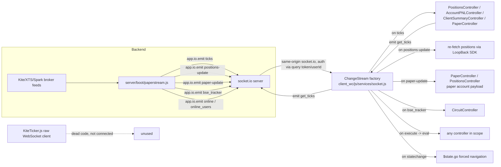

# AlgoMaker / SMP Frontend Architecture (`client_wc` / `build_wc`)

Scope note: only `client_wc/` (source) and `build_wc/` (gulp output) are live. `client/`, `client_am/`, `client_ob/`, `client_pd/` and their `build*` counterparts exist on disk but are out of scope and presumed dead (not verified further here).

## 1. Overview + stack inventory

Single-page app, "Stoch Market Platform" (branded "SMP" in-app, "AlgoMaker" on login/register), an options/futures algo-trading dashboard for Indian markets (NSE/BSE F&O), talking to a LoopBack 3 backend.

- **AngularJS** 1.x (unversioned vendor copy, `client_wc/vendor/angular.js`) with `angular-resource`, `angular-ui-router` (`client_wc/vendor/angular-ui-router.js`), `angular-loading-bar`.
- **Module**: single Angular module `app` declared `client_wc/js/app.js:2` depending on `lbServices`, `ui.router`, `angular-loading-bar`.
- **UI**: AdminLTE + Bootstrap (bundled `bootstrap.bundle.min.js`) + FontAwesome (`client_wc/css/fontawesome`), jQuery (`client_wc/js/jquery/jquery.min.js`) for modal/popover control (`$('#...').modal()`, `.popover()`).
- **Charts**: TradingView-style `lightweight-charts` (loaded from unpkg CDN in `build.html:63`, used in `usersCtrl.js` and `adminCtrl.js` for PNL area charts), plus vendored `charts.js` (149KB) and `tradingview_charts.js` (150KB) — large legacy charting libs whose actual call sites were not confirmed as wired into any controller (candidate dead weight, worth a follow-up grep before a rewrite).
- **Real-time**: `socket.io-client` (`client_wc/vendor/socket.io.js` in dev / `client_wc/js/socket.io.js` vendor copy) via a custom `ChangeStream` factory, plus an unused raw `KiteTicker` WebSocket client.
- **LoopBack SDK**: `client_wc/js/services/lb-services.js` — 24,898 lines, auto-generated `lbServices` Angular module (`urlBase = "/api"`, `lb-services.js:16`), created via `loopback-sdk-angular`-style codegen (NOT hand-maintained — regenerate, don't hand-edit).
- **moment.js** 2.x for all date formatting (no timezone lib beyond `.utcOffset()` calls).
- **html2canvas** + **FileSaver.js** for "save report as PNG" (`adminCtrl.js:41-56`, `saveDoc`).

## 2. Route map (ui-router state tree, `client_wc/js/app.js:40-226`)

All authenticated routes nest under abstract state `app` (`app.js:41-46`, templateUrl `views/wrapper.html`, controller `AppController`), which renders the top nav (`client_wc/views/wrapper.html:53-133`) and a nested `ui-view`. `login`/`register` are top-level, outside `app`.

| State | URL | View | Controller | Purpose | In nav? | Status |
|---|---|---|---|---|---|---|
| `app` (abstract) | `/app` | wrapper.html | AppController | Shell/nav/logout, profile bootstrap | — | alive |
| `app.home` | `/home` | home.html | **HomeController** | AdminLTE placeholder ("Card title" boilerplate) | no | **dead** — controller never defined anywhere in the codebase |
| `app.pricing` | `/pricing` | pricing.html | *(none — commented out, `app.js:55`)* | Marketing pricing tiers page | no | dead — no controller, unlinked |
| `app.builder` | `/strategy-builder` | builder.html | BuilderController | Option-chain strategy builder (per-strike greeks, futures/options tables) | no | **dead in production** — controller excluded from `app.min.js` build since Feb 2025 |
| `app.combo` | `/combo-builder` | combo.html | ComboController | Multi-leg spread combo builder | no | dead in prod (same exclusion) |
| `app.parity` | `/nymex-mcx` | ibkr_parity.html | ParityController | NYMEX/MCX cross-exchange spread parity feed | no | dead in prod |
| `app.combo_list` | `/combo-list` | combo_list.html | ComboListController | Saved combo strategies list | no | dead in prod |
| `app.spreads` | `/strategy-spreads` | spreads.html | SpreadsController | Option debit/credit spread scanner | no | dead in prod |
| `app.screener` | `/live-algos` | screener.html | ScreenerController | Watchlist/live-algo signal screener, reads `/data/marketwatch.json` | yes ("Watchlist") | alive |
| `app.strategies` | `/strategies` | strategies.html | StrategyController | Per-account live-strategy lot-size admin | yes ("Live Strategy", admin-only) | alive |
| `app.manager` | `/manager` | manager.html | ManagerController | Start/stop/restart trading-strategy processes (pm2-style) | yes ("Manage", admin-only) | alive |
| `app.allorders` | `/orderbook` | allorders.html | AllOrdersController | Global orderbook view | yes ("Orderbook", admin-only) | alive |
| `app.mysummary` | `/my-summary` | mysummary.html | ClientSummaryController | Per-user dashboard: positions, orders, PNL | yes ("Dashboard"/"PNL", non-admin) | alive |
| `app.settings` | `/settings` | settings.html | SettingsController | Change 4-digit PIN | yes | alive |
| `app.users` | `/users` | users.html | UsersController | Admin: user CRUD, PIN reset, account mapping | yes (admin-only) | alive |
| `app.circuit` | `/circuit` | circuit.html | CircuitController | BSE upper/lower circuit tracker (live via socket) | yes (admin-only) | alive |
| `app.accounts` | `/accounts` | accounts.html | AccountsController | Broker account admin (Zerodha/XTS/Spark/Tmp) | yes ("Broker", admin-only) | alive |
| `app.positions` | `/positions/:platform/:accountId/:name/:full_name/:ts` | positions.html | PositionsController | Per-account positions/orderbook/strategy-book detail, manual order entry, square-off | drill-in only (not top-nav) | alive |
| `app.allpnl` | `/accounts-summary` | all_pnl.html | AccountPNLController | All-accounts aggregate PNL dashboard | yes ("PNL", admin-only) | alive |
| `app.mystrategies` | `/my-strategies` | mystrategies.html | UserStrategiesController | User-facing strategy "marketplace" — subscribe/set lot size | linked from screener ("Go Live") | alive |
| `app.papertrading` | `/paper-trading` | paper.html | PaperController | Paper-trading account list/PNL | default landing for superadmin (`common.js:22-24`) | alive |
| `app.positional` | `/positional` | positional.html | PositionalController | Positional (multi-day) paper trading book | nav link commented out (`wrapper.html:71-74`) | alive but orphaned from nav |
| `app.reports` | `/reports` | reports.html | ReportsController | PNL reports by date range/strategy, PNG export | yes | alive |
| `app.performance` | `/performance` | performance.html | PerformanceController | Cumulative PNL chart | nav link commented out (`wrapper.html:115-118`) | alive but orphaned from nav |
| `login` | `/login` | login.html | LoginController | Login (mobile + 4-digit PIN) | default state (`$urlRouterProvider.otherwise('/login')`, `app.js:225`) | alive |
| `register` | `/register` | register.html | LoginController | New user signup | linked from login.html | alive |

25 states total (26 view files including `wrapper.html`, which is the shell template, not a routed leaf).

## 3. Controller reference

Bundled controllers (per `gulpfile.js:22-34` `JS_Files`): `util.js`, `KiteTicker.js`, `app.js`, `ticker.js`, `socket.js`, `fixedCol.js`, `common.js`, `paper.js`, `adminCtrl.js`, `usersCtrl.js`.

- **`common.js`** (1,581 lines) — the largest and most central controller file. Declares: `AppController` (shell bootstrap, profile fetch via `Client.getCurrent()`, `Account.token()`), `CircuitController`, `SettingsController`, `AccountPNLController`, `ClientSummaryController`, `PositionsController` (by far the biggest single controller, ~770 lines: order entry, square-off, strategy-vs-admin PNL diffing algorithm `diff_strategy_pnl`, retry-on-empty-response logic for flaky broker APIs, XTS/Zerodha/Spark platform branching throughout), `ScreenerController`, `LoginController`. Also hard-codes a ~180-entry `$rootScope.liveStrategies` array of strategy tag names (`common.js:34-38`) used to classify orders/positions as "algo-managed" vs manual — this list is a maintenance smell (should come from the backend) and directly encodes business logic a rewrite must preserve.
- **`adminCtrl.js`** (1,033 lines) — admin/ops surface: `ReportsController` (date-range PNL reports, chart, PNG export), `UsersController` (user CRUD + account mapping), `AccountsController` (broker account onboarding across 4 platforms — Zerodha, XTS, Spark, Tmp), `AllOrdersController`, `StrategyController` (per-account strategy lot sizing), `ManagerController` (process control: list/restart/stop strategy runners).
- **`usersCtrl.js`** (296 lines) — `PerformanceController` (cumulative PNL chart) and `UserStrategiesController` (the client-facing strategy marketplace: browse strategies, set lot multiplier, view per-strategy chart, add broker account).
- **`paper.js`** (180 lines) — `PaperController` and `PositionalController`, near-identical: fetch `PaperTrade.positions()` / `Positional.positions()`, listen for `paper-update` / `ticks` over `ChangeStream`, recompute M2M client-side.
- **`builderCtrl.js`** (980 lines) — **excluded from the gulp `JS_Files` list since commit `de0c65f2` (2025-02-12)**, confirmed by `gulpfile.js:30` and by absence of builder-specific string literals (e.g. `_spread_params`, `optionInstruments`) in `build_wc/assets/app.min.js`. Contains `ParityController`, `SpreadsController`, `BuilderController`, `ComboController`, `ComboListController`. Notably, source edits continued on this file *after* it was excluded from the build (last modified 2026-01-09, per `git log`), meaning real feature work has been landing in a file that never ships. `BuilderController` (`builderCtrl.js:326-624`) calls three custom (non-LoopBack-model) REST endpoints via raw `fetch()`: `/options/instruments`, `/options/live_prices/:token`, `/options/instrument_strikes/:symbol` (`builderCtrl.js:343,358,395`) — an options-chain/greeks service that exists server-side but has no live UI entry point today.
- **`index.html`** (the dev shell, unminified) *does* load `builderCtrl.js` directly (`client_wc/index.html:62`), so these 5 controllers/pages only work when the site is served unbundled/in dev — never in the gulp-built `build_wc` that the server actually serves.

## 4. Service reference

- **`socket.js`** → `ChangeStream` factory (`client_wc/js/services/socket.js:3-87`) and `ParityFeed` factory (`socket.js:89-166`). `ChangeStream` opens a single `socket.io` connection to same-origin `/` (`socket.js:10`), authenticating via query params `token`/`userId` read from `localStorage['$LoopBack$accessTokenId']` / `['$LoopBack$currentUserId']` (`socket.js:4-5`) — i.e. it piggybacks on the LoopBack access token rather than a separate socket auth scheme. Wraps `.on`/`.emit` in `$rootScope.$apply()` so socket events trigger Angular digest. Also handles a generic `execute` event that does `eval(resp)` server-pushed code (`socket.js:24-26`) — a notable trust/security smell (arbitrary server-driven code execution in the client) to flag for a rewrite, and a `statechange` event that can force-navigate the client via `$state.go` (`socket.js:28-30`). `ParityFeed` is the same pattern hard-wired to a second, separate socket.io server at `3.6.199.136:3000` (`socket.js:91`) — a hardcoded IP, presumably the NYMEX/MCX parity data box; used only by the dead `ParityController`.
- **`ticker.js`** → `ticker` factory wrapping the raw `KiteTicker.js` WebSocket client. **Effectively unused**: `ticker.start()`, `$scope.socket = ticker.fn()`, and all `ticker.on('ticks', ...)` call sites across every controller are commented out (grep confirms only comments remain, e.g. `common.js:68-72`, `paper.js:40-46`, `builderCtrl.js:52-54`). Only injected (unused) in `UsersController`, `AccountsController`, `AllOrdersController`, `StrategyController` (`adminCtrl.js:293,370,637,672`). All real-time price flow now goes through `ChangeStream`'s `ticks` event instead (see §6).
- **`KiteTicker.js`** — a hand-rolled port of Zerodha Kite Connect's binary tick-parsing WebSocket client (connects directly browser→`wss://ws.zerodha.com/`, decodes binary tick packets: LTP/quote/full modes, market depth). Dead code per the above — kept for reference/future re-enable, not wired into any live data path today.
- **`fixedCol.js`** → `fixedColumnTable` directive: scroll-synced frozen table columns/headers, used by data-dense tables (screener, orderbooks).
- **`lb-services.js`** — generated LoopBack Angular SDK, `urlBase = "/api"` (`lb-services.js:16`), `authHeader = 'authorization'` (`lb-services.js:17`). Generates one Angular `$resource`-based factory per server model: **Client, Instrument, Account, Strategy, Position, XtsAccount, StrategyData, Payment, Report, Tmp_account, PaperTrade, StrategyPNL, Orderbook, Log, Manager, FyersAccount, Positional, OrderUpdate, SparkAccount, Algopaper, Algouser, Orderbook2, Spreads** (23 models; grep of `module.factory(` in `lb-services.js`). Also provides `LoopBackAuth` (token/user persistence to `localStorage`) and `LoopBackResource`. The frontend controllers only actually call into a subset of these (see §5) — `Position`, `StrategyData`, `Payment`, `Log`, `FyersAccount`, `OrderUpdate`, `Algopaper`, `Algouser`, `Orderbook2` have generated Angular services with **no call sites** in any bundled controller (candidates for backend-only or dead-model status; not independently verified server-side).
- **`util.js`** — small stats helpers (`mean`/`median`/`variance`/`stdev`/`outlier`) and synthetic-keyboard-event helpers; grep shows no call sites in any bundled controller — likely dead/legacy utility.

## 5. API surface consumed

Base URL `/api` (LoopBack REST convention: `/api/<Model>/<method>`). Table lists **custom remote methods actually called** by the bundled controllers (excludes generic CRUD like `.find()`/`.create()` where not notable):

| Model | Endpoints used | Called from |
|---|---|---|
| `Client` | `login`, `logout`, `create` (register), `getCurrent`, `isAuthenticated`, `accounts()`, `day_summary`, `squareOff`, `setPassword`, `destroyById`, `resetPin`, `find` | common.js (App/Login/ClientSummary), adminCtrl.js (Users), usersCtrl.js |
| `Account` (Zerodha) | `token`, `all_positions`, `positions`, `orderbook`, `orderFNO`, `squareOff`, `cashout`, `check`, `create`, `find`, `loadMargins`, `removeAccount`, `resetQuantity`, `prototype$updateAttributes` (map/unmap client) | common.js, adminCtrl.js, usersCtrl.js |
| `XtsAccount` | `all_positions_only`, `positions`, `position2`, `orderbook`, `sync_orderbook`, `backfill_orderbook`, `place_order`, `squareOff`, `instruments`, `option_analysis`, `check`, `create`, `find`, `allMargins`, `destroyById`, `removePending` | common.js (Positions), adminCtrl.js (Accounts) |
| `SparkAccount` | `all_positions`, `positions`, `orderbook`, `squareOff`, `check`, `create`, `find`, `destroyById` | common.js, adminCtrl.js |
| `Tmp_account` | `find`, `destroyById` | adminCtrl.js (Accounts) |
| `PaperTrade` | `positions`, `create` (redo/manual order), `find`, `clear` | paper.js, common.js (Positions redo), adminCtrl.js |
| `Positional` | `positions`, `clear`, `squareoff` | paper.js, adminCtrl.js |
| `Orderbook` / `Orderbook2` | `find`, `findOne` (historical positions snapshot by timestamp) | adminCtrl.js, common.js (Positions) |
| `StrategyPNL` | injected into `PositionsController` — no direct call found in read window (likely used for a strategy-level PNL panel not covered above) | common.js |
| `Report` | `find` (date-range PNL) | adminCtrl.js, usersCtrl.js |
| `Strategy` | `find` | usersCtrl.js (marketplace) |
| `Manager` | `list`, `restart`, `stop` | adminCtrl.js (process control) |
| `Instrument` | (screener data actually comes from static `/data/marketwatch.json`, not this model — `Instrument` DI'd but the fetch call bypasses it, `common.js:1465`) | common.js |
| `Spreads` | injected into Combo/ComboList controllers (dead in prod) | builderCtrl.js |
| non-model REST | `/options/instruments`, `/options/live_prices/:token`, `/options/instrument_strikes/:symbol` (raw `fetch`, not LoopBack SDK) | builderCtrl.js (dead in prod) |
| static file | `/data/marketwatch.json` | common.js (ScreenerController) |

Auth: every LoopBack SDK call automatically attaches the `authorization` header from `LoopBackAuth` (token in `localStorage`); a global `$httpProvider` interceptor (`app.js:16-28`) catches any `401` response, clears the stored token/user, and redirects to `/login`.

## 6. Real-time data flow



Every M2M/PNL number shown client-side is **recomputed in the browser** from the last known LTP tick plus cached position rows (`updatePositionsPNL` reimplemented near-identically in `common.js`, `paper.js`, `builderCtrl.js`) — the server does not push pre-computed PNL, only raw ticks and "something changed, go refetch" signals. This duplicated PNL math (buy/sell price × quantity accounting, four copies of the same function) is a concrete refactor target.

The `ticker`/`KiteTicker` direct-to-broker WebSocket path exists in source but every call site is commented out; the app relies entirely on the server-relayed `ChangeStream` socket for live prices. A rewrite does not need to reproduce the raw KiteTicker browser client unless there's a reason to reintroduce direct-to-broker streaming.

## 7. Build & deploy pipeline

```mermaid
flowchart TD
    A[client_wc/ source] -->|gulp default:<br/>lbServices, html, main_html, js<br/>gulpfile.js:171| B[build_wc/]
    B --> B1[build_wc/assets/lb-services.js<br/>minified only]
    B --> B2[build_wc/views/*.html<br/>copied as-is]
    B --> B3[build_wc/index.html<br/>from client_wc/build.html,<br/>htmlmin + inline-min + versioned]
    B --> B4[build_wc/assets/app.min.js<br/>concat(util,KiteTicker,app,ticker,socket,<br/>fixedCol,common,paper,adminCtrl,usersCtrl)<br/>-> ng-annotate -> uglify(mangle) -><br/>javascript-obfuscator(selfDefending:true)]
    B4 -.builderCtrl.js commented out of JS_Files<br/>since commit de0c65f2 2025-02-12.-> Excluded[BuilderController/ComboController/<br/>ParityController/SpreadsController/<br/>ComboListController NEVER shipped]
    B --> Served[server/middleware.json:43-44<br/>loopback#static serves ../build_wc directly<br/>-> this IS the live production frontend]
    Deploy[npm run sync:<br/>aws s3 sync build s3://cdn.algomaker.in] -.wrong folder name.-> DeadDir[build/ — untouched since 2022-10-18,<br/>NOT build_wc]
    Refresh[npm run refresh:<br/>CloudFront invalidation E3UFZGBZ0V38Z4] -.invalidates a CDN<br/>that isn't serving current app.-> DeadDir
```

**Critical finding**: `package.json:11` (`"sync": "aws s3 sync build s3://cdn.algomaker.in --acl public-read"`) syncs the directory named `build`, not `build_wc`. `build/` (the dead legacy output folder) was last modified 2022-10-18 (`git log -1 -- build`) while `build_wc/` has been actively updated through 2026-07-17. The live app is served directly by the Node/LoopBack process itself — `server/middleware.json:43-44` configures `loopback#static` pointing at `../build_wc` — so the app does **not** depend on the S3/CloudFront path to function today. `npm run sync` / `npm run refresh` are stale/broken relative to the current deployment model: either they're vestigial from an earlier CDN-fronted architecture, or `cdn.algomaker.in` still serves *something* (a 2022 snapshot) that no page currently references (the commented-out `viewsURL = 'https://cdn.SMP.in/'` in `app.js:38` supports this theory — CDN-hosted views were tried and abandoned). One live exception: `server/datafeed/market_watch.js:196` explicitly `s3upload`s `marketwatch.json` to `cdn.algomaker.in` outside of `npm run sync`, so the CDN bucket is not fully abandoned, just disconnected from the app bundle deploy.

Both `client_wc` (142 files) and `build_wc` (86 files) are tracked in git (`git ls-files build_wc | wc -l` = 86) and are committed together in the same commits (e.g. `bdbc9099`, 2026-07-17, touches `build_wc/assets/app.min.js`, `build_wc/index.html`, and `client_wc/js/controllers/common.js` in one commit) — i.e. **the build artifact is manually rebuilt and committed alongside source changes**, not generated by CI. This is a smell (binary/obfuscated output living in version control, dependent on someone remembering to run `gulp` before committing) but in practice the two do stay in sync for the files that are actually in `JS_Files` — the one confirmed drift is the `builderCtrl.js` exclusion (source keeps changing, build artifact permanently excludes it).

`client_wc/index.html` vs `client_wc/build.html`: `index.html` is the **unminified dev shell** — loads all individual unbundled JS/CSS files from `/js/...`, `/vendor/...`, `/css/...`, socket.io from `/socket.io/socket.io.js`, and does include `builderCtrl.js` (`index.html:62`). `build.html` is the **production shell template** gulp expands into `build_wc/index.html` — loads only 3 concatenated/minified/obfuscated bundles (`vendor.min.js`, `lb-services.js`, `app.min.js`) plus 2 CDN scripts. Since `app.min.js` never includes `builderCtrl.js`, **dev and prod builds now behave differently for 5 routes**, not just cosmetically.

## 8. Dead / orphaned frontend assets

- **`client/`, `client_am/`, `client_ob/`, `client_pd/`** and matching `build*` dirs — out of scope, presumed fully dead (per task framing; not re-verified here).
- **`home.html`** — `HomeController` referenced in `app.js:50` does not exist in any JS file in the repo (checked `client_wc/`, `build_wc/`, and the other dead client dirs). Content is unedited AdminLTE scaffold. Fully dead, unreachable from nav.
- **`pricing.html`** — no controller assigned at all (`app.js:55` commented out); not linked from any nav or view.
- **`builder.html`, `combo.html`, `combo_list.html`, `spreads.html`, `ibkr_parity.html`** — views and (dev-only) controllers exist and are non-trivial (option-chain builder with live greeks, multi-leg combo builder, NYMEX/MCX parity spreads), but the controllers backing them (`builderCtrl.js`) are excluded from the production JS bundle and none of the 5 pages are linked from `wrapper.html`'s nav or from any other reachable view (`combo.html`/`combo_list.html` only link to each other, a closed loop with no entry point). Confirmed dead in the app users actually get; alive only if someone serves `client_wc/index.html` directly (dev mode).
- **`app.positional`, `app.performance`** — controllers are bundled and functional, but their nav links in `wrapper.html` (lines 71-74, 115-118) are commented out. Reachable only by typing the URL directly; effectively hidden features.
- **`ticker` service / `KiteTicker.js`** — loaded and injected in several controllers but every call site is commented out; no live data path uses it.
- **`util.js`** stats helpers (`mean`/`median`/`stdev`/`outlier`) — no call sites found in bundled controllers.
- **Root `dash.html` and `pay.html`** — not referenced by any route, any controller, or any served-file config found in `server/middleware.json`/`server/*.js` (only self-reference inside `dash.html`/`pay.html` via `grep`); `build_wc/dash.html` also exists as a static file but nothing routes to it. Treat both as dead/legacy standalone pages, not part of the Angular app.
- **`charts.js` / `tradingview_charts.js`** (each ~150KB, vendored into every build via `vendor_files.js` in `gulpfile.js:44-57`, though note the `vendor_js`/`vendor_css` gulp tasks are themselves commented out of the default export at `gulpfile.js:171`) — large legacy charting libraries; actual usage by any controller was not confirmed within this pass and should be verified with a targeted grep before assuming they're needed in a rewrite.

## 9. Migration notes for a rewrite

Concrete, currently-live user-facing functionality that **must be preserved**:

1. **Auth**: mobile-number + 4-digit-PIN login and self-registration (`login.html`, `register.html`); session persisted as a LoopBack access token in `localStorage`, auto-attached to every API call, with global 401 → force-logout-and-redirect-to-login behavior.
2. **Role-gated navigation**: two audiences sharing one app — `superadmin` (ops/admin) sees Dashboard/Circuits/PNL/Live Strategy/Manage/Orderbook/Users/Broker/Reports/Settings; regular clients see their own Dashboard/PNL/Watchlist/Reports/Settings. `execRights` is a second, separate permission flag gating several admin actions independent of `superadmin`.
3. **Multi-broker/platform abstraction**: the same "positions / orderbook / square-off / place order" UX must work uniformly across (at least) 4 backend platforms — Zerodha (`Account`), XTS (`XtsAccount`), Spark (`SparkAccount`), and paper trading (`PaperTrade`/`Positional`) — with per-platform quirks (XTS has both a "live" and a "cached/snapshot" orderbook mode toggled by the user; large XTS/Zerodha orders over 1200 qty get auto-split into tranches, `common.js:668,686,725`).
4. **Live positions & PNL**: per-account and all-accounts-aggregate position/PNL views that recompute M2M in the browser from server-pushed LTP ticks (buy/sell price × quantity accounting must be preserved exactly — see `updatePositionsPNL` logic, duplicated 4x in current code, should become one shared function).
5. **Strategy-vs-manual order attribution**: a nontrivial reconciliation algorithm (`diff_strategy_pnl`, `common.js:780-891`) that walks the raw order tag sequence to separate "ADMIN" (manual/square-off) fills from algo-tagged fills sharing the same underlying broker position, so per-strategy PNL can be shown standalone. This is real, hard-won business logic, not boilerplate — port it deliberately, don't reinvent it.
6. **Strategy marketplace**: browse available strategies (`$rootScope.liveStrategies`, ~180 tags — should move server-side), subscribe by setting a lot-size multiplier per account, view a strategy's own cumulative PNL chart.
7. **Manual order tools**: from a positions page, add ad-hoc orders (symbol search over instrument master), redo/reverse a historical order, bulk-select-and-resend/reverse multiple orders, one-click square-off (whole account or per-strategy "SQF").
8. **Live watchlist/screener** ("Live Algos") driven by a static, periodically-refreshed `/data/marketwatch.json` plus live ticks, with a frozen-first-column scrollable table for dense symbol grids.
9. **BSE circuit tracker**: live upper/lower-circuit stock list with client-side filter (all/UC/LC).
10. **Reports**: date-range PNL query per account/strategy, day win/loss counts and amounts, cumulative-PNL area chart, PNG export of the report panel.
11. **Admin ops**: broker-account onboarding/validation ("check credentials before saving") across 4 platforms, user management (create/delete/reset-PIN/map-unmap broker account to user), and a strategy-process manager (list/start/stop/restart running strategy processes — this talks to whatever backs `Manager.list/restart/stop`, likely PM2-adjacent).
12. **Real-time infrastructure**: a single per-user socket.io connection authenticated by the same access token, emitting `ticks` / `positions-update` (refetch signal) / `paper-update` (full payload push) / `bse_tracker` / `online` counts — this pub/sub shape (some events are "here's fresh data," others are just "go refetch") should be kept or deliberately simplified, not accidentally lost.
13. **Mobile-aware rendering**: a hand-rolled UA-sniffing `isMobileDevice()` check (`common.js:26-32`) drives font-size and date-format differences throughout — a rewrite should replace this with real responsive CSS/media queries rather than porting the regex.

Things that can be **dropped rather than migrated** (confirmed dead, not linked from any reachable page, or superseded): `home.html`, `pricing.html` (unless product wants a real marketing page), the raw browser-side `KiteTicker`, `util.js`'s unused stats helpers, and the `execute`/`eval` socket event (a security liability, not a feature to preserve). The strategy-builder/combo-builder/parity-spreads feature set (`builder.html`, `combo.html`, `combo_list.html`, `spreads.html`, `ibkr_parity.html`) is a **judgment call**: it's dead in the current production build, but source keeps being edited, suggesting it's either mid-revival or someone is unknowingly wasting effort — confirm with the team before deciding to port or drop it.
