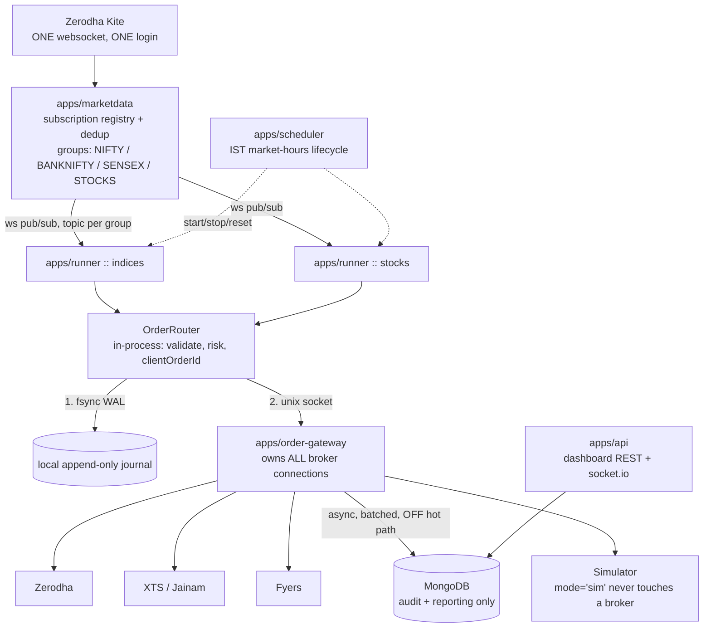

# Target Architecture — authoritative design

> **Inherited from the NSE desk** (`/opt/algomaker`, copied 3 Nov 2026). It describes the machinery this repo
> shares with the NSE desk as it stood there, and is not maintained here. The process names (`desk-*`), ports
> (87xx), database (`algomaker`) and paths in it are the **live NSE desk's**: in this repo they are `dx-*`,
> 8890–8897 and `algomaker_dx`. Never run a command from this page. Links to other NSE documents point into
> the NSE repo and were not carried over.

*Consolidates every requirement the owner stated on 2026-07-25. This supersedes the sketch in
`08-overhaul-proposal.md` §2 where they differ. Decisions here are **made**, with rationale; open
items are marked **OPEN**.*

## Requirements, as stated

| # | Requirement | Status |
|---|---|---|
| R1 | One shared tick bus; one login; one subscription set | designed below |
| R2 | Group market data by underlying (nifty / banknifty / sensex / per-stock option groups) | designed below |
| R3 | Scale to trading **5–10 stocks**, not just indices | designed below |
| R4 | `xtsOrder` is messy → module-based, independently restartable/resettable, separate logs | designed below |
| R5 | Data bus: 0mq **or** websockets that work on modern Node | **decided: `ws`** |
| R6 | `tulind` breaks on new Node | **DONE** — replaced by `packages/indicators` |
| R7 | Latest Node; drop old libraries | in progress (Node 22+ pinned) |
| R8 | Full rewrite / refactor / restructure approved | proceeding |
| R9 | Only `autostart`/`delay_start` strategies in scope; archive the rest **after documenting** | scope fixed at **15 strategies** |
| R10 | Declutter `slive` and `smp` | plan below |
| R11 | pm2 file to start everything incl. strategies | **DONE** — `ecosystem.config.cjs` |
| R12 | **Remove MongoDB from the order-routing path** | designed below |
| R13 | Consider latest LoopBack | LB4 viable — see `08` DECISION 1 |

## The one rule everything else follows from

**The trading core must not import the web framework.**

The current system's worst property: strategies `require('../server.js')` just to reach
`app.models`, so **every strategy boots an entire web app**. Measured: 150 of 156 files boot
LoopBack; 147 of 156 open their own Kite websocket. That is the root cause of the ~150×
duplication, and no amount of framework modernisation fixes it.

## Process topology



## R12 — MongoDB off the order path

**Today:** strategy → insert into Mongo `paper-trade` → each consumer's change stream fires →
broker call. So every order pays a cloud-Atlas insert **plus** a majority-commit replication wait
**plus** oplog fan-out before it reaches a broker. On a stop-loss, that is the wrong place to spend
latency. It is also a single point of failure and the reason "paper" and "live" got conflated.

**New design — three separate concerns that were previously one:**

| Concern | Old | New |
|---|---|---|
| **Transport** (get the order to the broker) | Mongo change stream | in-process call → Unix domain socket to `order-gateway`. Sub-millisecond, no network. |
| **Durability** (survive a crash mid-order) | implied by the DB write | **local append-only WAL, fsync'd before submission.** Faster than a cloud round-trip and a stronger guarantee. |
| **Audit / reporting** (P&L, dashboard, history) | same DB write | MongoDB, written **asynchronously and batched, off the hot path.** |

Recovery: on restart, replay the WAL tail and reconcile against the broker's order book before
accepting new intents. This is what the legacy system cannot do today — it has no record of
in-flight intent separate from the DB write.

**Why a Unix socket rather than 0mq:** `zeromq@6` is a native addon, and a native addon (`tulind`)
is exactly what blocked the last Node upgrade. Unix domain sockets and `ws` are pure Node with no
build step. If a measured need for 0mq/NATS appears later, it swaps behind the `Transport`
interface.

## R1/R2/R3 — one feed, grouped subscriptions, stock-ready

`apps/marketdata` owns the **only** Kite login and the **only** websocket.

- **Subscription registry.** Each strategy *declares* what it needs (`{underlying, kind}`) rather
  than subscribing itself. The service unions all declarations, dedups tokens, and subscribes once.
  Ten strategies on BANKNIFTY produce one subscription, not ten.
- **Topics = groups**, so a consumer only receives what it asked for:
  `md.index.NIFTY`, `md.index.BANKNIFTY`, `md.index.SENSEX`,
  `md.opt.NIFTY.<expiry>`, `md.fut.BANKNIFTY.<expiry>`,
  `md.stock.RELIANCE`, `md.opt.RELIANCE.<expiry>` …
- **Stocks (R3).** Indices are hardcoded all over the legacy code (`260105`, `256265`, `265`,
  strike steps 50/100). The new `InstrumentUniverse` makes underlyings **data**: symbol, spot
  token, strike step, lot size, expiry calendar, tick size. Adding 5–10 stocks becomes config plus
  an instrument refresh — no code change. Note stock options need per-symbol strike steps and lot
  sizes (unlike the uniform index steps), which is precisely why this must be data.
- Kite enforces a per-connection subscription cap (~3000 tokens). The registry must enforce and
  report headroom, and shard across a second connection if a stock-options universe exceeds it.
  **OPEN:** confirm the current cap against Kite's live docs before sizing the stock universe.

## R4 — modular, restartable, separately logged

`xtsOrder.js` today mixes three responsibilities in one file: watch a change stream, translate
order shapes, and manage XTS sessions. Split into:

- `apps/order-gateway` — owns broker connections and the submit/ack/reject lifecycle. One
  **adapter per broker** behind a single `BrokerAdapter` interface, so a wedged XTS session is
  restartable without touching Zerodha or any strategy.
- `packages/brokers/*` — pure adapters, no bus or DB knowledge.
- Independent restart, per-module logs, and a health/reset endpoint per module. Already partly
  delivered: `ecosystem.config.cjs` gives per-process `logs/<name>-{out,err}.log`, namespaces for
  group restarts, and `stop_exit_codes: [0]` so a clean 15:30 exit stays down while a crash
  auto-recovers.

## Sim vs live — permanently unambiguous

`OrderIntent` carries a **required** `mode: 'sim' | 'live'`. The simulator and the broker adapters
are different consumers selected by that field. It becomes impossible to reproduce today's
situation, where whether real money moves depends on which daemon happens to be running.

## Layout

```
packages/
  core/          IST time, money/rounding, Result types, ids
  indicators/    DONE - pure TS, zero deps, tulind replacement
  bus/           Transport interface + ws + unix-socket impls
  order-bus/     OrderIntent types, WAL, OrderRouter, risk checks
  brokers/       zerodha | xts | fyers adapters
  instruments/   InstrumentUniverse, expiry calendars, strike steps
  strategy-kit/  StrategyBase, injected feed, golden-master port verification
  strategies/    the ~8 parameterized classes for the active set
apps/
  marketdata/    one login, one websocket, subscription dedup
  runner/        hosts many strategies (sharded indices / stocks)
  order-gateway/ owns broker connections
  scheduler/     IST lifecycle: start/stop/reset
  api/           dashboard REST + socket.io  (LB4 or Fastify)
  web/           React + Vite dashboard
legacy/          archived strategies, documented, moved not deleted
```

## R9/R10 — declutter plan

Scope is the **15 active strategies** (`context/09-active-strategy-scope.md`). Their full
dependency closure is **26 files**:

| Path | Keep | Currently | Reduction |
|---|---|---|---|
| `server/slive/` | **19** | 156 | **-88%** |
| `server/lib/` | 4 (`KiteTicker`, `zerodha`, `notify`, `otmSelector`) | 17 | |
| `server/tools/` | 2 (`optionInstruments`, `smp_order_listener`) | 34 | |
| `server/smp/` | **0** | 134 | **-100%** |

The 19 `slive` keepers are the 15 active modules plus 4 logic helpers (`atr-band-logic`,
`orb-fut-core`, `orb-fut-logic`, `orb-scalp-logic`).

**Sequencing (order matters):**
1. Taxonomy workflow finishes documenting **all** families → `context/strategy-specs/`.
2. `git mv` the non-keepers to `legacy/slive/`, `legacy/smp/`. **Move, never delete** — they are
   the record of what was tried, and several encode ideas absent from the active set.
3. Re-run `npm test` and confirm the 26-file closure still resolves.
4. Only then start porting.

`server/smp/` empties completely: it is the staging dir, and its 26 slive-twinned files are stale
copies while its 108 orphans are unregistered experiments. Documented first, then moved.

## Migration safety

Unchanged and non-negotiable: **golden-master replay.** Record a session's ticks, run the legacy
file and the new class+config over identical input, and diff the emitted order intents — they must
match exactly. This is only possible because the new design injects the feed, and it is what turns
"did I port 15 strategies correctly?" into a test suite.

Live-order strategies (`lion-s25-2`, `cheetah-b1-1`, `cheetah-b1-snx`) port **last**, and only
after the bus-routed ones have run in parallel with the legacy system and matched.

## Open questions

1. **`lion-s25-2` rail mismatch.** Auto-starts, enters live on Zerodha (`:142,:152`), stops via the
   bus → `xtsOrder` → XTS. With `xtsOrder` confirmed running, are entry and stop on the **same**
   broker accounts? If not, the stop does not protect the position.
2. ~~**`otmSelector` returning 0.**~~ **RESOLVED 2026-07-25 — intentional; the desk trades ATM.**
   Delete the dead weekday scaffolding rather than porting it. Keep `offset` as a config axis
   (the `ce-d2*`/`pe-d2*` spread scanner varies it) but default it to `0` = ATM.
3. **`eagle-s-1`** has no intraday stop and auto-starts. Is total reliance on `squareoff_smp`
   intended?
4. **Which stocks** for R3, and cash-secured vs margin sizing rules?
5. Kite per-connection subscription cap — confirm before sizing the stock universe.
