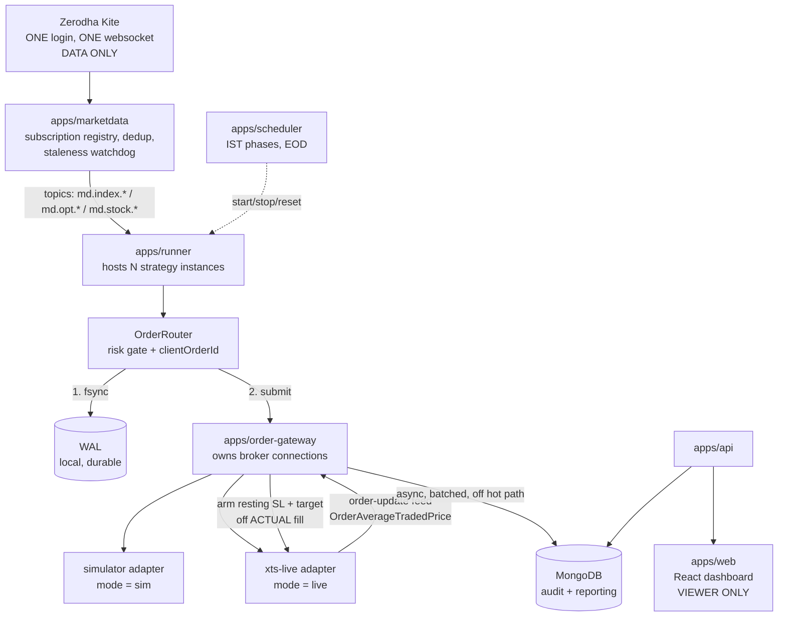
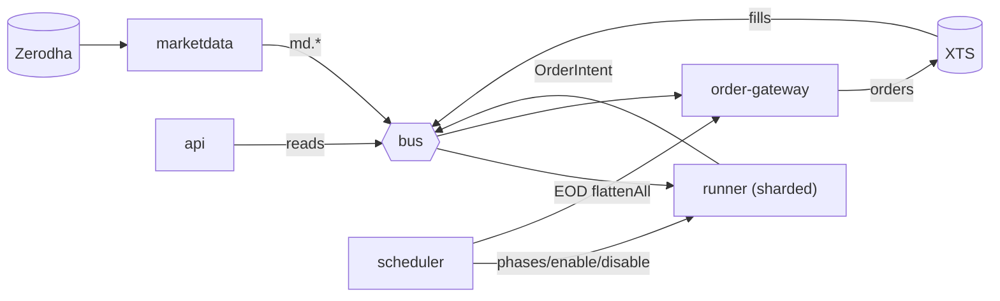

# AlgoMaker — Clean Architecture Design Spec

**Date:** 2026-07-25
**Status:** Awaiting owner review
**Branch:** `overhaul/foundation`

This is the single comprehensive design for rebuilding AlgoMaker: consolidating to two brokers,
supporting paper and live trading through identical code, reducing ~380 strategy files to a handful
of parameterized classes, replacing an EOL runtime and framework, and removing the accumulated dead
code.

Sections 2–8 were drafted in parallel by separate agents against a shared brief, then reconciled
here. Every claim about existing code was required to cite `file:line`; where a section corrected an
earlier assumption of mine, §0.4 records it.

---

## 0.1 Locked decisions

Made by the owner on 2026-07-25. These are settled inputs, not open questions.

| # | Decision | Why it matters |
|---|---|---|
| **D1** | **Zerodha = market data only** (read-only). **XTS = order placement + order-update feed.** Drop Fyers, Spark/Tradelab, Shoonya/Noren. | Deletes `Account.placeAllAccount`, which **eliminates the dual-rail bug by construction** — Zerodha becomes structurally incapable of placing an order |
| **D2** | **Paper and live are both first-class**, sharing one code path and differing only by injected `BrokerAdapter` | Paper becomes a genuine rehearsal instead of a different program |
| **D3** | **Live SL/target are RESTING BROKER orders priced off the ACTUAL fill** (`OrderAverageTradedPrice` from the XTS feed) | Fixes the systemic gap: all 6 non-modern active strategies currently hold stops only in process memory |
| **D4** | **Cutover migration** — build clean, verify in paper, switch all 15 strategies on one day, then retire legacy | No parallel-running period, so the verification gate (§8.3) and rollback (§8.5) carry the entire safety burden |
| **D5** | **MongoDB off the order hot path** — transport in-process/socket, durability via fsync'd WAL, Mongo async for audit only | Removes a cloud round-trip plus replication commit from the stop-loss path |
| **D6** | **No research/P&L backtester.** Replay exists solely to verify ports | Scope guard — do not grow the replay harness into one |
| **D7** | **ATM is intentional.** `otmSelector` returning 0 is correct | Delete the dead weekday scaffolding; keep `offset` as config defaulting to 0 |
| **D8** | Node **16 → 24**; LoopBack 3 and AngularJS both replaced | Production runs a runtime EOL since Sept 2023 |
| **D9** | **Risk limits are opt-in, not mandatory.** `maxLotsNet: null` means unlimited and `stopPolicy: 'none'` means no stop — both are valid, supported configurations | Owner (2026-07-26) chose uncapped sizing for `bull-s-1`/`bull-snx-1` and a stopless `eagle-s-1`, with **manual monitoring as the stated mitigation**. Ports stay faithful to legacy behaviour. Raises the importance of the live monitoring surface (§6.4) and the kill switch, since those become the operative controls |

## 0.2 Scope

**In:** the 15 active strategies (every `strategies.json` entry with `autostart: true` or a
`delay_start`), the two brokers, paper + live execution, the runtime services, the API and
dashboard, the data model, and the full cleanup.

**Out:** a backtester (D6); Fyers/Spark/Noren; the 365 archived strategies (documented, not
migrated); migrating off MongoDB; the builder/combo/spreads/parity dashboard features (§6, dropped
with source preserved in `legacy/`).

## 0.3 The problem, in four measurements

1. **A strategy is a file, not a config row.** `cheetah-1910.js` vs `cheetah-1911.js` differ by 4
   diff lines out of 236.
2. **The trading core imports the web framework.** 150 of 156 strategies `require('../server.js')`
   just to reach `app.models`, so each boots a whole LoopBack app; 147 of 156 open their own Kite
   websocket.
3. **Whether an order is real depends on which daemon runs.** `PaperTrade` is an untyped order bus;
   `xtsOrder.js:306-309` forwards it to real XTS accounts.
4. **Protection lives in process memory.** All 6 non-modern active strategies have
   `trackOrder_slm = 0` and `OrderUpdate = 0`.

## 0.4 Corrections to earlier analysis

Recorded so they are not re-derived wrongly. Each was verified after the drafting agents flagged it.

| Earlier claim | Correction | Evidence |
|---|---|---|
| "LoopBack 4 is probably the lower-effort API path" | **Fastify is now recommended.** The model trim (§3) removes LB4's main benefit — declarative CRUD over many models — while the LB3→LB4 rewrite cost remains | §6.1 |
| "9 strategy classes needed for the active set" | **4 classes + 1 adapter**, after the taxonomy's cross-family merges | §4.1 |
| "`server/lib` has 4 live files" | **7.** `fill-price.js` and `option-pricing.js` are live via boot scripts; the earlier count covered the strategy closure only | §7.1 |
| "6 tools are live in pm2" | **5.** `ob_start` appears only in a comment in `ecosystem.config.cjs`, not as an app | verified against the file |
| "The secrets audit is complete" | **It was not.** `totp.js` holds **8 TOTP 2FA seeds labelled with broker account IDs, plus a plaintext password**, in `//` comments — every prior scan matched quoted literals and walked past them | §7.3 |
| "Zerodha session cookies expire daily, so are probably dead" | True for cookies, but **TOTP seeds never expire.** They are a permanent 2FA bypass until rotated at the broker | §7.3 |

## 0.5 What is built versus what is designed

The repo currently has **9 packages and 263 passing tests, 0 type errors**. That is real, but it is
foundations. Three capabilities this design depends on are **designed and not yet built** — all
three were found by drafting agents auditing the existing code:

| Capability | Status |
|---|---|
| `packages/{core,indicators,execution,order-bus,bus,instruments,marketdata-core,events,strategy-kit}` | **Built and tested.** Indicators are parity-tested against the live `atr-band-logic.js` |
| **Feed-staleness reaction** | `StalenessWatchdog` computes health and `FEED_STALE` exists as a code, but **`StrategyBase` has zero staleness references** — nothing blocks entries |
| **Broker-position reconciliation** | `unresolvedIntents()` covers the WAL side only; **nothing compares local state to a real broker position** |
| **Cross-process `ws` Transport** | Interface + `InProcessTransport` only. The 7-process topology (§5) **cannot run without it** |

Under D4 (cutover) all three must be finished *and demonstrated* before switching — they are in the
pre-cutover gate (§8.3), not deferred.

## 0.6 Open items needing owner sign-off

Ordered by consequence. **The first two involve unbounded risk and will not be guessed at.**

1. ~~**Lot cap for `bull-s-1` / `bull-snx-1`.**~~ **RESOLVED 2026-07-26: keep UNCAPPED.**
   Owner: "keep lot uncapped ... we monitor the live execution and manage manually when things look
   risky." Design consequence: `risk.maxLotsNet` must accept an **explicit `null` meaning
   unlimited**, not merely be omitted — a config loader that rejects null would block this. The
   ported behaviour therefore matches legacy exactly. See D9.
2. ~~**`eagle-s-1` stop policy.**~~ **RESOLVED 2026-07-26: leave AS IS — stopless.**
   Owner chose the faithful port: no intraday stop, exits continue to rely on the central
   `squareoff_smp` flatten. Design consequence: **D3 (resting SL/target off actual fill) does NOT
   apply to `eagle-s-1`**, so `stopPolicy: 'none'` must be a first-class, supported value rather
   than an error case. See D9.
3. **Billing.** Is the `payment` model / strategy marketplace live, or dead? It is currently slated
   for DROP. (§3)
4. **Stock symbols** for the 5–10 stock expansion. Symbols only; steps and lot sizes derive from the
   instrument dump. (§5.3)
5. **Builder/combo/spreads/parity dashboard features** — proposed DROP (broken in production since
   Feb 2025; one 15-line commit in 11 months), source preserved in `legacy/`. Confirm. (§6.3)
6. **OCO trade-off.** XTS may lack native OCO, so the SL/target pair is tracked locally. The
   proposed stance accepts a possible **double-exit** over a possible **naked position**. Confirm
   that preference. (§2.2)
7. **XTS modify semantics.** Unverified whether XTS's modify endpoint atomically covers
   `SL_LIMIT`/`StopLimit`, not just entry limits. Affects the amend-preferred chase design. (§2)

## 0.7 Two findings worth acting on independently

**Node 16 → 24 can ship on its own, first.** It is independent of the rewrite and already unblocked:
`server/lib/indicators/atr.js` was rewritten off `tulind`, and LoopBack 3 has been **verified booting
and serving on Node 24** ("Web server listening at :80" + explorer + PM2 connected). 51 of 53
dependencies load; the only other failure is `norenrestapi`, which has **zero references**. This
gets you off an EOL runtime without waiting for anything else. (§8.2)

**Cut over on a flat book** — after an EOD square-off, before the next open. Then `onRecover()` has
nothing stale to reconcile and there are no resting broker orders for a rollback to trip over,
which removes the sharpest edge of D4 at zero cost. (§3, §8.4)

## 0.8 Success criteria

Objectively checkable, not judgement calls:

1. `npm test` and `npm run typecheck` pass in CI on Node 24.
2. Every one of the 15 strategies is golden-master-clean against its legacy twin, with any
   difference traced to D3 and explicitly signed off.
3. **One** Zerodha websocket serves all strategies (today: ~150).
4. Paper mode fills a resting SL — a test the current system **cannot** pass, since
   `paperstream.js:353` returns early unless `status === 'COMPLETE'`.
5. Killing the runner with an open position and restarting recovers it from the WAL and reconciles
   against the broker.
6. The kill switch halts new entries while still permitting exits.
7. A stale feed blocks new entries while open positions continue to be managed.
8. `server/` contains no file that is neither in the active dependency closure nor deliberately
   retained, and every archived strategy is findable from one knowledge folder.

## 0.9 Contents

| § | Section |
|---|---|
| 1 | Overview, problem statement and target architecture |
| 2 | Brokers & execution — `BrokerAdapter`, resting SL/target, simulator, reconciliation |
| 3 | Data model & persistence — model trim, WAL, audit schema |
| 4 | Strategy layer — 4 classes, config schema, per-strategy port notes, golden-master procedure |
| 5 | Runtime services — marketdata, runner, order-gateway, scheduler, pm2 layout |
| 6 | API & dashboard — Fastify, page map, health/notification surface |
| 7 | Cleanup, repo layout & the strategy-knowledge folder |
| 8 | Phasing, cutover & rollback |

---

# 1. Overview and target architecture


Rebuild the AlgoMaker trading platform on modern Node and TypeScript, consolidating to two brokers,
supporting paper and live trading through identical strategy code, and reducing ~380 strategy files
to a small set of parameterized classes driven by config.

This is one comprehensive spec covering cleanup, broker consolidation, execution, all 15 active
strategy ports, the API and the dashboard. Implementation is staged in phases (§8), but the design
is decided as a whole so the pieces fit.

### What is in scope

- The **15 active strategies** — every entry in `common/models/strategies.json` with
  `autostart: true` or a `delay_start` value. Everything else is already archived to `legacy/`.
- Brokers: **Zerodha for market data**, **XTS for order placement and the order-update feed**.
- **Paper and live**, both first-class, sharing one code path.
- Node **16 → 24**, LoopBack 3 replaced, AngularJS dashboard replaced.
- Full dead-code removal and a single strategy-knowledge reference folder.

### What is explicitly out of scope

- **A research / P&L backtester.** Declined by the owner. Replay exists only to verify that a
  ported strategy emits the same orders as the legacy file it replaces.
- Fyers, Spark/Tradelab and Shoonya/Noren integrations. Dropped, not ported.
- The 365 archived strategies. Documented in the knowledge folder; not migrated.
- Database migration off MongoDB.

## 2. The problem being solved

Four measured properties of the current system drive every decision below.

**A strategy is a file, not a config row.** 380+ files encode 15–18 distinct trading ideas;
`cheetah-1910.js` and `cheetah-1911.js` differ by 4 diff lines out of 236. Every new client or
variant costs a file, a process, a websocket and a full framework boot.

**The trading core depends on the web framework.** Strategies call `require('../server.js')` purely
to reach `app.models`, so **150 of 156 files boot an entire LoopBack application** and **147 of 156
open their own Kite websocket**. This single coupling is the direct cause of the resource sprawl.

**Whether an order is real is decided by which daemon is running.** `PaperTrade` is not paper
trading — it is an untyped order bus. `xtsOrder.js:306-309` change-streams the `paper-trade`
collection and forwards to real XTS accounts. Worse, `Account.placeAllAccount`
(`common/models/account.js:148-152`) inserts on that bus **and** places Zerodha orders in the same
call, so one decision can fill on two brokers.

**Protection lives in process memory.** All six non-modern active strategies (`bull-s-1`,
`bull-snx-1`, `eagle-s-1`, `lion-s25-2`, `cheetah-b1-1`, `cheetah-b1-snx`) have
`trackOrder_slm = 0` and `OrderUpdate = 0` — every stop is a local tick check. If a process dies or
the feed stalls while the socket stays open, a short options position is unprotected until the
central square-off runs.

## 3. Locked decisions

| # | Decision | Consequence |
|---|---|---|
| D1 | **Zerodha = market data only** (read-only); **XTS = orders + fill feed** | `Account.placeAllAccount` is deleted, which **eliminates the dual-rail bug by construction** — Zerodha can no longer place an order at all |
| D2 | **Paper and live share one code path**, differing only by which `BrokerAdapter` is injected | Paper becomes a real rehearsal rather than a different program |
| D3 | **Live SL/target are resting broker orders priced off the ACTUAL fill** | Strategies wait for `OrderAverageTradedPrice` from the XTS feed, then arm protection at the broker. Fixes the in-memory-stop gap |
| D4 | **Cutover migration** — build clean, verify in paper, switch all 15 on one day | No parallel-running period, so the golden-master gate and the rollback procedure carry the entire safety burden (§8) |
| D5 | **MongoDB off the order hot path** | Transport in-process/socket; durability via fsync'd WAL; Mongo async for audit only |
| D6 | **No backtester** | Replay is for port verification only |
| D7 | **ATM is intentional** — `otmSelector` returning 0 is correct behaviour | Delete the dead weekday scaffolding; keep `offset` as config defaulting to 0 |

### On D3 — why it is the most consequential

Today a strategy assumes its fill price. Under D3 it learns the real one. That changes behaviour:
an entry filled at 128.35 rather than an assumed 128.00 produces a different stop and a different
target. This is more correct, and it is a **behaviour change** — ported strategies will not place
byte-identical orders to their legacy twins on the SL/target legs. §8's verification gate must
distinguish "differs because the port is wrong" from "differs because D3 is working."

### On D4 — the honest trade-off

Cutover reaches a clean system faster and avoids maintaining two stacks. The cost is that there is
one day when everything moves onto code that has never traded real money. Two specific
consequences the design must handle: the verification gate has to be strong enough to substitute
for live experience (§8.3), and rollback has to reconcile **resting SL/target orders placed at the
broker by the new stack that the legacy stack knows nothing about** (§8.5).

## 4. Target architecture in one picture



The rule that makes this work: **`packages/*` and the runtime apps import none of the API
framework.** Data access goes through a plain repository layer, so the framework choice is
contained to `apps/api` and can change later without touching a strategy.

## 5. Success criteria

Objectively checkable, not judgement calls:

1. `npm test` and `npm run typecheck` pass in CI on Node 24.
2. Every one of the 15 strategies is golden-master-clean against its legacy twin, with any
   difference traced to D3 and explicitly signed off.
3. One Zerodha websocket serves all strategies — verified by process count and subscription count
   (today: ~150 sockets; target: 1).
4. Paper mode fills resting SL/target orders, demonstrated by a test that the current system
   cannot pass (`paperstream.js:353` returns early unless `status === 'COMPLETE'`).
5. Killing the runner with an open position and restarting it recovers that position from the WAL
   and reconciles against the broker.
6. The kill switch halts new entries while still permitting exits.
7. `server/` contains no file that is neither in the active dependency closure nor deliberately
   retained, and every archived strategy is findable from one knowledge folder.

---

# 2. Brokers and execution


### 1. `BrokerAdapter` interface

One interface (`packages/brokers/src/adapter.ts`, new package), three implementations. Strategies never see it — they talk to `StrategyContext.orders`/`.md` (`OrderGateway`/`MarketData`, `packages/strategy-kit/src/ports.ts:63-113`). `BrokerAdapter` is the layer the gateway and market-data service are built on. This is what makes "paper and live run identical strategy code" literal: one `StrategyContext`, only the adapter it's constructed with changes.

```
interface BrokerAdapter {
  readonly kind: 'zerodha-data' | 'xts-live' | 'simulator'
  readonly capabilities: { orders: boolean; marketData: boolean; atomicModify: boolean }

  subscribe(tokens: readonly number[]): void          // zerodha-data, simulator
  unsubscribe(tokens: readonly number[]): void
  onTick(handler: (tick: Tick) => void): () => void
  historicalCandles(instrument: InstrumentRef, interval: Interval, from: number, to: number): Promise<readonly Candle[]>

  placeOrder(o: BrokerOrderRequest): Promise<BrokerAck>   // xts-live, simulator
  modifyOrder(brokerOrderId: string, patch: { limitPrice?: number; triggerPrice?: number; qty?: number }): Promise<BrokerAck>
  cancelOrder(brokerOrderId: string): Promise<BrokerAck>
  positions(): Promise<readonly BrokerPosition[]>
  orderBook(): Promise<readonly BrokerOrderState[]>
  onOrderUpdate(handler: (u: BrokerOrderUpdate) => void): () => void
}
```

`zerodha-data` wraps `server/lib/zerodha.js` session handling with every order-placing method stripped; constructed with `capabilities.orders = false`, so the router refuses to route any `OrderIntent` to it. This eliminates the `Account.placeAllAccount` dual-rail bug **by construction** — no code path exists through which a Zerodha adapter can receive `placeOrder`.

`xts-live` wraps `xts-interactive-api` (used at `xtsOrder.js:2,168`, `smp_order_listener.js:5-6`). `modifyOrder` maps to XTS's native modify endpoint — **required**, because cancel-then-replace has the double-fill race `execution/src/types.ts:37-41` documents (`supportsAmend`): the resting order can fill between the cancel request and its ack, leaving two fills for one intent. `atomicModify` must be `true` for the chase policy to receive `supportsAmend: true`; if an order type turns out not atomically modifiable, that flag flips to `false` for that path rather than silently degrading.

`simulator` implements both surfaces against injected ticks, no network — used in golden-master replay and day-to-day paper trading, holding resting orders per §3.

`BrokerAck` is synchronous accept/reject only. All later state — working, partial, filled — arrives exclusively through `onOrderUpdate`, mirroring XTS: `placeOrder` returns `AppOrderID` (`xtsOrder.js:175`), the real fill price appears later via `OrderAverageTradedPrice` (`smp_order_listener.js:83`).

### 2. Resting SL/target sequence (decision 3)

1. `orders.submit()` for the entry. Gateway assigns `clientOrderId`, fsync's `WalRecord{kind:'INTENT'}` (`wal.ts:67-77`) **before** calling `adapter.placeOrder()`.
2. Ack returns `{status:'ACCEPTED', brokerOrderId}`; WAL gets `SUBMITTED`. Not yet a real position — ack means resting/routed, not filled.
3. **Exposure window**: from ack to fill event, no SL/target exists at the broker. Can't be eliminated — the arm price is the real fill, unknown until it happens — only bounded: a fill-timeout (config per instrument liquidity; illiquid stock options route through chase, §5) triggers a direct `adapter.orderBook()` poll rather than a second order.
4. Order-update reports `OrderAverageTradedPrice`, status FILLED/PARTIALLY_FILLED. WAL gets `STATUS{avgFillPrice}` — the only price SL/target are ever computed from, never the strategy's decision price.
5. Gateway computes SL/target from `avgFillPrice`, places both immediately: resting `SL_MARKET` (XTS `StopLimit` with the existing protective-limit band, `xtsOrder.js:150-165` — a bare stop-market can print through a gap) and a target `LIMIT`, both carrying `meta.pairId = clientOrderId` for step 7.
6. **If the SL placement is rejected** (margin, freeze range — `paperstream.js:100` already special-cases "Price is out of the current execution range"): not a retry-forever state. Alert immediately, retry with a widened trigger a bounded number of times, then call `orders.flattenAll()` (`ports.ts:112`). An unprotected fill is worse than an immediate flat exit at a possibly-bad price.
7. **OCO without native XTS support**: SL and target are a locally-tracked pair by `pairId`. The moment either `onOrderUpdate` reports FILLED, `cancelOrder()` the other. This races — the other leg can also fill before the cancel lands — accept a possible double-exit as the lesser failure versus a naked position, and detect it in reconciliation (§4): a cancel-ack after its pair already reports FILLED is expected, not an error.
8. **If the fill event never arrives**: the WAL exists for this. `unresolvedIntents()` (`wal.ts:130-148`) surfaces the `clientOrderId` on the next reconciliation pass or restart (§4); the gateway trusts `orderBook()`/`positions()` over a stalled feed — why those are first-class adapter methods, not conveniences.

### 3. Simulator upgrade for resting-order rehearsal

Today `paperstream.js:353-354` (`handleInsertEvent`) returns unless `status === 'COMPLETE'`, so a `'Pending'` resting order is never revisited — decision 3 is untestable in paper. The `simulator` adapter fixes this: resting orders (`LIMIT`/`SL_MARKET`) are stored as `WORKING`, not filled on insert. On every tick (same stream `MarketData` uses):
- `SL_MARKET` fills at the crossing tick — the first tick where `last_price` trades through the trigger — priced there plus configurable slippage (extend the existing `resolveFill`/slippage model, `server/lib/fill-price.js`, `paperstream.js:16,50,370`, to a signed per-side value).
- Target `LIMIT` fills only if a tick actually trades through it (`last_price` crosses, since ticks carry no separate high/low — a known fidelity gap versus a full L2 book, to be stated explicitly, not hidden).
- Emits the same `BrokerOrderUpdate` through the same `onOrderUpdate` hook, so gateway code is identical between sim and live, including OCO cancellation of the paired leg.

**Fidelity validation**: extend golden-master replay (`packages/strategy-kit`'s existing replay/`diffIntents` harness) to replay recorded XTS `OrderUpdate` sequences from real resting-SL/target trades and assert the simulator reproduces the same fill sequence/prices within slippage tolerance — port verification, not a P&L claim (decision 7).

### 4. Order lifecycle + reconciliation

State machine is the existing `OrderStatus` (`order-bus/src/types.ts:64-84`), driven by `WalRecord{kind:'STATUS'}` from `onOrderUpdate`. `clientOrderId` (assigned pre-WAL-write) is the idempotency key end to end, carried in XTS's `orderUniqueIdentifier` (`xtsOrder.js:147`, read back at `smp_order_listener.js:74-84`), so a WAL replay after crash recognizes an in-flight order and reconciles instead of resubmitting.

**Reconciliation loop** runs continuously against `adapter.orderBook()`/`positions()`, correcting local WAL state to match the broker whenever they diverge — never the reverse.

**Restart with an open position**: `Wal.replay()` (`wal.ts:95-121`) plus `unresolvedIntents()` (`wal.ts:130-148`) lists every `clientOrderId` journalled but never terminal; each is checked against `adapter.orderBook()`/`positions()` before any new intent for that strategy tag is accepted — the step the legacy system cannot do at all, since positions lived only in process memory. A resolved WAL showing FILLED with no SL/target recorded (crash between step 4 and 5 of §2) must trigger immediate SL/target placement ahead of resuming normal logic — `StrategyBase`'s `onRecover`/`catchUpOnRestart` (`packages/strategy-kit`) is where this plugs in.

### 5. Where chase and basket plug in

`packages/execution`'s `chase` (`chase.ts`) handles illiquid legs: instead of a bare `placeOrder`, entries/exits route through `stepChase`, which places a `LIMIT` at reference price and on timeout either `AMEND`s (when `atomicModify`) or falls back to cancel/replace, capped by `maxSlippage`, escalating to `PLACE_MARKET` only if `allowMarketFallback` is set (`execution/src/types.ts:18-50`). This is the natural handler for the §2-step-3 fill-timeout on instruments where a timeout is expected, not anomalous.

`basket.ts`'s `protective-first` ordering sequences all BUY legs before all SELL legs so a naked short is never briefly held (`basket.ts:7-11,71-77`); each leg is itself a full §2 entry-then-resting-SL/target sequence, and `onPartial:'unwind'` reverses `filledExposure` if a later stage fails. Both are pure, already-tested reducers — this spec wires `BrokerAdapter` as their I/O boundary (`ChaseAction`/`BasketAction` → `adapter.placeOrder`/`modifyOrder`/`cancelOrder`; `adapter.onOrderUpdate` → `ChaseEvent`/`BasketEvent`), not redesigns them.

### 6. What gets deleted

Verified by grep against `server/`, `common/`, root `*.js` (excluding `node_modules`, `legacy/`):

- `server/tools/{sparkOrder,fyersOrder,am_xtsOrder,am_xtsOrder-cluster,tradelab_login}.js` — zero inbound references anywhere. Standalone daemon entry points, consistent with the 150/156-processes pattern. Safe to delete.
- `Account.placeAllAccount` and its siblings `placeAllAccount_LMT`, `placeAllAccountNrml` (`common/models/account.js:148-179,222-247,286-`) — dies with the cutover to `OrderGateway`/`BrokerAdapter`; confirmed dual-rail per `order-bus/src/types.ts:10-14`.
- `server/lib/tradetron.js` — zero references anywhere, including its own directory.
- `server/boot/tradelab_auth.js` — its route body uses `app.models.sparkAccount`, but nothing else requires this file. Safe to delete as a boot script.

**NOT safe to delete as scoped — still referenced:**
- `server/lib/fyers.js` ← required by `common/models/fyers-account.js:3`. `server/lib/tradelab.js` ← required by `common/models/spark-account.js:4`. `server/lib/tradelab-rest.js` itself has zero references and is safe alone.
- `fyers-account`/`spark-account` are still **registered** LoopBack models (`server/model-config.json:111-114` + a `fyersAccount` entry), related from `client.json:16-20` (`fyersAccounts: hasMany`), and `server/tools/saveDailyPNL.js:150-158` writes a `fyersAccountId`/`platform:'fyers'` record.
- **Recommendation**: decision 1 drops fyers/spark/tradelab entirely, so widen this deletion to also remove `common/models/{fyers-account,spark-account}.{js,json}`, their `model-config.json` entries, the `fyersAccounts` relation in `client.json`, and the fyers branch of `saveDailyPNL.js` — otherwise deleting the two lib files leaves `require()`s that crash model loading at boot.
- Out of scope but flagged: `common/models/xts-account copy.js` and `xts-account2.js` look like dead duplicates of `xts-account.js`.

**OPEN**: whether `xts-interactive-api`'s modify endpoint covers `SL_LIMIT`/`StopLimit` atomically (needed for `atomicModify: true` on the SL leg specifically, not just entries) — not verified against SDK/broker docs this pass; `chase.ts`'s own `supportsAmend` field already treats this as a policy input rather than an assumption, which is the right posture until confirmed.

---

# 3. Data model and persistence


### 1. Model trim

`server/model-config.json` registers 27 entries: 5 LoopBack built-ins (`User`, `AccessToken`, `ACL`, `RoleMapping`, `Role`) + **22 custom models**. Three more `.js`/`.json` files sit in `common/models/` but are **not registered at all** (`spreads.js`, `xts-account2.js`, `"xts-account copy.js"`) — dead weight today regardless of this trim. `strategies.json`/`strategies_ob.json` are plain data files, not schemas.

| Model | Datasource | Verdict | Reason |
|---|---|---|---|
| `client` | cloud | **KEEP** | Web-app login entity (base `User`); frontend stays live. Drop `fyersAccounts`/`algousers` relations (client.json:16-21). |
| `instrument` | cloud | **KEEP** | Instrument master; sole source Zerodha (data-only, decision 1); feeds `packages/instruments`. |
| `account` | cloud | **KEEP, trim** | Zerodha sub-account. Strip `placeAllAccount`/`trackOrder`/`squareOff` (account.js:148-152, the dual-rail bug) — Zerodha becomes read-only, eliminating it by construction. Keep credentials/session for market data login. |
| `xtsAccount` | cloud | **KEEP** | Sole order-placement + fill-feed broker (decision 1). `xts-account.js`, 1336 ln. |
| `OrderUpdate` | cloud | **KEEP** | Only writer of real fills (`smp_order_listener.js`); decision 3 (`OrderAverageTradedPrice`) depends on it directly. |
| `strategyPNL` | **memory** | **KEEP, relocate** | 10s M2M snapshots — see §2. |
| `log` | **memory** | **KEEP, relocate** | Admin audit trail — see §2. |
| `strategyData` | cloud | **MERGE** | "Generic per-strategy state" — this is exactly what `StateStore` (strategy-kit) now owns. No standalone LoopBack model; see §4. Current callers (account.js:561,612; positional.js:164,169) are all legacy paths being dropped. |
| `report` | cloud | **MERGE** | EOD PNL snapshot folds into the new `daily_pnl` audit collection (§3). |
| `paper-trade` | cloud | **MERGE (split)** | Its ORDER-BUS role (SHARED-CONTEXT) is replaced wholesale by `packages/order-bus` (WAL + transport). Its *paper-fill* role is replaced by a fixed sim execution engine that actually fills resting orders (today it doesn't — `paperstream.js:353`), folded into the same `orders`/`fills` audit schema as live (§3). |
| `orderbook2` | cloud | **MERGE** | XTS order-book audit cache (`xts-account.js`, `xtsOrder.js`, `smp_target.js`) folds into the unified `orders` audit collection (§3) instead of a separate ad-hoc cache. |
| `strategy` | memory | **DROP** | Empty schema, zero live callers anywhere in `server/`. |
| `position` | cloud | **DROP** | Empty schema, zero live callers (confirmed by grep — registered, never written or read). |
| `payment` | memory | **DROP** | Zero live callers found; billing is out of scope for this cutover. **OPEN** if billing continues elsewhere. |
| `tmp_account` | cloud | **DROP** | Soft-delete bin for removed accounts; superseded by a one-time archive dump at cutover (§5), not an ongoing model. |
| `orderbook` (singular) | cloud | **DROP** | Zerodha rejected/cancelled-order cache (`paperstream.js:66` `sendUpdatePnl`); meaningless once Zerodha places no orders (decision 1). |
| `manager` | memory | **DROP** | "No real documents" — a stateless pm2 RPC wrapper, not data. pm2 start/stop continues as a plain ops script, not a LoopBack model. |
| `fyers-account` | cloud | **DROP** | Broker dropped (decision 1). |
| `sparkAccount` | cloud | **DROP** | Broker dropped (decision 1). |
| `positional` | cloud | **DROP** | Carry-forward paper ledger. Zero writers inside `server/slive` (the 15 active strategies) — only legacy `tob/bently/rollsroyce`-class scripts and superseded `am_xtsOrder*`/`sparkOrder.js` daemons touch it. |
| `algopaper` | memory | **DROP** | Structurally broken (see §2) and out of scope — "algouser" mirror accounts are not among the 15 active strategies. |
| `algouser` | memory | **DROP** | Paired 1:1 with `algopaper`, same reasoning. |
| `spreads`, `xts-account2.js`, `"xts-account copy.js"` | — | **DROP (delete files)** | Not even registered in `model-config.json`; `spreads` had one caller in the already-archived `smp/combo-trade.js`; the two xts-account duplicates are unreferenced backups (grep confirms 0 hits for `xtsAccount2`). |
| `strategies_ob.json` | n/a | **DROP** | ~40-entry legacy roster (Audi/BMW names) for the already-dead `client_ob` fork; 0 grep references repo-wide. |
| `strategies.json` | n/a | **KEEP, trim** | Becomes the 15-strategy registry; everything else in it is dead scaffolding. |

**Tally**: KEEP 7 (2 relocated), MERGE 4, DROP 11 registered models + 4 orphan files/registries.

**Collections that must be preserved even though the model is dropped or merged**: `report` (EOD history → migrate into `daily_pnl`), `paper-trade` and `orderbook2` (historical ledgers → freeze as read-only archives, folded conceptually into `orders`/`fills`), `positional` (only if the owner wants continuity for the non-in-scope legacy books — **OPEN**, otherwise archive-dump and discard), `tmp_account`/`fyers-account`/`sparkAccount` (archive-dump only, for compliance — never migrated as live data), `strategyData` (check per-document for any state worth seeding into the new `StateStore` before cutover — **OPEN**, case-by-case). `algopaper`/`algouser`/`strategy`/`position`/`payment`/`orderbook`/`manager` hold no data worth preserving (empty, broken, or provably unread).

### 2. Kill the in-memory datasource

`server/datasources.json` maps `db` → `{"connector":"memory"}`, `cloud` → MongoDB. Every strategy process boots its own LoopBack app, so `db` is not just wiped on restart — it is **never shared across the ~150 processes that are alive simultaneously**. Targets:

- `strategy`, `payment`, `manager`, `algopaper`, `algouser` → **DROP**, no target needed (§1).
- `strategyPNL` → the 10s M2M cadence moves to an in-process ring buffer (read directly by whatever renders the live PNL chart) plus an async batched write into `daily_pnl` (§3). No WAL needed — this is a derived metric, not an order; losing the last few seconds on crash is acceptable, losing all of today's history on every pm2 restart (today's bug) is not.
- `log` → moves to the same async Mongo audit writer as orders/fills (§3), just a different collection (`audit_log`); low volume, no durability escalation required beyond "eventually in Mongo."

**The `algopaper` inconsistency**: `algopaper` is a **memory**-connector model, but `paperstream.js:413-420` change-streams the collection via `db.collection("algopaper").watch()` — real **Mongo**, not the in-process store the model actually writes to. `paperalgo.js`'s `Algopaper.create()` calls therefore land in memory, invisible to the Mongo watcher, so the fill-stamping step can never fire — this isn't a one-line bug, it's a structural impossibility given the connector mismatch. Resolution: **drop the feature**, not fix the datasource — it's unused by the 15 active strategies and was already non-functional.

### 3. MongoDB off the order hot path

Three separated concerns, per SHARED-CONTEXT and what's already built:

1. **Transport** — `packages/bus`'s `Transport` interface, in-process today; a Unix domain socket implementation is needed wherever the strategy process and the execution/order-bus daemon are separate OS processes (no native addons, matching the ws-over-0mq precedent).
2. **Durability** — `packages/order-bus/src/wal.ts`'s `Wal`: fsync'd newline-delimited JSON, `append()` resolves only once bytes are on disk. This — not Mongo — is what a submit call must `await` before hitting the broker. `unresolvedIntents()` replays the journal on boot to find intents that never reached a terminal `OrderStatus`, reconciled against the broker's live order book before new intents are accepted.
3. **Audit/reporting** — MongoDB, async, batched, off the acknowledgement path entirely. A new `AuditWriter` service subscribes to `WalRecord` events (`INTENT`/`SUBMITTED`/`STATUS`/`REJECTED_BY_RISK`, already typed in `order-bus/src/types.ts:156-176`) and batches inserts. Mongo being slow or down delays reporting visibility only — never order execution, never the risk gate.

**What's written, when, by whom**: the `AuditWriter` (new, lives with the repository layer in §4) is the *only* Mongo writer on this path.

```
OrderAuditDoc   { clientOrderId (pk), strategyTag, mode, destinations, instrument,
                  side, orderType, quantity, lots, limitPrice?, triggerPrice?,
                  referencePrice?, status, brokerOrderId?, filledQty, avgFillPrice?,
                  createdTs, updatedTs, history: {ts,status,filledQty,avgFillPrice}[] }
FillAuditDoc    { fillId (pk = clientOrderId+seq), clientOrderId, destination,
                  brokerOrderId, instrument, side, filledQty, avgPrice, ts,
                  source: 'xts-order-update' | 'sim-fill-engine' }
PositionSnapshotDoc { strategyTag, instrument, netQty, avgPrice, m2m, ts, mode }
PnlSnapshotDoc  { strategyTag, ts, m2m, realizedPnl, unrealizedPnl, mode }   // replaces strategyPNL
```

`OrderAuditDoc`/`FillAuditDoc` are upserted on every WAL `STATUS`/`SUBMITTED` record; `PositionSnapshotDoc` on every fill; `PnlSnapshotDoc` on the same cadence `strategyPNL` used (10s), batched.

### 4. The new persistence layer

The trading core (`packages/*`) must never import a web framework — this is literally why 150 processes each booted LoopBack. A new package, **`packages/persistence`**, holds plain repository interfaces (`OrderRepository`, `FillRepository`, `PositionRepository`, `PnlRepository`, `AuditLogRepository` — `upsert`/`append`/`get`/`list` shapes only, backed by the native `mongodb` driver, never `loopback-connector-mongodb`). It is consumed *only* by the `AuditWriter` (§3) and, later, by a reporting API — never by strategy code or the order-bus hot path.

`StateStore` (`strategy-kit/src/ports.ts:136-140`, `get`/`set`/`delete`) currently has no durable implementation. It must be available *before* Mongo/network is confirmed up, since `onRecover()` (base.ts:96, 114) runs at the very start of `start()`. Recommend a new **`packages/state-store`** package backed by `node:sqlite` (built into Node 24, no native-addon rebuild — consistent with the ws-over-0mq no-native-addons precedent) or, more simply, one fsync'd JSON file per strategy tag using the same append/replay discipline as `Wal`. Either way it is local-disk, not Mongo — recovering an open position must not depend on a network round-trip.

### 5. Migration (CUTOVER)

**Carries over, unchanged, same Mongo cluster/URI**: `client`, `account` (trimmed), `xtsAccount`, `instrument` — point the new repository layer at the *same* `cloud` datasource connection the legacy app already uses; zero re-entry.

**Carries over as frozen, read-only archive** (not wired into the new live schema): `report`, `paper-trade`, `orderbook2`, and — if the owner wants continuity for the out-of-scope legacy books — `positional` (**OPEN**).

**Discarded**: `algopaper`, `algouser`, `fyers-account`, `sparkAccount` (revoke/rotate credentials, don't migrate), `payment`, `strategy`, `position`, `manager`, `orderbook` (singular), `tmp_account`, `spreads`, `strategies_ob.json`, both orphan `xts-account*` files. `strategyData` is checked case-by-case for live state worth seeding into the new `StateStore` (**OPEN**).

**Verification**: a `node:test` gate that boots the legacy `account`/`xtsAccount`/`instrument`/`client` LoopBack models and the new `packages/persistence` repositories against the *identical* Mongo URI, diffs record-for-record (IDs, credential/status fields, full instrument token/tradingsymbol set), and asserts zero orphans either direction. This is the data-parity counterpart to the golden-master *logic* replay (`strategy-kit/src/testing.ts`) that already gates strategy porting — both must pass before the single cutover day. **OPEN**: confirm the cutover day is chosen at a flat/EOD boundary, since `onRecover()` restores state written *after* cutover, not legacy in-memory-only state that was never durably recorded (`strategyPNL`/`algopaper`/etc. left nothing to recover from).

---

# 4. Strategy layer


### 1. Minimum class set for the active 15

The taxonomy (`context/strategy-specs/00-taxonomy.md`) defines 12 classes + 1 adapter for all 290
files. Of those, the 15 active modules touch only **4 classes + the 1 adapter** — 5 constructs
total, not 12. `context/09-active-strategy-scope.md`'s own "8 proposed classes" table predates the
taxonomy's cross-family merge and is superseded here: it kept `atm-straddle-pyramid` separate from
`atm-crossover-strangle`, and `band-breakout-option`/`atr-band-option`/`opening-range-*` separate
from each other. The canonical taxonomy already collapsed all of those into one machine each
(§2.1 of the taxonomy doc); nothing in the active 15 requires re-splitting them. Do not build
`RollingLegStrangle`, `RungLadderSeller`, `StraddleScalper`, `SpreadLadderEngine`,
`IndicatorFlipStructure`, or `ChainScanBreakout` — no active module needs them.

| Class | Count | Modules |
|---|---|---|
| `RangeBreakoutDirectional` | 6 | `bn-breakout`, `atr-band-nifty`, `orb-scalp`, `orb-fut-bn`, `orb-fut-nifty`, `orb-fut-snx` |
| `PremiumLegBook` | 3 | `bull-s-1`, `bull-snx-1`, `lion-s25-2` |
| `MomentumFlipDirectional` | 2 | `cheetah-b1-1`, `cheetah-b1-snx` |
| `PremiumDistanceAccumulator` | 1 | `eagle-s-1` |
| `ExternalSignalMirror` (adapter, **not** a `Strategy`) | 3 | `candlestrategy`, `candlestrategy-a006`, `candlestrategy-test3` |
| — infra, not a class | 1 | `smp_order_listener` — becomes the live `FillStream` producer (XTS interactive websocket → order-bus), lives beside `packages/order-bus`, is required by decision 3 for every LIVE-rail strategy |

Per-module mapping (config names carried over from the taxonomy's migration ledger, §6.1):

| Module | Class | Config name | Rail today |
|---|---|---|---|
| `bn-breakout` | RangeBreakoutDirectional | `rbd/bn-firstcandle-pct09-opt` | sim/bus |
| `atr-band-nifty` | RangeBreakoutDirectional | `rbd/nifty-atr14-div3-opt` | sim/bus |
| `orb-scalp` | RangeBreakoutDirectional | `rbd/{bn,nifty,snx}-orb6-opt` (3 instances, 1 process) | sim/bus |
| `orb-fut-bn` | RangeBreakoutDirectional | `rbd/bn-orb6-fut` | sim/bus |
| `orb-fut-nifty` | RangeBreakoutDirectional | `rbd/nifty-orb6-fut` | sim/bus |
| `orb-fut-snx` | RangeBreakoutDirectional | `rbd/snx-orb6-fut` | sim/bus |
| `bull-s-1` | PremiumLegBook | `plb/bn-fut-atm-straddle-125-pyramid` | sim/bus, in-process stop |
| `bull-snx-1` | PremiumLegBook | `plb/snx-atm-straddle-125-pyramid` | sim/bus, in-process stop |
| `lion-s25-2` | PremiumLegBook | `plb/bn-fut-atm-straddle-125-tick` | **LIVE** (Zerodha) + bus |
| `cheetah-b1-1` | MomentumFlipDirectional | `mfd/bn-fut-follow-fixed10-tgt90-cap12` | **LIVE** (Zerodha) |
| `cheetah-b1-snx` | MomentumFlipDirectional | `mfd/snx-follow-fixed10-tgt90-cap12` | **LIVE** (Zerodha) |
| `eagle-s-1` | PremiumDistanceAccumulator | `pda/bn-fut-floor20` | sim/bus, **no exit** |
| `candlestrategy` | ExternalSignalMirror | `mirror/optionbhai-1pbuy` | sim/bus mirror |
| `candlestrategy-a006` | ExternalSignalMirror | `mirror/optionbhai-a006` | sim/bus mirror |
| `candlestrategy-test3` | ExternalSignalMirror | `mirror/optionbhai-ema2050` | sim/bus mirror |

### 2. Config schema (types only)

Only the axis values the active 15 actually use. Built on the already-shipped
`packages/strategy-kit/src/ports.ts` shapes (`DataNeed`, `SubmitRequest`, `StrategyContext`) —
these are **config**, consumed at construction time to build a `StrategyBase` subclass; they are
not a new runtime layer.

```ts
type Underlying = 'NIFTY' | 'BANKNIFTY' | 'SENSEX';

interface UnderlyingSpec {
  symbol: Underlying;
  reference: 'index-spot' | 'current-future';   // futures basis matters — lion-s25-2, bull-s-1, eagle-s-1, cheetah-b1-1/-snx all use 'current-future'
  strikeStep: number;                            // NIFTY=50, BANKNIFTY/SENSEX=100
}

/** otmSelector returning 0 is intentional (owner decision 8). Default is ATM. */
interface StrikeOffset {
  offsetPoints: number;                           // default 0
}

type StopBasis =
  | { basis: 'none' }
  | { basis: 'fixed-pct'; value: number }          // e.g. 1.25 = 25% premium stop
  | { basis: 'trailing-pct'; value: number }
  | { basis: 'fixed-points'; value: number };

type TargetBasis =
  | { basis: 'none' }
  | { basis: 'fixed-points'; value: number }       // cheetah-b1-1/-snx: +90
  | { basis: 'premium-target'; value: number };    // combined-premium %/pts target

interface ExitRules {
  stop: StopBasis;
  target: TargetBasis;
  precedence: Array<'EOD' | 'TARGET' | 'SL'>;
  stopMeasuredOn: 'signal' | 'traded';
}

type Sizing =
  | { kind: 'flat'; lots: number }
  | { kind: 'pyramid-up'; start: number; step: number; cap: number | null }   // null = legacy uncapped
  | { kind: 'pyramid-down'; start: number; step: number; floor: number }
  | { kind: 'martingale-capped'; start: number; cap: number };                // cheetah-b1-1/-snx: cap 12

type ExecMode = 'sim' | 'live';   // maps 1:1 onto packages/order-bus ExecMode + Destination set

interface Rail {
  mode: ExecMode;
  destinations: ReadonlyArray<'sim' | 'xts'>;      // Zerodha is data-only (decision 1) — never a destination
  exitMechanism: 'local-tick' | 'broker-resting-stop';   // decision 3: new configs must default to broker-resting-stop
}

interface Session {
  startAt: string;          // 'HH:mm:ss' IST
  squareOffAt: string;      // mandatory in the rewrite — no legacy active file has one in code
}

interface ExpiryPolicy {
  select: 'nearest' | 'next';
}

interface Risk {
  maxLotsNet: number | null;     // MUST be non-null when sizing.kind !== 'flat' (kills the uncapped pyramid by construction)
  dayLossRupees: number | null;
}

interface BaseConfig {
  tag: string;                                 // unique; sizing/P&L/correlation/square-off key
  class: 'premium-leg-book' | 'range-breakout-directional' | 'momentum-flip-directional' | 'premium-distance-accumulator';
  enabled: boolean;
  underlying: UnderlyingSpec;
  strike: StrikeOffset;
  expiry: ExpiryPolicy;
  session: Session;
  sizing: Sizing;
  rail: Rail;
  risk: Risk;
  data: ReadonlyArray<import('@algomaker/strategy-kit').DataNeed>;
  legacy: { files: string[]; notes?: string };
}
```

Filled-in examples:

```ts
// bull-s-1 — PremiumLegBook, sim rail today
const bullS1: BaseConfig & { legs: { entrySignal: 'strike-crossover'; exit: ExitRules } } = {
  tag: 'Bull_S-1', class: 'premium-leg-book', enabled: true,
  underlying: { symbol: 'BANKNIFTY', reference: 'current-future', strikeStep: 100 },
  strike: { offsetPoints: 0 },
  expiry: { select: 'nearest' },
  session: { startAt: '09:15:00', squareOffAt: '15:20:00' },
  sizing: { kind: 'pyramid-up', start: 1, step: 1, cap: null },   // OPEN: legacy is uncapped; Risk.maxLotsNet now mandatory
  rail: { mode: 'sim', destinations: ['sim'], exitMechanism: 'local-tick' },
  risk: { maxLotsNet: null, dayLossRupees: null },                // OPEN: owner must pick a cap
  data: [{ kind: 'future', underlying: 'BANKNIFTY' }, { kind: 'option-chain', underlying: 'BANKNIFTY', strikeWindow: 4, mode: 'quote' }],
  legacy: { files: ['server/slive/bull-s-1.js'] },
  legs: { entrySignal: 'strike-crossover', exit: { stop: { basis: 'fixed-pct', value: 1.25 }, target: { basis: 'none' }, precedence: ['EOD', 'SL'], stopMeasuredOn: 'traded' } },
};

// cheetah-b1-1 — MomentumFlipDirectional, LIVE
const cheetahB1_1: BaseConfig & { flip: { onStop: true; onTarget: false; strikeRef: 'frozen-first-atm' } } = {
  tag: 'CheetahB1-1', class: 'momentum-flip-directional', enabled: true,
  underlying: { symbol: 'BANKNIFTY', reference: 'current-future', strikeStep: 100 },
  strike: { offsetPoints: 0 },
  expiry: { select: 'nearest' },
  session: { startAt: '09:17:00', squareOffAt: '15:20:00' },
  sizing: { kind: 'martingale-capped', start: 1, cap: 12 },        // cheetah-b1-1.js:145 `if (quantity < 12) quantity += 1;`
  rail: { mode: 'live', destinations: ['xts'], exitMechanism: 'broker-resting-stop' },  // decision 3
  risk: { maxLotsNet: 12, dayLossRupees: null },
  data: [{ kind: 'future', underlying: 'BANKNIFTY' }, { kind: 'option-chain', underlying: 'BANKNIFTY', strikeWindow: 2, mode: 'quote' }],
  legacy: { files: ['server/slive/cheetah-b1-1.js'] },
  flip: { onStop: true, onTarget: false, strikeRef: 'frozen-first-atm' },   // on target, goes idle for the day — preserve the asymmetry
};

// atr-band-nifty — RangeBreakoutDirectional, already logic-split
const atrBandNifty: BaseConfig & { band: { source: 'atr-anchor'; atrPeriod: 14; divisor: 3 }; executionMapping: 'atm-option-of-side' } = {
  tag: 'ATR_Band_NIFTY', class: 'range-breakout-directional', enabled: true,
  underlying: { symbol: 'NIFTY', reference: 'index-spot', strikeStep: 50 },
  strike: { offsetPoints: 0 },
  expiry: { select: 'nearest' },
  session: { startAt: '09:18:00', squareOffAt: '15:20:00' },
  sizing: { kind: 'flat', lots: 1 },
  rail: { mode: 'sim', destinations: ['sim'], exitMechanism: 'local-tick' },
  risk: { maxLotsNet: 1, dayLossRupees: null },
  data: [{ kind: 'index', underlying: 'NIFTY' }, { kind: 'option-chain', underlying: 'NIFTY', strikeWindow: 3, mode: 'quote' }],
  legacy: { files: ['server/slive/atr-band-nifty.js', 'server/slive/atr-band-logic.js'] },
  band: { source: 'atr-anchor', atrPeriod: 14, divisor: 3 },
  executionMapping: 'atm-option-of-side',
};
```

### 3. Per-strategy port notes

**RangeBreakoutDirectional (6)** — the reference lineage; already logic-split + `node:test`'d.
`orb-fut-bn/-nifty/-snx` are 7-line config wrappers over `orb-fut-core.js` — port the core once,
the three wrappers become config records only. `orb-scalp` runs **3 instances in one process**
(BN/NIFTY/SNX) — the port must keep per-underlying state isolated (three `StrategyBase`
instances, not one instance with three underlyings baked in). `bn-breakout` and `atr-band-nifty`
carry the "1 trade per side, a non-loss ends the day" (`bn-breakout`) vs. "2-candle colour
confirm" (`atr-band-nifty`) distinctions — keep `exit.precedence` opposite between the option-buy
mapping (`[EOD,TARGET,SL]`) and the future mapping used by `orb-fut-*` (`[EOD,SL,T1]`); this is
already unit-tested and must not regress. Golden-master fixture: one band-formed day, one
no-breakout day, one day where the day-budget/loss-gate ends trading early.

**PremiumLegBook (3)** — `bull-s-1`/`bull-snx-1` are near-identical (BANKNIFTY vs. SENSEX; step
100 both), crossover entry, per-leg 25% stop, **uncapped** pyramid-up (`+1` forever in legacy).
Per the taxonomy's config-load assertion, `sizing.kind !== 'flat'` now requires a non-null
`risk.maxLotsNet` — legacy has no cap, so a cap value is an **OPEN** owner decision, not a
transliteration. `lion-s25-2` is the LIVE variant: same book/exit machine, `reference:
current-future` (so its ATM tracks the futures basis, not spot — do not collapse this into a
spot-referenced sibling), tick-based stop today (`lion-s25-2.js:148` `sl_trigger: ce_ltp *
sl_percent`, checked against `ticksCache[...].last_price` at `:178`). Fixture must exercise: a
normal entry+stop day, a pyramid day (2+ re-adds), and — separately, gated — the new
broker-resting-stop path once decision 3 lands.

**MomentumFlipDirectional (2)** — `cheetah-b1-1`/`cheetah-b1-snx`, both LIVE. Sizing is
martingale, capped at **12 lots** (`cheetah-b1-1.js:145`). **Flag:** the taxonomy's migration
ledger separately lists `cheetah-b1-2117` (config `mfd/bn-follow-fixed10-martingale-uncapped`) as
the *uncapped* sibling — that file is **not** in the active 15, but it shares the same
`MomentumFlipDirectional` class. The port must not let the two configs share a default
`sizing.cap`; `-2117`'s config record must stay out of the active config set entirely until
someone deliberately re-enables it with `risk.maxLotsNet` wired. `cheetah-b1-1`/`-snx` also "goes
idle for the day" on target (does not re-enter) — this asymmetry vs. the stop-flip path is
load-bearing and must appear in the fixture (a target-hit day and a stop-flip day are different
test cases, not one).

**PremiumDistanceAccumulator (1)** — `eagle-s-1`. `reference: current-future`. Verified
`BUY = 0` in the file (only `SELL` `trackOrder` calls, `eagle-s-1.js:133,148,163`) — there is
**no intraday stop of any kind**; exits rely entirely on the central 15:24
`server/scripts/squareoff_smp.js` flatten. **BEHAVIOUR CHANGE FLAG — needs owner sign-off:**
decision 3 mandates resting broker SL/target priced off the actual fill for live/paper trading.
`eagle-s-1` currently has no stop to convert into a resting order — applying decision 3 here would
mean *inventing* a per-leg stop where legacy has none, which changes live P&L behaviour, not just
where the stop lives. Recommend porting `eagle-s-1` first with `exit.basis:'none'` (byte-faithful
to production), and treating "should eagle-s-1 get a resting stop at all" as a separate,
explicitly gated decision — do not fold it into the general decision-3 rollout. Golden-master
fixture: a multi-leg accumulation day (several trigger fires in both directions) and the 15:24
central square-off itself, since that is eagle's only exit path today.

**ExternalSignalMirror (3, not a Strategy)** — `candlestrategy`, `candlestrategy-a006`,
`candlestrategy-test3` mirror optionbhai.com order executions; they carry no entry/exit logic of
their own and must be built as a `SignalSource` adapter (subscribe optionbhai's websocket, replay
`ORDER_EXECUTION`/`EXECUTED` messages onto the order bus under a local tag), not as a
`StrategyBase` subclass — giving them phases/squareOff/day-budget would be meaningless. **Rotate
credentials before doing anything else**: `candlestrategy.js:15-16` has `username: 'LIVE001'`,
`password: 'UNW3v5Q5Xf9Pj2Y'` committed in plaintext (all three files, per the taxonomy). Fixture
for these three is a recorded optionbhai message stream, not a tick stream — `replay()`/
`diffIntents()` still apply, but the "signal" is inbound messages, not `Quote`s, so the adapter
needs its own minimal harness (`FakeSignalSource` alongside `FakeMarketData`).

### 4. Golden-master port procedure

The technique (`packages/strategy-kit`'s `replay()` + `diffIntents()`, `packages/strategy-kit/src/testing.ts`)
already passes for the ATR/indicator parity comparisons. It works unmodified for the 3 modern
logic modules — `atr-band-logic.js`, `orb-fut-logic.js`, `orb-scalp-logic.js` — because they are
pure, dependency-free, and `require()`-able directly: import the legacy module and the ported
module side by side, run the same tick fixture through the ported `StrategyBase` via `replay()`,
call the legacy pure function directly for the same inputs, and `diffIntents()` (or a plain
`assert.deepEqual` for the indicator outputs) the two.

The 6 legacy strategies with no logic split (`bull-s-1`, `bull-snx-1`, `lion-s25-2`, `eagle-s-1`,
`cheetah-b1-1`, `cheetah-b1-snx`) cannot be `require()`d safely as-is — they boot a LoopBack app,
open a Kite socket, and call `Account.placeAllAccount` on load. The extraction procedure:

1. **Mechanical, reviewed, non-behavioural instrumentation patch** to each legacy file: (a) export
   the internal tick handler (`module.exports._onTicks = onTicks`) so it is callable without a
   real socket; (b) make the `app.models`/`PaperTrade`/`Account` lookups reassignable
   (`module.exports._setModels(fake)`) instead of hard `require`s, so a test can substitute stubs.
   Neither change touches a conditional or a computed value — a reviewer diffs the patch against
   the original and confirms it is pure plumbing.
2. Build a `LegacyShadowRunner` (new, small, lives next to `packages/strategy-kit`): boots the
   patched legacy file with faked `Models` whose `trackOrder`/`create`/`placeAllAccount` push into
   a `RecordedOrder[]` array (never touching Mongo or a real broker — this matters especially for
   `lion-s25-2`/`cheetah-b1-1`/`cheetah-b1-snx`, whose `Account.placeAllAccount` must never fire
   for real during verification), a faked `ticksCache` driven by the **same** `ReplayTick[]`
   fixture the ported class replays, and a frozen/advancing wall clock synced to the fixture's
   timestamps (legacy code calls `moment()` directly; freeze it with a time-travel shim rather
   than rewriting the calls).
3. Run the identical `ReplayTick[]` fixture through both: the shadow-run legacy file →
   `legacyOrders`, and `replay(portedStrategy, ctx, ticks)` → `ported.orders`. `diffIntents(legacyOrders, ported.orders)`
   must be empty.
4. Each strategy needs a **golden-day set**, not one fixture: a flat/no-trigger day, a normal
   entry+exit day, a re-entry/pyramid day (`bull-s-1`/`-snx-1`), a martingale-cap day
   (`cheetah-b1-1`/`-snx`), a multi-leg accumulation day (`eagle-s-1`), and a stop-hit day
   (all but `eagle-s-1`). Freeze fixture + both outputs as checked-in `__fixtures__/<module>/<day>.json`
   files so CI can re-run the diff after the legacy file is deleted at cutover.
5. For `eagle-s-1`, run the diff in legacy-preserving mode (`exit.basis:'none'`) to zero first;
   any resting-stop behaviour is a **separate**, explicitly-labelled fixture that is expected to
   diverge, reviewed and signed off on its own, never silently merged into the "port is faithful"
   gate.

### 5. Port order, lowest risk first

1. **`orb-fut-bn`/`-nifty`/`-snx`** — already a factory + config pattern (`orb-fut-core.js`),
   already logic-split and tested, sim/bus rail only. Proves `StrategyBase`, phase catch-up, and
   `replay()`/`diffIntents()` end to end against known-good behaviour before anything harder.
2. **`bn-breakout`, `atr-band-nifty`, `orb-scalp`** — same class, same low-risk shape, no
   legacy-harness needed, sim/bus rail. Completes `RangeBreakoutDirectional`.
3. **`candlestrategy` ×3** — new adapter type (`ExternalSignalMirror`), but zero position/exit
   logic and sim/bus rail; capital risk is nil even if the port is wrong. Rotate the committed
   credentials as an independent, blocking prerequisite before touching these files at all.
4. **`bull-s-1`, `bull-snx-1`** — first use of the `LegacyShadowRunner` extraction technique
   (§4), but still sim/bus rail, so a harness mistake cannot move real money. Establishes
   `PremiumLegBook` and the shadow-runner pattern the last two live ports reuse.
5. **`eagle-s-1`** — sim/bus rail, but forces the eagle behaviour-change decision (§3) to be
   resolved before it can be marked done, so it should not be left for last where it would block
   the whole cutover date.
6. **`lion-s25-2`** — LIVE. Reuses the proven `PremiumLegBook` class and the shadow-runner
   technique from step 4; the new risk here is exclusively the live rail and the resting-stop
   wiring (decision 3), not the class or extraction method.
7. **`cheetah-b1-1`, `cheetah-b1-snx`** — LIVE, last. `MomentumFlipDirectional` is not proven
   anywhere else in the active set, the martingale cap (§3) must be enforced by the new
   `risk.maxLotsNet` gate before switch-on, and it carries live capital — the largest
   combination of unproven-class risk and live-order risk in the scope, so it goes last per the
   locked decision that all 3 live-order strategies port last.

`smp_order_listener` (the XTS order-update → `FillStream` producer) must be built and verified
**before** step 6, since decision 3's resting-stop pricing for `lion-s25-2` depends on it.

**OPEN items requiring owner sign-off:** (a) `eagle-s-1` — does decision 3 apply to a strategy
that has never had an intraday stop, or does it stay `exit.basis:'none'` permanently? (b)
`bull-s-1`/`bull-snx-1` — legacy pyramid-up is uncapped; the new config-load assertion requires a
concrete `risk.maxLotsNet`, and no legacy value exists to carry forward. (c) confirm
`cheetah-b1-2117`'s uncapped-martingale config is excluded from the active config set, not merely
disabled.

---

# 5. Runtime services


### 5.1 Process topology

Legacy: ~150 pm2 processes, each booting a full LoopBack app (150/156 files)
and 147/156 opening a private `KiteTicker`. Replacement: five named
processes, each a single Node entrypoint under `server/runtime/`.

| process | owns exclusively | must NOT do | restart |
|---|---|---|---|
| **marketdata** | Zerodha login/websocket; `SubscriptionRegistry`; `StalenessWatchdog` | place orders; hold strategy state | resubscribes via `fullSubscriptionSet()`, never a replayed diff |
| **runner** (sharded, 5.4) | `StrategyBase` instances; phases; per-strategy state | touch Kite/XTS SDKs; write the WAL | strategies enable/disable/reset without a process restart |
| **order-gateway** | XTS login/order placement/fill websocket (decision 3); the WAL (`order-bus/src/wal.ts`); risk gate | compute strategy logic; hold market data | boot runs `unresolvedIntents()` (`wal.ts:130`) vs XTS's order book before accepting new intents |
| **scheduler** | IST phase calendar; EOD square-off; strategy start/stop (successor to `Manager.restart`) | run strategy logic; touch data/orders directly | stateless beyond "what fired today"; restart needs only a catch-up pass like `#catchUpPhases` (`base.ts:128`) |
| **api** | REST + dashboard (successor to `server/server.js`) | anything on the order/tick hot path | `max_memory_restart:'1G'` |

All five: `autorestart:true`.

**Exclusive ownership is the fix for "`xtsOrder` is messy."**
`server/tools/xtsOrder.js:306-309` change-streams `paper-trade` and forwards
to real XTS from a file that also reconciles with whatever else writes that
collection. Here exactly one process ever calls the XTS order API and
exactly one ever calls Kite — no second writer to reconcile against. Each
process keeps its own pm2 name and `logs/<name>-{out,err}.log`
(`ecosystem.config.cjs:76-77`), so any one can be inspected or hard-reset
(`pm2 delete <name> && pm2 start ecosystem.config.cjs --only <name>`)
independently.



### 5.2 marketdata service

One process, one Zerodha login, one `KiteTicker`, replacing 147 private
sockets. It is the sole caller of `SubscriptionRegistry.declare()`
(`marketdata-core/src/index.ts:116`).

**Strategies declare, never subscribe.** `StrategyBase.dataNeeds()`
(`strategy-kit/src/ports.ts:51-57`) returns `DataNeed[]`. `runner` batches
every hosted strategy's needs into a `Subscription` (subscriberId = strategy
tag) and forwards it to `marketdata` over `md.control.declare`. `marketdata`
calls `registry.declare(sub)` and applies the returned `RegistryDiff` to the
live `KiteTicker`. Ten strategies on BANKNIFTY collapse to one wire
subscription — the registry's stated purpose (`index.ts:9-12`); this is
wiring, not new mechanism.

**Topic grouping** uses `marketdata-core/src/index.ts:307-312`:
`md.index.NIFTY`, `md.stock.RELIANCE`, `md.opt.NIFTY.<expiry>`,
`md.fut.NIFTY.<expiry>`. An option-chain need expands to one topic per
expiry, not per strike, so ATM drift changes `marketdata`'s wire
subscriptions without any runner-side bus resubscribe.

**ATM-window maintenance.** `DataNeed.strikeWindow` declares a width (e.g.
±10), not a strike list. `marketdata` recomputes it per spot tick via
`InstrumentUniverse.strikeWindow()` (`instruments/src/index.ts:164-173`) and
re-declares the resolved tokens; `declare()` being idempotent/refcounted
means a shifted window drops exited strikes and adds new ones with no
accumulation — bounded growth is structural, not something `marketdata`
implements itself. Recompute is debounced to ~1/sec per underlying.

**Reconnect.** On a Kite drop, `marketdata` does not replay past diffs (wire
state is gone); it calls `registry.fullSubscriptionSet()` (`index.ts:214-221`)
and resubscribes the whole set in one shot, resetting the watchdog clock per
token so `no-data` is distinguishable from `stale`.

**Staleness.** `StalenessWatchdog.check()` (`index.ts:239-280`, default
`maxAgeMs=15_000`) runs on a timer. On `state:'stale'`, `marketdata` emits
`EventCode.FEED_STALE` (`events/src/index.ts:41`) on `sys.feed.stale`; the
**runner** reacts, not `marketdata` — a data service shouldn't know strategy
semantics. `submit()` for new entries (`reducesExposure:false`) is gated on
`FEED_STALE` for a subscribed topic; exits and `flattenAll` remain
permitted — the same split the risk gate already makes via
`isReducingExposure` (`order-bus/src/types.ts`). `FEED_RECOVERED` un-gates.

### 5.3 Scaling to 5-10 stocks (R3)

`defineStock()` (`instruments/src/index.ts:182-201`) already makes a stock
`Underlying` indistinguishable from an index one everywhere else
(`atmStrike`, `strikeWindow`, `filter('stock')`). Still needed:

- **Strike step / lot size from the instrument dump.** `defineStock()`
  requires both explicitly because a wrong step "silently produces option
  symbols that do not exist" (`index.ts:11-13`). A daily pre-market loader
  must resolve these per symbol from Zerodha's instrument dump and construct
  the `defineStock()` calls — doesn't exist yet; belongs in `marketdata`'s
  boot sequence.
- **Monthly-only expiries.** Already modelled: `defineStock()` hardcodes
  `weeklyExpiryDay: null` (`index.ts:198`), reusing the resolver path already
  built for BANKNIFTY's post-Nov-2024 monthly-only case.
- **Token budget.** Cap is `maxTokensPerConnection` (default 3000,
  `marketdata-core/index.ts:86`). 3 indices (NIFTY/BANKNIFTY/SENSEX — today's
  LIVE-ORDER underlyings) at ±10 strikes × CE/PE × ~2 expiries ≈ 240 tokens.
  10 stocks at ±5 strikes × CE/PE × 1 (monthly) expiry ≈ 200 tokens. Plus ~13
  spot/future tokens. Total ≈ 450-460, well inside 3000.
- **Sharding if exceeded.** `declare()` already throws deterministically at
  the cap (`index.ts:133-138`) instead of truncating silently, so a breach is
  loud. Remediation: a second `marketdata-2` instance on a second Kite
  session, splitting underlyings by symbol, each with its own registry and
  topic prefix — deferred until measured need, per the same principle
  already applied to the bus transport (`bus/src/index.ts:4-8`).

**OPEN:** the owner has not named the 10 stocks; strike step/liquidity
assumptions above depend on which symbols are chosen.

### 5.4 runner

One process, many `StrategyBase` instances — the fix for "150 processes each
booting LoopBack." Isolation is already structural: `StrategyBase.#guard()`
(`base.ts:229-244`) catches and logs any throw from `onTick`/phase/`onFill`
without propagating, so one strategy erroring cannot kill the process or its
neighbours.

**Per-tick time budgeting.** `handleTick()` already serialises a strategy's
own ticks (`base.ts:176-179`); the runner-level concern is cross-strategy:
one incoming tick dispatches to every subscribed strategy's `handleTick()`
(fire-and-forget, it queues internally), so no strategy blocks another. The
runner tracks wall-clock time per strategy tag per second and emits a new
`STRATEGY_SLOW` event if a tag sustains above a threshold (e.g. 50ms/tick) —
informational, since `#guard` already contains failures; it flags a
candidate to move to its own shard.

**Sharding policy**, each shard a separate pm2 process (`runner-indices`,
`runner-stocks`, `runner-live`): indices vs stocks (different data volume,
matches R3's scaling axis) and sim vs live — `ctx.mode` (`ports.ts:158`) is
already per-context, so this is a placement decision, not a code fork. The
LIVE-ORDER-today set (`cheetah-b1-1`/`cheetah-b1-snx`/`lion-s25-2`) runs in
`runner-live`, isolated from paper strategies' CPU.

**Enable/disable/reset without a restart.** A bus control surface
(`ctl.runner.<shard>`), driven by `scheduler`/`api`: `disable(tag)` calls the
instance's `stop(reason)` (`base.ts:192-198`, idempotent, drains);
`enable(tag)` constructs a fresh instance and calls `start()`
(`base.ts:108-121`, runs `onRecover()` before phase catch-up, so a
mid-session re-enable recovers state, not starts blind); `reset` is both in
sequence. No pm2-level restart — the direct generalisation of "xtsOrder is
messy" to per-strategy control.

### 5.5 scheduler

Replaces `ob_start.js` + its `Manager.restart`-only pattern
(`ob_start.js:6-27`). The trap being closed: `ob_start.js` calls **only**
`Manager.restart(...)`, for both the 09:15:30 mass-start (`:38`) and the
per-minute `delay_start` sweep (`:16-26`) — there is no `Manager.start`
anywhere in the repo. `pm2.restart` on a never-started process is a no-op, so
a registry entry without a manual one-time pm2 start silently never ran.
`ecosystem.config.cjs` already fixes this by construction (`:43-46`): every
active strategy exists in pm2 from `pm2 start ecosystem.config.cjs`,
independent of registry state.

`scheduler` replaces the CronJob triplet (`ob_start.js:38-42`) with one IST
phase calendar using the same `Clock`/`istMinutes()` every `StrategyBase`
already uses — one timezone end to end, not `cron`'s server-local time plus
each strategy's own `Asia/Kolkata` cron, the split `ecosystem.config.cjs:31-35`
already rejects for pm2. It calls `runner.enable(tag)` at session open for
the autostart set, and `runner.firePhase(tag, name)` for scheduled phases
sourced from `phases()` (`base.ts:76`), not a separate config, since the
phase list now lives in the strategy itself.

**EOD square-off.** At `MARKET_CLOSE_MIN` (15:30 IST) `scheduler` calls
`orders.flattenAll(reason)` (`ports.ts:112`) via `order-gateway` for every
live-mode strategy, then `runner.disable(tag)` for all — successor to
`squareoff_smp.js`, safety-critical today because `eagle-s-1` has no in-file
exit logic (`ecosystem.config.cjs:129-131`). Centralizing it in `scheduler`
keeps that property without a special-cased process.

### 5.6 pm2 layout after cutover

`ecosystem.config.cjs` (7 infra + 15 strategy = 22 apps today) becomes:

```
namespace: infra
  marketdata        server/runtime/marketdata.js
  order-gateway     server/runtime/order-gateway.js
  scheduler         server/runtime/scheduler.js
  api               server/runtime/api.js

namespace: runner
  runner-indices    server/runtime/runner.js --shard=indices
  runner-stocks     server/runtime/runner.js --shard=stocks
  runner-live       server/runtime/runner.js --shard=live
```

Seven processes replace 22 today (and ~150 pre-overhaul), each with its own
`out_file`/`error_file` (`ecosystem.config.cjs:76-77`) and namespace for bulk
`pm2 restart <namespace>`. `stop_exit_codes:[0]` (`:24-29`) is dropped from
`runner()`: `scheduler` now disables strategies in-process (5.4) rather than
the process exiting at EOD, so nothing observes a clean exit — simplification,
not regression.

**OPEN:** exact `runner-*` shard boundaries depend on measured per-tick
timing once strategies are ported (5.4's budget counter is the intended
input) and on the stock symbols named in 5.3.

---

# 6. API and dashboard


### 1. API framework: Fastify, not LoopBack 4

`@loopback/core@7.0.14`/`@loopback/rest` published 2026-07-16 — LB4 is alive. `loopback@3.28.0`
(what runs today) last published 2024-07-09 and boots on Node 24 only after the tulind fix
(SHARED-CONTEXT #6). But LB3→LB4 is not an upgrade path, it is a full rewrite: `server/boot/*.js`
scripts become DI components, `common/models/*.json` become decorated TS classes, remote methods
(`Account.prototype.orderFNO` etc.) become controller methods. Every one of the ~35 files touching
`placeAllAccount`-style APIs would be rewritten either way.

Given that the rewrite cost is paid regardless, the question is which target. The data-model
section is cutting the 27 registered models down hard: dropping `fyers-account.json`,
`spark-account.json`, `tmp-account.json` outright (SHARED-CONTEXT #1 trims brokers to
Zerodha+XTS), retiring `spreads.json` with the dead builder feature (§3 below), and moving
`algopaper`/`algouser`/`strategy`/`strategyPNL` off the `memory` connector into the order-bus/WAL
world instead of LoopBack models. **OPEN:** exact final count belongs to the data-model section,
but directionally this API serves single-digit-to-low-teens resources, not 27.

LB4's entire value proposition — declarative CRUD scaffolding, repository/datasource DI,
OpenAPI-first generation — amortizes over a *large* model count. At this trimmed size it buys
almost nothing and costs a second framework's worth of conventions (its own DI container, its own
decorator vocabulary, its own sequence/interceptor chain) on top of TypeScript, which the team
does not yet run in production. LB4 also remains a niche framework relative to its competition;
hiring and Stack-Overflow-grade support lean the other way.

**Recommendation: Fastify.** Native TypeScript, JSON-schema (TypeBox) request/response validation
that doubles as the OpenAPI source, plugin encapsulation for the ~13 route groups below, one of the
fastest Node HTTP layers (matters for the order-command path even though it's thin), and — the
deciding factor — it stays a *thin* layer: `apps/api` is the only process that imports it. Fastify
is the framework whose absence from `packages/*` costs nothing to enforce because it was never
designed to be embedded in a strategy runner in the first place.

**Non-negotiable rule:** the trading core (`packages/core`, `order-bus`, `execution`,
`strategy-kit`, `marketdata-core`, `instruments`) imports none of Fastify, socket.io, or any HTTP
concern. `apps/api` depends on those packages; the dependency never runs the other way. This is
the direct fix for "150 processes each booted a web app" (SHARED-CONTEXT: 150/156 legacy
strategies booted a full LoopBack app, 147/156 opened their own Kite websocket) — under the new
architecture exactly one process hosts HTTP/WS, and strategy processes are pure consumers of
`packages/*` ports with no listen socket at all.

### 2. API surface

| Area | Endpoints (indicative) | R/C |
|---|---|---|
| Auth | `POST /auth/login`, `POST /auth/logout`, `GET /auth/session` | R+C |
| Accounts | `GET /accounts`, `POST /accounts` (Zerodha/XTS only), `POST /accounts/:id/check` | R+C |
| Instruments | `GET /instruments`, `GET /instruments/search?q=` | R |
| Strategies | `GET /strategies`, `POST /strategies/:tag/enable`, `POST /strategies/:tag/disable`, `POST /strategies/:tag/reset` | R+C |
| Positions | `GET /positions?account=&mode=live\|sim` | R |
| Orders/blotter | `GET /orders?status=WORKING\|AMENDING\|...`, `POST /orders` (manual, admin), `POST /orders/:id/cancel`, `POST /positions/:account/square-off` | R+C |
| P&L | `GET /pnl?account=&strategy=&from=&to=` | R |
| Events/health | `GET /health`, `GET /events?minSeverity=&source=&code=`, `POST /events/:id/ack` | R+C |
| Kill switch | `POST /kill-switch/engage`, `POST /kill-switch/release` | C |

Commands (enable/disable/reset, manual order, square-off, ack, kill switch) all route through the
same `packages/order-bus` risk gate and WAL as strategy-originated intents — there is one
authorization/audit path, not a side door. This is what makes rule #5 (browser is a viewer, never
in the order path) compatible with manual order entry: "not in the order path" means the browser
issues no automated per-tick decisions and nothing client-computed feeds back into strategy logic,
not that a human can never place an order.

**Realtime transport.** Keep socket.io (already the working pattern) but fix the version split:
server is pinned `socket.io@^3.1.2` (`package.json`) while the client dependency is
`socket.io-client@4.8.1` — a major-version mismatch that happens to still work today only by
accident of protocol compatibility windows. Resolve by moving the server to `socket.io@^4.x` to
match the client, mounted on the same underlying `http.Server` Fastify listens on (standard
attach-alongside-Fastify pattern; socket.io does not need to be a Fastify plugin). Auth via the
handshake `auth` payload (a short-lived session token), not query-string params as today
(`socket.js:4-5`). Channels: `tick` (topic-scoped, honoring `marketdata-core`'s
`SubscriptionRegistry`), `order-update` (full `OrderIntent`+status payload — replaces the legacy
"here's data" vs "go refetch" split with one consistent push since order-bus already holds
complete state), `system-event` (warn+ `SystemEvent` push, drives the notification bell), `health`
(`ModuleHealth[]` snapshot on change). Drop `execute`/eval (`socket.js:24-26`, already removed
2026-07-25 per hard rules) and `statechange` forced-navigation (`socket.js:28-30`) — if a session
must be invalidated, emit `session-expired` and let the client navigate itself.

### 3. Dashboard rewrite: React + Vite + TypeScript

| New page | Replaces | Notes |
|---|---|---|
| Login / Register | `login.html`/`register.html` | mobile+PIN auth preserved |
| System Health | *(new)* | per-module `ModuleHealth` cards, tick-age, kill switch, per-strategy quick toggle |
| Notification bell + Event Log | *(new)* | persistent unacked warn+ count; log filterable by severity/source/code |
| Strategies | `strategies.html` + `manager.html` | list/enable/disable/reset merged with process control |
| Positions | `positions.html` + `paper.html` + `positional.html` | one page, `mode=live\|sim` toggle — legacy split existed only because sim/live were separate models; order-bus's `mode` field on every intent makes that split unnecessary |
| Order Blotter | `allorders.html` | global, live WORKING/AMENDING states visible mid-chase |
| P&L / Reports | `reports.html` + `all_pnl.html` + `mysummary.html` + `performance.html` | date-range query, per-strategy `diff_strategy_pnl` breakdown, PNG/CSV export |
| Watchlist | `screener.html` | live-algo screener |
| Accounts | `accounts.html` | onboarding now 2 platforms only (Zerodha data-only, XTS live) |
| Users | `users.html` | admin CRUD, PIN reset, account mapping |
| Strategy Marketplace | `mystrategies.html` | subscribe + lot multiplier; `liveStrategies` tag list moves server-side into `GET /strategies` |
| Settings | `settings.html` | PIN change |
| Circuit Tracker | `circuit.html` | **OPEN:** not part of the 15-strategy scope; keep only if BSE circuit monitoring still has a consumer — confirm with owner |

**Dropped outright:** `home.html`, `pricing.html` (no controller ever existed, unreachable).
`builder.html`, `combo.html`, `combo_list.html`, `spreads.html`, `ibkr_parity.html` — these 5 ship
router states but `builderCtrl.js` has been excluded from the gulp build since commit `de0c65f2`
(2025-02-12, `gulpfile.js:30`), throwing `$controller:ctrlreg` in production for over a year with
zero linked entry points. **Decision: drop, do not rebuild.** They're outside the 15-strategy
CUTOVER scope, their backing options-chain/greeks REST endpoints (`/options/instruments` etc.)
have no verified live server implementation either, and reviving a dead-in-prod feature is new
product work, not migration. If wanted later, scope it separately post-cutover. Also dropped: raw
browser `KiteTicker.js` (dead, no live call sites), `util.js` stats helpers (unused).

### 4. Health/notification surface (owner requirement)

Built on `packages/events` (already implemented, do not redesign): `SystemEvent` with stable
`EventCode` values (`FEED_STALE`, `KILL_SWITCH_ENGAGED`, `STRATEGY_QUARANTINED`, `WAL_RECOVERY`,
etc.), a bounded `EventStore` ring buffer exposing `droppedCount`, and `HealthRegistry` whose
`snapshot(nowMs)` downgrades a module to `degraded` on missed heartbeat rather than trusting stale
`healthy` state — silence is a failure signal. The dashboard consumes this directly:

- **System Health page**: one card per `ModuleHealth.name` (state, `lastHeartbeatTs` age,
  `detail`), a kill-switch control, and a per-strategy enable/disable panel sourced from
  `GET /strategies`.
- **Notification bell**: badge count of unacknowledged events at `warn`+ severity, sourced from
  `EventStore` filtered by `unacknowledgedOnly`. Deliberately a persistent bell, not a toast — a
  `FEED_STALE` that nobody clicked stays visible until `POST /events/:id/ack`, matching the
  package's own design note that "an unnoticed FEED_STALE must stay visible."
  Live-pushed via the `system-event` socket channel, backed by `GET /events` for history/reload.
- **Event log**: full `EventFilter` surface (severity, source, code, since, unacknowledged) as page
  filters, paginated over `EventStore` contents.
- **Order Blotter**: renders `OrderStatus` including the non-terminal `WORKING`/`PARTIALLY_FILLED`/
  `AMENDING`/`CANCELLING` states so a chase (reprice-until-filled, `packages/execution`) is
  observable in real time, not just its final `FILLED`/`REJECTED` outcome.

### 5. Hard rules

The browser is a viewer: it renders state pushed from `apps/api`/order-bus and issues explicit,
authenticated commands (enable/disable, manual order, kill switch) — it never runs strategy logic,
never computes a value that feeds back into an automated decision, and closing the tab must not
change what the trading core does. No `eval` of server-pushed code (the `socket.js:25,104` pattern,
already removed 2026-07-25). `diff_strategy_pnl` (`common.js:780-891`) — the algorithm that
separates manual/ADMIN fills from algo-tagged fills sharing one broker position — is ported as-is
into the P&L API, not reimplemented from scratch; it is hard-won reconciliation logic, not
boilerplate.

**OPEN items:** (1) Circuit Tracker page — confirm still needed. (2) Builder/combo/spreads
feature family — confirmed drop per this spec; flag to product in case source edits after
2025-02-12 indicate unfinished revival intent. (3) Exact final model/resource count for the API,
pending the data-model section's trim list.

---

# 7. Cleanup, repo layout and strategy knowledge


Verdicts below come from grepping the live tree (`server/`, `common/`, `client_wc/`, `packages/`,
`ecosystem.config.cjs`) for real `require(...)` call sites and pm2 script paths, excluding
`legacy/`. "0 refs" = grep empty against every plausible relative path.

### 7.1 `server/lib` — 17 files

| File | Verdict | Reason |
|---|---|---|
| `KiteTicker.js` | KEEP | Zerodha websocket client; required by every slive strategy + 5 tools/boot files (decision 1: Zerodha stays for market data) |
| `zerodha.js` | KEEP | Zerodha REST wrapper; same 15+ call sites (`account.js:2`, `position.js:2`, every `slive/*.js`) |
| `notify.js` | KEEP | Telegram alert helper; required by ~25 files incl. `server.js:6` |
| `otmSelector.js` | KEEP | Decision 8: intentionally returns 0 (ATM desk); required by 7 slive files |
| `debounce.js` | KEEP | Required by `paperstream.js`, `iv_calc.js`, `am_retry.js`, `smp_rejections.js` |
| `fill-price.js` | KEEP | `resolveFill()` used by `boot/paperstream.js:5`; newest file in the dir (Jul 13), has a test (`server/test/fill-price.test.js`) |
| `option-pricing.js` | KEEP | Used by `boot/iv_calc.js:15` |
| `fyers.js` | ARCHIVE | Only consumer is `fyersOrder.js` + `fyers-account.js` — both dead per decision 1 (fyers dropped) |
| `tradelab.js` | ARCHIVE | Only consumer is `spark-account.js` — dropped broker (spark/tradelab, decision 1) |
| `tradelab-rest.js` | ARCHIVE | 0 refs anywhere, same dropped broker |
| `tradetron.js` | ARCHIVE | 0 refs anywhere |
| `db_util.js` | ARCHIVE | 0 refs anywhere |
| `option_greeks.js` | ARCHIVE | 0 refs; its only dependency (`scholes.js`) is likewise unreferenced |
| `scholes.js` | ARCHIVE | 0 refs except from already-dead `option_greeks.js` |
| `positionalReport.js` | ARCHIVE | 0 refs anywhere |
| `positionBuilder.js` | ARCHIVE | 0 refs anywhere |
| `s3upload.js` | ARCHIVE | 0 refs anywhere |

**7 KEEP / 10 ARCHIVE.** Corrects the brief's "4 active" — verification found 7 (adds
`fill-price.js`, `option-pricing.js`, both wired into live boot scripts).

### 7.2 `server/tools` — 34 files

pm2 (`ecosystem.config.cjs`) runs exactly **5** directly: `xtsOrder.js`, `smp_target.js`,
`smp_report.js`, `smp_order_listener.js`, `exchangeToken.js` — not 6. `ob_start.js` appears only in
a code *comment* (`ecosystem.config.cjs:35,43`); nothing `pm2.start`s it. Its job (cron-restarting
registry strategies at `delay_start`) is superseded by `ecosystem.config.cjs` starting every active
strategy directly, each with its own internal `Asia/Kolkata` cron. **OPEN:** confirm no OS crontab
outside the repo still invokes `ob_start.js` before deleting it.

| File | Verdict | Reason |
|---|---|---|
| `xtsOrder.js` | KEEP | pm2 `infra`; the order-bus consumer (`PaperTrade` → real XTS), decision 3's target |
| `smp_target.js` | KEEP | pm2 `infra`; stoploss service on `XtsAccount` positions |
| `smp_report.js` | KEEP | pm2 `infra`; P&L aggregation |
| `smp_order_listener.js` | KEEP | pm2 `infra`; only writer of `OrderUpdate` fill events |
| `exchangeToken.js` | KEEP | pm2 `infra`; daily Zerodha token exchange |
| `optionInstruments.js` | KEEP | Required by 8 slive files + `smp_target.js`, `xtsOrder.js`, `paperstream.js`, `iv_calc.js`, `account.js` |
| `futureInstruments.js` | KEEP | Required by `paperstream.js`, `iv_calc.js` |
| `position_analyse.js` | KEEP | Required by `common/models/xts-account.js` |
| `process-link.js` | KEEP\* | Required by `boot/paperstream.js:5` for a `'BSE'` socket-room subscription — \*but its counterpart server (`data-switch-server.js`) is not in pm2, so this channel is likely already inert in production. Flag, don't archive (live import). |
| `ob_start.js` | ARCHIVE | Superseded by `ecosystem.config.cjs` (see above); OPEN item on external cron |
| `am_xtsOrder.js` | ARCHIVE | Superseded by `xtsOrder.js` (395 lines vs 239) — old pre-Orderbook2 version, 0 refs |
| `am_xtsOrder-cluster.js` | ARCHIVE | Same lineage as `am_xtsOrder.js` (24-line diff, adds a `groupId` CLI arg) — also superseded by `xtsOrder.js`, 0 refs |
| `bse-tracker.js` | ARCHIVE | 0 refs; not in pm2; feeds the likely-inert `process-link`/`'BSE'` channel above |
| `data-switch-server.js` | ARCHIVE | 0 refs, not in pm2; the socket.io hub `process-link.js` connects to — dead unless started manually |
| `daily_report_tob.js` | ARCHIVE | 0 refs; `tob` strategy family already archived to `legacy/` |
| `daily_report.js` | ARCHIVE | 0 refs, not in pm2 (superseded functionally by `smp_report.js`) |
| `exchangeToken_crude.js` | ARCHIVE | 0 refs, not in pm2; variant of `exchangeToken.js` for a dropped instrument |
| `fyersOrder.js` | ARCHIVE | Dropped broker (decision 1) |
| `sparkOrder.js` | ARCHIVE | Dropped broker (decision 1) |
| `tradelab_login.js` | ARCHIVE | Dropped broker (decision 1) |
| `historical.js` | ARCHIVE | 0 refs; calls a `localhost:8081/candles` service that doesn't exist elsewhere in-repo |
| `m2mLogger.js` | ARCHIVE | 0 refs, not in pm2 — superseded by `strategyPNL`'s 10s M2M snapshot (shared context) |
| `paperalgo.js` | ARCHIVE | 0 refs; references `Algouser`/`Algopaper` models (memory connector, effectively unused subsystem) |
| `record.js` | ARCHIVE | 0 refs; ad-hoc tick-recording script |
| `record_greeks.js` | ARCHIVE | 0 refs; hits a hardcoded Sensibull URL |
| `saveDailyPNL.js` | ARCHIVE | 0 refs, not in pm2; see 7.3 dedup |
| `saveDailyPNL_smp.js` | ARCHIVE | 0 refs, not in pm2; see 7.3 dedup |
| `smp_clear.js` | ARCHIVE | 0 refs; one-off `destroyAll()` script (destructive, should not be casually kept) |
| `smp_rejections.js` | ARCHIVE | 0 refs, not in pm2 |
| `stoploss.js` | ARCHIVE | 0 refs; a `Stoploss` class with no importer anywhere |
| `updateDB.js` | ARCHIVE | 0 refs; one-off migration script (see 7.3, duplicate of root `updateDB.js`) |
| `volume_check.js` | ARCHIVE | 0 refs |
| `volume_check_nse.js` | ARCHIVE | 0 refs |
| `am_retry.js` | ARCHIVE | 0 refs; references `FyersAccount` (dropped broker) |

**9 KEEP / 25 ARCHIVE.**

### 7.3 `server/lib/indicators` + `indicators2` — 42 files

Both directories are the tulind-wrapper generation `packages/indicators` (parity-tested,
pure-TS) was built to replace. Verification: `common/models/instrument.js:4-9` requires six of them
(`rsi`, `atr`, `ema`, `stoch`, `macd`, `ao`) but **every one of those lines is commented out** —
dead code, not a live dependency. The one genuine survivor:

| File | Verdict | Reason |
|---|---|---|
| `indicators/atr.js` | KEEP (transitional) | Only file in either directory with a live caller: `common/models/strategy-pnl.js:3` (`Supertrend`). Already rewritten to drop `tulind` (see file header + `server/test/atr-indicator.test.js`). Retire once `strategy-pnl.js` migrates to `packages/indicators`. |
| `strategies/tulip_ticks.js` | KEEP (transitional) | Tick-array formatter required by the live `atr.js` (`indicators/atr.js:36`) |
| other 22 files in `indicators/` | ARCHIVE | 0 live callers; all `require('tulind')`, a package the Node-24 migration (commit `c6d4dd6b`) intends to drop but which is still in `package.json:70` — held there only by these dead files |
| all 19 files in `indicators2/` | ARCHIVE | 0 references anywhere, including from `legacy/`. Fully vestigial — never wired to a live model at all |

Archiving these 41 files (23−1 + 19 − 1 already counted) lets `tulind` be deleted from
`package.json` outright, closing the loop the Node-24 unblock commit started.

### 7.4 `server/lib/strategies` — 6 files (not 5)

| File | Verdict | Reason |
|---|---|---|
| `tulip_ticks.js` | KEEP (transitional) | Required by live `indicators/atr.js:36` |
| `tulip_ticks_oi.js` | ARCHIVE | Only required by `indicators/oi_rsi.js`, itself dead (0 refs) |
| `sma.js` | ARCHIVE | 0 refs; `require('tulind')` at line 1 — would throw if ever invoked |
| `candles-arr.js` | ARCHIVE | 0 refs |
| `candles-sum.js` | ARCHIVE | 0 refs |
| `tick.js` | ARCHIVE | 0 refs |

### 7.5 `server/boot` — 10 files

All 10 auto-load on every app start (`loopback-boot` loads every file in `server/boot/`
unconditionally — `server/server.js:68`), so "archive" here means "retire the feature," not just
"delete a dangling file."

| File | Verdict | Reason |
|---|---|---|
| `authentication.js` | KEEP | LoopBack framework boilerplate (auth strategy registration) |
| `role.js` | KEEP | ACL role resolver, core to every model's `acls` block |
| `paperstream.js` | KEEP | **Critical.** The order-bus simulator; per shared context, currently never fills resting orders (`paperstream.js:353`) — this is the file decision 3 requires fixing |
| `iv_calc.js` | KEEP | Live IV computation service, wired to Zerodha ticker |
| `historical.js` | KEEP | Mounts `/stocks_sme_data`, consumed by `build_wc/sme-stocks.html:26` |
| `optionfactory.js` | KEEP | Mounts `/options/*`, consumed by `client_wc/js/controllers/builderCtrl.js` (11 call sites) — the strategy-builder UI page |
| `sensibull.js` | ARCHIVE | Mounts `/fno/*` — 0 client-side callers (unlike near-identical `optionfactory.js`, which client code does call) |
| `tradelab_auth.js` | ARCHIVE | OAuth for tradelab — dropped broker (decision 1) |
| `tradingview.js` | ARCHIVE | Webhook is a no-op: logs body, returns `"ok"`; its one real action (`notify(data)`) is commented out. OPEN: confirm no external TradingView alert still hits this URL before deleting |
| `restoreLotSize.js` | ARCHIVE | `app.on('started')` listener whose body is 100% commented-out `CronJob`s — inert |

**6 KEEP / 4 ARCHIVE.**

---

### 7.6 Duplicate code to consolidate

| Pair/set | Sizes | Diff | Verdict |
|---|---|---|---|
| `common/models/xts-account.js` vs `xts-account copy.js` vs `xts-account2.js` | 1336 / 847 / 799 lines | copy: 787 diff lines, xts-account2: 830 diff lines vs the winner | `xts-account.js` is the only one registered in `server/model-config.json` (`xtsAccount`) and the only one with any live requirer. `xts-account copy.js` and `xts-account2.js` have **zero** references anywhere and aren't wired to any model config — pure abandoned forks. **ARCHIVE both**, keep `xts-account.js`. |
| `common/models/orderbook.js` vs `orderbook2.js` | 5 vs 5 lines (both empty LoopBack customization stubs) | schema diff only: `orderbook2.json` adds an `accountId` field and drops the ACL block | Not code duplication (both files are empty) — it's **schema drift**: two live Mongo collections for one concept, evolved instead of migrated. `orderbook` is used by `smp_report.js`, `paperstream.js`, `saveDailyPNL.js`; `orderbook2` is used by `xtsOrder.js`, `smp_target.js`, `xts-account.js`, `paperstream.js`. **Both KEEP for now** — both are on the live write path — but flag for a real migration once `packages/order-bus`'s WAL ledger replaces both with a single source of truth. |
| `server/tools/saveDailyPNL.js` vs `saveDailyPNL_smp.js` | 377 vs 186 lines | 273 diff lines (73% of combined) | Neither has any live reference (0 refs, not in pm2). **ARCHIVE both** — superseded functionally by `smp_report.js`, which is in pm2. |
| `server/tools/daily_report.js` vs `daily_report_tob.js` | 159 vs 97 lines | 74 diff lines | Neither referenced, neither in pm2; `_tob` is explicitly the already-archived `tob` family. **ARCHIVE both.** |
| `server/tools/am_xtsOrder.js` vs `am_xtsOrder-cluster.js` vs `xtsOrder.js` | 239 / 247 / 395 lines | am_xtsOrder vs cluster: 24 diff lines (near-identical, cluster adds a `groupId` CLI arg and raises OS priority); both vs `xtsOrder.js`: substantially rewritten (adds `Orderbook2`, `maxOrderLots` guard) | `xtsOrder.js` is the pm2-run production process. **ARCHIVE both `am_xtsOrder*` files** — confirmed-dead prior iterations. |
| `server/lib/indicators/` vs `indicators2/` | 23 vs 19 files, 14 identical basenames | Both are tulind wrappers; `packages/indicators` is the parity-tested TS replacement | See §7.3. **ARCHIVE both directories** except the one transitional file (`atr.js`). |
| root `updateDB.js` vs `server/tools/updateDB.js` | 47 vs 48 lines | Same `require` shape, different target account/strategy fields hardcoded (one zeroes `BN_LowRisk`/`BN_Pivot`/etc., the other zeroes `STG2`/`STG8`/etc.) | Two separate one-off, one-time migration scripts that happened to get the same filename. Neither referenced anywhere. **ARCHIVE both** — git history preserves them if ever needed again. |

### 7.7 Root-level cruft

Verdict for every item named in the assignment, plus two additional live-secret files found during
verification.

| Item | Tracked? | Verdict | Reason |
|---|---|---|---|
| `a.out` | **untracked** | DELETE (working tree only) | 33KB stray compiled binary from 2022-12-12; `git ls-files` shows it was never committed, so no history surgery needed |
| `calc.js`, `clearPositional.js`, `clearReports.js`, `download.js`, `downloadTrades.js`, `filter-stocks.js`, `test.js`, `xts_test.js` | tracked | ARCHIVE (delete from tree, keep in git history) | Ad-hoc one-off scripts (`require('./server/server.js')` or direct broker API calls); 0 references from any other file |
| `dash.html`, `pay.html` | tracked | ARCHIVE | Static HTML with no route in `server/boot` or `middleware.json` serving from the repo root; `client_wc`/`build_wc` is the one live frontend per shared context |
| `.yo-rc.json` | tracked | ARCHIVE | Yeoman generator config (`generator-loopback`) — scaffolding leftover, no generator use since |
| `dump.pm2` | tracked | ARCHIVE | Confirmed stale: JSON dump's newest internal timestamp is 2023-03-05, references ~90 process names (`cheetah-0042`, `lion-zzJ4351`, etc.) none of which exist in the current `strategies.json` registry or `ecosystem.config.cjs`. Fully superseded. |
| `updateDB.js` | tracked | ARCHIVE | See §7.6 duplicate table |
| **`todo`** | tracked | **DELETE — SECURITY.** Remove from working tree *and* purge from git history (`git filter-repo` or BFG) | Contains a MongoDB Atlas URI with embedded password, 3 plaintext broker account passwords, and a 2FA seed, per assignment brief. Its strategy notes are superseded by `context/strategy-specs/`. Last touched 2025-02-12 — credentials must be treated as compromised and rotated regardless of deletion. |
| **`totp.js`** (new finding) | tracked | **DELETE — SECURITY**, same treatment as `todo` | Verified: lines 3–10 are **7 plaintext TOTP base32 seeds** for named broker/demat logins (`aaditya`, `ZV5170`, `IJ0574`, `MF2551`×2, `QW5537`, `JB4071`, `ZER762`), plus a plaintext password (`ramswa@1987`) in a comment on line 12. Not called out in the original brief but found during verification — same severity as `todo`. Also last touched 2025-02-12. |
| **`server/datasources am.json`, `server/datasources ob.json`, `server/datasources smp.json`** | tracked | **DELETE — SECURITY**, same treatment | Each contains a live-looking `mongodb://` or `mongodb+srv://` connection string with embedded credentials (verified: 1 match each via grep). **0 references anywhere** — the one file LoopBack actually loads is `server/datasources.json` (no space, 0 credential matches — it reads from env vars correctly). These three are dead orphans that exist only as a credential leak. |

**Not root cruft — separately noted, gitignored, local-only, no action needed:** `instruments.csv`
(6.9MB), `order.log` (1.1MB), `data/` (223MB) — confirmed untracked and ignored
(`git status --ignored` shows `!!`).

**Action item beyond file deletion:** every credential embedded in `todo`, `totp.js`, and the three
`datasources *.json` files must be **rotated** (Mongo Atlas password, the 3 broker passwords, the 2FA
seeds, and now the 7 TOTP seeds + password in `totp.js`) — deleting the file does not un-leak a
credential that's sat in git history since 2025-02-12.

---

### 7.8 The single strategy-knowledge folder

The substance already exists and is high quality — `context/strategy-specs/` (10 family specs +
`00-taxonomy.md`, with a full migration ledger at §6 mapping all 290 filenames to one of 12
classes) plus `context/sheets/` (156-row `slive-strategies.csv`, 408-row `legacy-strategies.csv`).
What's missing is **discoverability**: it's three directories deep inside a general `context/` docs
tree that also holds architecture docs, with no single filename-keyed lookup landing on
"class → spec section → where the file lives now."

**Proposal: promote and consolidate into a root-level `strategy-knowledge/` folder.**

```
strategy-knowledge/
├── README.md              # index: read-order, the "12 classes" one-paragraph summary, how to add a new strategy
├── taxonomy.md             # = context/strategy-specs/00-taxonomy.md, moved verbatim (still canonical)
├── families/
│   ├── bull.md             # = context/strategy-specs/bull.md
│   ├── cheetah-hft.md
│   ├── eagle.md
│   ├── lion.md
│   ├── modern.md
│   ├── p718-spread.md
│   ├── rv-cp.md
│   ├── singles.md
│   ├── smp-drift.md
│   └── stgl.md
├── sheets/
│   ├── slive-strategies.csv    # = context/sheets/slive-strategies.csv
│   └── legacy-strategies.csv   # = context/sheets/legacy-strategies.csv
└── archive-map.md          # NEW — see below
```

**Why move rather than leave in `context/`:** `context/01`–`11` are architecture/audit docs with a
shelf-life tied to this migration (`06`, `08` describe a not-yet-done migration and will be stale
post-cutover). Strategy knowledge documents *trading logic*, which outlives any one migration — a
distinct root-level name signals that and makes it findable without reading `context/` first.
`context/04-strategy-catalog.md` becomes a two-paragraph pointer into
`strategy-knowledge/README.md` instead of a duplicate narrative.

**`archive-map.md` — the piece that doesn't exist yet.** A flat, filename-keyed table, one row per
archived file, mechanically generated by joining two things that already exist:
`taxonomy.md`'s §6 migration ledger (filename → class → family spec section) and the deterministic
path rule already documented in `legacy/README.md` (`server/slive/*.js` → `legacy/slive/*.js`;
`server/smp/*.js` → `legacy/smp/*.js`; `tob`/`monks`/`archive`/`asmp`/`wealth`/`insta`/`parity`/87
scripts/`extra` → `legacy/<original-name>/`). Columns:

```
| legacy filename | original directory | class (§ in taxonomy.md) | family spec | legacy/ path today |
```

408 rows (matches `legacy-strategies.csv` row count), generated once from the CSVs + taxonomy —
not hand-maintained. This is the file a future engineer greps first: "what was `lion-zzJ4351.js`
and where did it go" resolves in one `Ctrl-F` instead of cross-referencing three documents.

**OPEN:** whether `archive-map.md` should be generated by a small script (reads the two CSVs +
taxonomy §6, emits the joined markdown table) or hand-written once. Given 408 rows, a script is
strongly preferred — but writing it is implementation work, out of scope for this design spec.

### 7.9 Final repo layout

```
algomaker/
├── server/                    # LoopBack 3 app: boot/, lib/ (7 files post-cleanup), tools/ (9),
│                               #   slive/ (19: 15 active strategies + 4 pure-logic helpers),
│                               #   scripts/, test/, templates/, userdata/
├── common/models/              # 27 registered LoopBack models (minus the 2 orphan xts-account forks)
├── client_wc/ -> build_wc/     # the one live frontend (AngularJS)
├── packages/                   # new TS packages: core, indicators, execution, order-bus, bus,
│                               #   instruments, marketdata-core, events, strategy-kit
├── strategy-knowledge/         # NEW — the one folder for strategy logic, see §7.8
├── context/                    # architecture/audit/migration docs (01-11 + README), NOT strategy logic
├── legacy/                     # archived source, git-mv'd with full history (datafeed, root, server, slive, smp)
├── ecosystem.config.cjs        # pm2 SSOT — replaces dump.pm2 (deleted)
├── package.json / tsconfig.json
├── eslint.config.js            # NEW — flat config, replaces eslint@3 + .eslintignore
├── .nvmrc                      # NEW — pins Node version
├── .github/workflows/ci.yml    # NEW — npm test + npm run typecheck
└── (data/, instruments.csv, order.log — gitignored, local-only, untouched)
```

Removed entirely from the tree (still recoverable via git history where previously tracked):
`todo`, `totp.js`, `server/datasources {am,ob,smp}.json`, `dump.pm2`, `a.out`, the 12 root scripts/
HTML files in §7.7, the 2 orphan `xts-account` forks, `server/lib/indicators2/`, 41 of 42 files in
`server/lib/indicators/`, `server/lib/strategies/{sma,candles-arr,candles-sum,tick,tulip_ticks_oi}.js`,
10 of 17 `server/lib/*.js` files, 25 of 34 `server/tools/*.js` files, 4 of 10 `server/boot/*.js` files.

### 7.10 Tooling to keep it clean

- **Replace `eslint@3` (`package.json:77`) with flat-config ESLint 9 + Prettier.** Current
  `.eslintignore` excludes `/server/`, `/client/`, `/client_ob/`, `/client_wc/` — i.e. it has never
  linted a single line of trading logic. New `eslint.config.js` (flat config, no `.eslintignore`)
  should lint `server/`, `common/`, and `packages/*/src` by default; keep `client_wc`/`build_wc`
  excluded only if the AngularJS code isn't going to be touched (confirm with owner before wiring
  it in, since it's untouched legacy UI, not dead).
- **CI:** add `.github/workflows/ci.yml` running `npm test` (already covers both
  `server/test/*.test.js` and `packages/*/test/*.test.ts` per `package.json:9`) and
  `npm run typecheck` (`tsc -p tsconfig.json`, already defined) on every PR. Currently there is no
  `.github/` directory at all — 0 CI today.
- **`.nvmrc`:** add pinning Node 22+ (shared context confirms LoopBack 3 boots and serves on Node 24
  after the tulind fix; production today runs Node 16, EOL Sept 2023). Prevents a contributor from
  installing on Node 16 and hitting the exact tulind-native-addon failure the Node-24 unblock commit
  already fixed once.

---

# 8. Phasing, cutover and rollback


### 0. Framing

This is a **cutover**, not a strangler migration (OWNER DECISION 4): there is no window where the
new stack and the legacy stack trade side by side sharing risk. On cutover day, all 15 strategies
switch from the legacy LoopBack/Mongo/kite-websocket path to `packages/*` in one motion, and three
of them (`cheetah-b1-1`, `cheetah-b1-snx`, `lion-s25-2`) are placing real Zerodha... now XTS money
(decision 1 makes Zerodha data-only) the same day. There is no fallback that "runs both and
compares" — the golden-master gate on the way in and the rollback procedure on the way out are the
entire safety margin. Everything below is written to make both of those objectively checkable, not
matters of judgement, because a judgement call is exactly the kind of thing that erodes under
pressure at 09:14 IST.

Every phase below ends with the system in a state someone could walk away from. None depend on
"finish the next phase quickly" as a safety property.

### 1. Phase sequence

**Phase A — Node 16 -> 24 (independent, ships first).** See §2. Exit: production boots on Node 24
and completes one live trading day with no new error class. Rollback: reinstall Node 16, redeploy
prior `node_modules`, PM2 restart — legacy code is untouched, so this is a version swap, not a code
revert.

**Phase B — Finish the packages (no strategy cutover yet).** Build out anything §3 requires that
isn't built yet: the paper simulator upgrade so resting SL/target orders actually fill
(`server/boot/paperstream.js:353` currently returns early unless `status === 'COMPLETE'`, so
`trackOrder_slm`/`trackOrder_limit`-inserted `'Pending'` rows — `common/models/paper-trade.js:8,27`
— never fill), the XTS adapter implementing `OrderGateway`/`FillStream`
(`packages/strategy-kit/src/ports.ts`) against the real XTS interactive websocket, and a WAL-backed
replacement for the `server/tools/smp_order_listener.js` fill listener. Exit: `npm test` (263+ new
tests) and `npm run typecheck` still pass; the new simulator has its own tests demonstrating a
resting order filling on a synthetic tick cross. Rollback: these are net-new files under
`packages/*` and unwired new server modules — nothing legacy references them yet, so rollback is
"stop building," not "undo."

**Phase C — Port all 15 strategies onto `StrategyBase`, keep legacy running.** Each port lands as
its own commit, each gated by golden-master diff against its legacy twin (§3). Modern strategies
(bn-breakout, atr-band-nifty, orb-scalp, orb-fut-bn, orb-fut-nifty, orb-fut-snx) port first — they
already have `node:test` coverage and pure-logic splits, so the port is mechanical. Legacy
strategies (bull-s-1, bull-snx-1, eagle-s-1, lion-s25-2, cheetah-b1-1, cheetah-b1-snx) port next,
LIVE-ORDER ones (cheetah-b1-1, cheetah-b1-snx, lion-s25-2) last and reviewed most heavily. Mirrors
(candlestrategy, candlestrategy-a006, candlestrategy-test3) and `smp_order_listener` port last —
they're plumbing, not signal generators, but the fill listener is on the critical path for decision
3 and needs its own scrutiny. Exit: 15/15 strategies have a passing golden-master diff (§3) checked
into `packages/*/test` or a new `apps/*/test` tree; legacy modules are untouched and still what PM2
runs. Rollback: none needed — this phase never touches the running system, only adds parallel code.

**Phase D — Paper cutover rehearsal.** Run the new stack's paper mode standalone (not yet replacing
legacy) for a minimum of 3 trading days, all 15 strategies, against live XTS/Zerodha market data.
This is not the strangler pattern (legacy is not consuming the same signals or sharing risk) — it's
a dry run of the exact binary that cutover-day promotes to live. Exit: the pre-cutover verification
gate in §3 is fully green using this run's evidence. Rollback: kill the paper process; nothing else
was touched.

**Phase E — Cutover day.** See §4. Exit: new stack is the system of record for all 15 strategies,
confirmed by the day-end reconciliation in §4. Rollback: §5, budgeted at 15 minutes to decision, 15
minutes to execute.

**Phase F — Post-cutover observation window.** See §6. Exit: one week of clean operation. Only after
this does `legacy/` get deleted; until then it is the rollback target.

### 2. Node 16 -> 24 as its own early phase

This is unblocked today: the tulind blocker is fixed, and LoopBack 3 is verified booting and
serving on Node 24 ("Web server listening at :80" + explorer + PM2 connected, per commit
`c6d4dd6b`). It is independent of the TS rewrite — same `server/`, same Mongo, same strategies,
just a newer runtime — so there is no reason to gate it behind Phase C. Shipping it first de-risks
everything after: any Node-version surprise is isolated and cheap to diagnose while the system is
still 100% legacy code, instead of confounded with a strategy-porting bug on cutover day.

Verification before switching the production box:
1. **Dependency load check.** `node -e "require('<pkg>')"` for all 53 `dependencies` in
   `package.json` on Node 24, off-box first. 51/53 already confirmed loading. Drop `norenrestapi`
   from `package.json` — 0 references in the codebase (it pulls a git dependency, i.e. an
   unauthenticated network fetch on every install, for a broker integration that was already
   dropped). Confirm the remaining count is 52/52 after the drop, or root-cause the other exception
   before proceeding.
2. **Boot check.** Full `node .` boot on Node 24 with production `config.json`/env, confirm every
   one of the 27 registered `common/models` attaches (no silent connector failure) and PM2 reports
   the process as `online`, not `errored`.
3. **Market-hours smoke test.** Run Node 24 in production for one full session (09:15-15:30 IST)
   with autostart strategies live and order placement still routed through legacy XTS/Zerodha
   flows — this phase changes the runtime only, not the trading logic. Confirm: tick ingestion rate
   matches the Node 16 baseline from the prior day (no silent websocket stall), `strategyPNL`
   snapshots continue at their 10s cadence (it's on the `memory` connector — a restart-losing model,
   so this also incidentally checks the process didn't restart), and order counts for the day match
   expected strategy behavior (no order gone missing to a swallowed exception).
4. **What to watch.** GC pause frequency/duration (V8 major-version jump can change GC behavior
   under sustained load), any deprecation warnings LoopBack 3 emits on Node 24 (LB3 is
   unmaintained; Node 24 is newer than anything it was tested against), and PM2's memory/restart
   counters for the process over the full session — a leak that's invisible in an hour shows up
   over 6.

Rollback for this phase alone: reinstall Node 16 as the PM2-managed runtime and redeploy the
previously-pinned `node_modules`. Because this phase touches no application code, rollback is a
version swap with no state to reconcile.

### 3. The pre-cutover verification gate

Nothing below is optional and none of it is a judgement call — each line is a command or an
artifact that either exists in a passing state or doesn't.

1. **Every ported strategy is golden-master-clean vs its legacy twin.** For each of the 15, replay
   the same recorded tick sequence through the legacy module and through
   `StrategyBase`/`replay()`/`diffIntents()` (`packages/strategy-kit/src/testing.ts`) and assert
   zero diff on `RecordedOrder` (symbol, side, lots, orderType, limitPrice, triggerPrice —
   deliberately excludes ids/timestamps, which are expected to differ). Concrete demonstration: a
   `node:test` file per strategy under `packages/*/test` or the strategy's own package, checked into
   the repo, run via `npm test`, with the recorded tick fixture and its expected legacy output both
   committed (not regenerated live) so the gate is reproducible offline.
2. **Paper mode exercises resting SL/target.** Requires the Phase B simulator fix. Concrete
   demonstration: a paper-mode integration test (or the Phase D rehearsal log) showing a strategy
   place a resting `SL_MARKET`/`SL_LIMIT` order, the simulated tick stream cross the trigger price,
   and the order transition `PENDING_NEW` -> ... -> `FILLED` with `avgFillPrice` populated — i.e.
   `paperstream.js`'s successor actually fills a non-`'COMPLETE'`-at-insert order, which today it
   structurally cannot.
3. **WAL restart recovery demonstrated with an open position.** Concrete demonstration: start a
   strategy in sim mode, let it open a position (an `OrderIntent` reaches `FILLED`), `kill -9` the
   process, restart it, and assert `unresolvedIntents()` (`packages/order-bus/src/wal.ts:130`)
   correctly reports nothing outstanding for the filled order (or correctly reports the in-flight
   one if killed mid-submit) — and that the strategy's `onRecover`/`catchUpOnRestart` path
   (`packages/strategy-kit/src/base.ts`) reconstructs the position from the WAL rather than from
   Mongo. Run this twice: once killed between INTENT and SUBMITTED, once between SUBMITTED and a
   terminal STATUS, since those are the two crash windows that matter.
4. **Risk limits demonstrably blocking.** Concrete demonstration: a test that feeds `checkRisk()`
   (`packages/order-bus/src/risk.ts:25`) an intent that violates each `RiskRejection` code in
   `types.ts` in turn (rate limit, per-underlying lot cap, total lot cap, notional cap, daily loss,
   mixed sim/live) and asserts `allowed: false` with the expected code — already partially covered
   by `packages/order-bus/test/risk.test.ts`; confirm it enumerates every code before treating this
   as closed.
5. **Kill switch demonstrated.** Concrete demonstration: with `killSwitch: true` in `RiskLimits`, an
   entry intent is rejected (`KILL_SWITCH`) and an exit intent (`isReducingExposure: true` in
   `RiskSnapshot`) still passes — i.e. the kill switch stops new risk without trapping the desk in
   open positions it can't close. This distinction is load-bearing for cutover day (§4) and must be
   proven before it's relied on operationally.
6. **Feed-staleness watchdog demonstrated.** Concrete demonstration: feed `StalenessWatchdog`
   (`packages/marketdata-core/src/index.ts:239`) a tick stream, stop ticks, and assert it raises a
   stale-feed `SystemEvent` (`packages/events`) within its configured threshold — and, critically,
   that a strategy or the router actually reacts to that event (e.g. refuses new entries) rather
   than only logging it. If the reaction isn't wired yet, that's an **OPEN** item, not a passed gate.

All six must be green, on the Phase D paper rehearsal's actual output where applicable (not just
unit tests in isolation), before Phase E is scheduled.

### 4. Cutover-day runbook

Times relative to 09:15 IST open. Verifier is named per step — this is deliberately not "the
system verifies itself."

- **T-1 day, EOD.** Confirm zero open positions held by any of the 15 strategies at the broker
  (both Zerodha-legacy and XTS) and zero resting orders. Cutover onto a flat book removes the
  hardest reconciliation problem (§5) as a day-one concern. *Verifier: manual broker statement
  check by the operator.*
- **T-1 day, EOD.** Freeze `legacy/` and the strategy modules being replaced — no code changes to
  either stack between now and cutover, so the golden-master evidence from Phase D still applies
  to what actually runs. *Verifier: git branch protection / operator discipline.*
- **T-60 min (08:15).** Start the new stack's processes (order-bus router, XTS adapter, WAL,
  marketdata-core feeds) in **live** mode but with `killSwitch: true` and an empty
  `liveAllowlist` — up and connected, incapable of sending an order. Confirm PM2/process manager
  reports all new processes `online`. *Verifier: operator, via process status + a log line per
  process confirming broker/feed connection.*
- **T-45 min (08:30).** Confirm market-data feed health: `StalenessWatchdog` reporting fresh ticks
  for all instruments the 15 strategies need (BANKNIFTY/NIFTY/SENSEX options + futures per
  `server/boot/xtsOrder.js:300-346`'s token universe). *Verifier: operator dashboard/log check.*
  **Abort criterion:** any instrument stale or unsubscribed at this checkpoint — do not proceed to
  arm.
- **T-15 min (09:00).** Stop legacy PM2 processes for the 15 strategy modules (leave legacy
  infra — auth, dashboard, non-trading models — running; the LoopBack app itself is shared and
  isn't being retired today). Confirm each stopped module shows no new order activity for 5
  minutes. *Verifier: operator, PM2 process list + order log tail.*
- **T-10 min (09:05).** Arm the new stack: flip `killSwitch: false`, populate `liveAllowlist` with
  the 3 LIVE-ORDER strategy tags, start all 15 strategy processes in `mode:'sim'` internally-gated
  (12 non-live strategies never get a live destination regardless of allowlist — that's enforced by
  `destinations`, not by trusting the strategy). *Verifier: operator, plus an automated assertion
  that `liveAllowlist` contains exactly `cheetah-b1-1`, `cheetah-b1-snx`, `lion-s25-2` and nothing
  else.* **Abort criterion:** allowlist contains anything unexpected, or any strategy process fails
  to reach a healthy state.
- **T-5 min (09:10).** Final go/no-go. Re-check: feed staleness (still fresh), risk snapshot (zero
  open lots, zero day loss — expected on a fresh day), WAL directory writable and empty for today.
  *Verifier: operator. **Abort criterion:** any check fails -> stay on legacy, do not restart the
  stopped legacy processes yet (they're still fine stopped-but-not-yet-needed at T-5; restarting
  them is the Phase 5 rollback, triggered only on a real abort decision).*
- **09:15 open.** New stack live. First 15 minutes: manual watch of every order the 3 LIVE-ORDER
  strategies place — each one checked against the strategy's intended signal by the operator in
  real time, not just logged. **Abort criterion for the whole day:** a LIVE-ORDER strategy places
  an order the operator cannot explain from its logic within 60 seconds of seeing it, or the WAL
  fails to durably record an intent before submission (a durability-contract violation, checkable
  because `Wal.append()` is documented to resolve only after fsync — if a submission is observed
  before the corresponding WAL line, that's the trigger), or `StalenessWatchdog` fires uncontained
  during market hours.
- **Ongoing through the day.** Periodic (hourly) reconciliation: broker-reported open
  positions/orders vs the order-bus's own view, for all 15 strategies. Any divergence is an abort
  trigger, not a "note it and continue."
- **15:30 close / EOD.** Confirm squareoff completed for intraday strategies, reconcile day's fills
  against the WAL end to end, and archive the day's WAL file. If clean, Phase E is done; proceed to
  Phase F.

### 5. Rollback procedure

Rollback means: stop the new stack, restart the legacy strategy modules, and reconcile any state
the legacy stack doesn't know about — because the new stack may have placed **resting SL/target
orders directly at the broker** (decision 3) that legacy has never placed and has no record of.
This is the subtle part: it's not enough to just restart legacy and let it resume; legacy's
strategy logic keeps stops in process memory and will begin evaluating exits with no knowledge that
resting orders already exist at the broker for the same positions, risking a double exit or a
naked position if the operator cancels the "extra" resting orders without checking whether legacy
now also intends to exit.

1. **Stop.** Kill all new-stack strategy processes and the order-bus router. Do not stop the XTS
   fill listener/adapter yet — it's still needed to observe what the new stack already did.
   Budget: 2 minutes.
2. **Freeze and snapshot.** Pull current state from three sources before touching anything: (a) the
   WAL's `unresolvedIntents()` and full record for the day, (b) broker-side open positions and
   working orders (both Zerodha for data-parity and XTS for the source of truth on live legs), (c)
   the order-bus's in-memory/last-known view. Budget: 3 minutes.
3. **Reconcile resting orders.** For every position the new stack holds, identify any resting
   SL/target order it placed at the broker. Decide per-position: cancel the resting order and let
   legacy re-establish its own in-memory stop after resuming, OR leave the resting order in place
   and mark that position as "exit-owned by the resting order, not by legacy's process-memory
   logic" until it's manually closed. The second option is safer for LIVE-ORDER strategies
   mid-position, because cancelling a working stop and relying on legacy's memory-only equivalent
   to re-arm correctly, live, under time pressure, is the riskier of the two paths. Budget: 5
   minutes for the 3 LIVE-ORDER strategies' positions; this is the step most likely to blow the
   time budget if the book is not flat, which is why T-1-day EOD flatness (§4) matters.
4. **Restart legacy.** PM2-start the 15 legacy strategy modules. Confirm each attaches to its
   expected Mongo collections and, for the 3 LIVE-ORDER ones, does NOT immediately re-open
   positions that are already open per step 3's reconciliation (legacy strategies generally
   evaluate entry conditions fresh, so this is usually fine, but must be confirmed per-strategy,
   not assumed). Budget: 3 minutes.
5. **Verify.** Broker positions/orders match what step 2 snapshotted, adjusted only by whatever
   step 3 deliberately changed. Legacy order log shows normal heartbeat activity. Budget: 2 minutes.

**Total budget: ~15 minutes from decision to verified rollback**, assuming a near-flat book; add
the LIVE-ORDER reconciliation time in step 3 proportional to open live-strategy positions if the
abort happens mid-session with positions on. Because `legacy/` was archived via `git mv` (not
deleted or rewritten), the legacy code itself needs no recovery — it's a `git checkout`/PM2 restart
away at all times through Phase F, and its full history is intact for auditing exactly what ran.

### 6. Post-cutover

**First day.** EOD reconciliation (§4) is the immediate gate: WAL matches broker fills exactly, no
unexplained order, no `StalenessWatchdog` event went unhandled. Any single LIVE-ORDER discrepancy
(wrong price, wrong quantity, missed resting SL/target placement) is a same-day revert trigger —
do not carry an unexplained live-money discrepancy into a second day hoping it self-resolves.

**First week.** Daily EOD reconciliation continues. Additionally track, day over day: order-bus
memory/WAL file growth (no unbounded growth), risk-gate rejection log (rejections should make
sense, not spike unexpectedly), and slippage/fill-price sanity for the 3 LIVE-ORDER strategies
against their legacy-era baselines — since decision 3 changes SL/target from memory-computed to
fill-price-computed, a systematic shift here would indicate the new pricing basis is wrong, not
just noisy. Any of: a second reconciliation discrepancy in the week, a `StalenessWatchdog` event
during market hours that wasn't handled correctly, or a WAL corruption/replay failure, triggers a
full revert to legacy per §5 and a stop on deleting `legacy/`.

**Deleting `legacy/`.** Only after one full clean week per the above, and only for the modules
actually retired (the 15 strategies + `smp_order_listener`) — do not delete `legacy/` wholesale in
the same commit as unrelated legacy infra that Phase E never touched (auth, dashboard models,
etc.), since decision 1's broker trim and this cutover only retire the trading path, not the whole
legacy tree. **OPEN:** exact criteria for "the whole legacy tree is safe to delete" beyond the
trading modules is out of scope for this section and belongs to whichever section owns final
decommissioning.

**OPEN items surfaced by this section:**
- Whether the feed-staleness watchdog's reaction (refuse new entries / notify only) is actually
  wired to strategies today, or only raises an event nobody consumes yet — §3.6 treats this as
  unverified until demonstrated.
- Exact reconciliation tooling for step 3 of rollback (§5) — whether broker-position-vs-WAL diffing
  is a script that exists or needs to be written before cutover day. Recommend building it during
  Phase B/D rehearsal, not improvising it during a live rollback.
- Final decommissioning criteria for `legacy/` beyond the 15 strategies + listener, referenced
  above.
